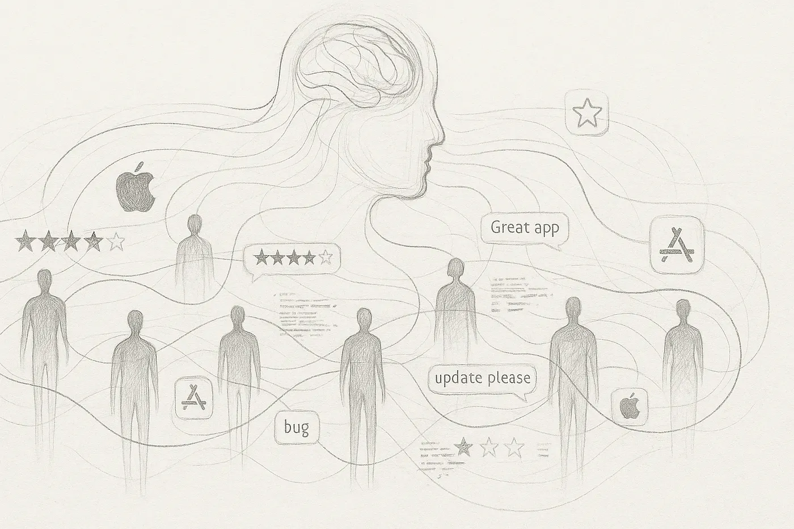
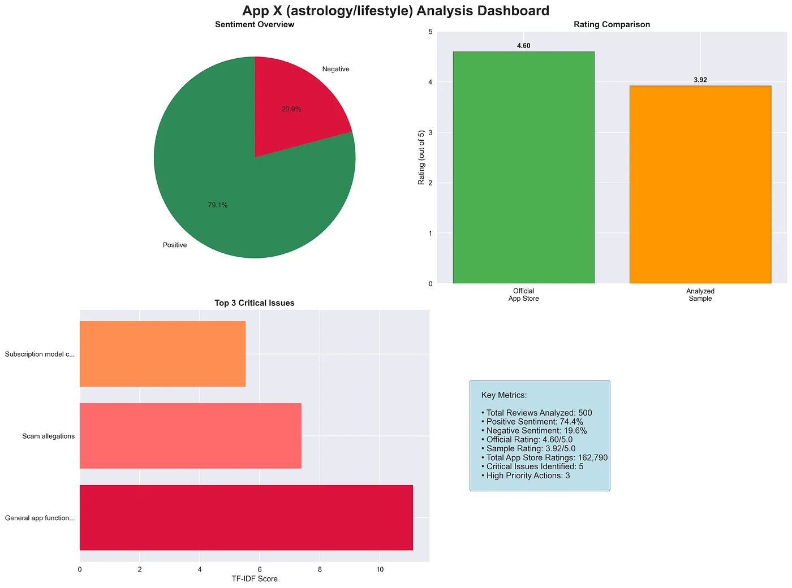
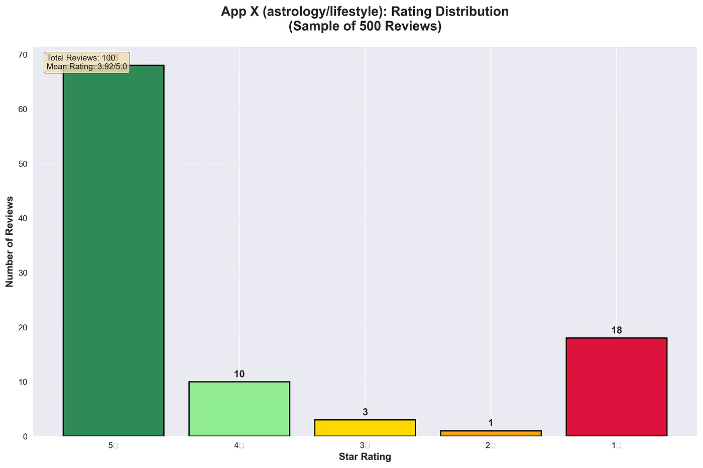
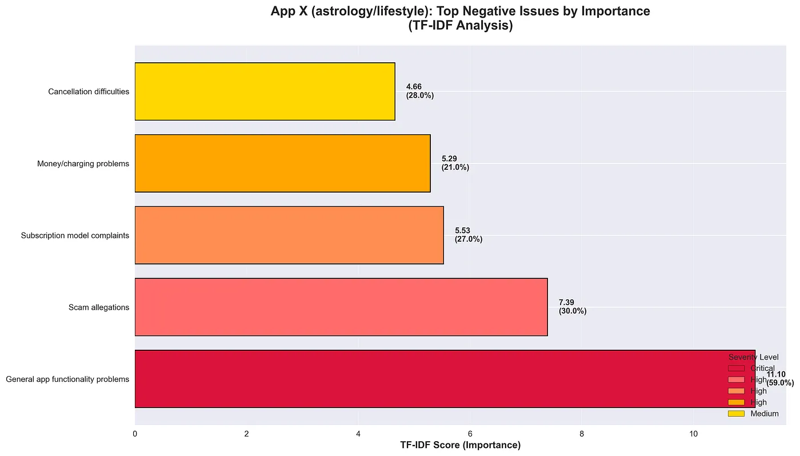
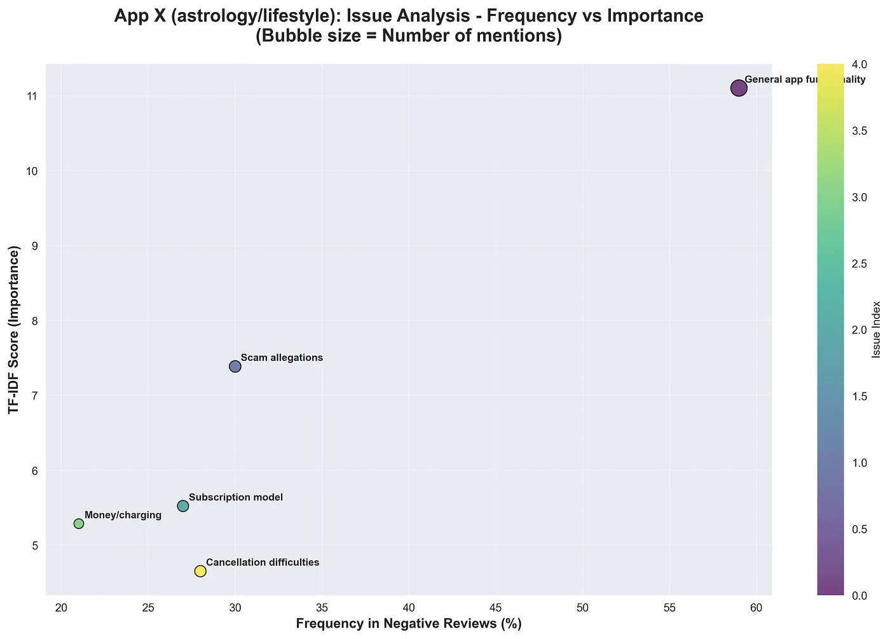
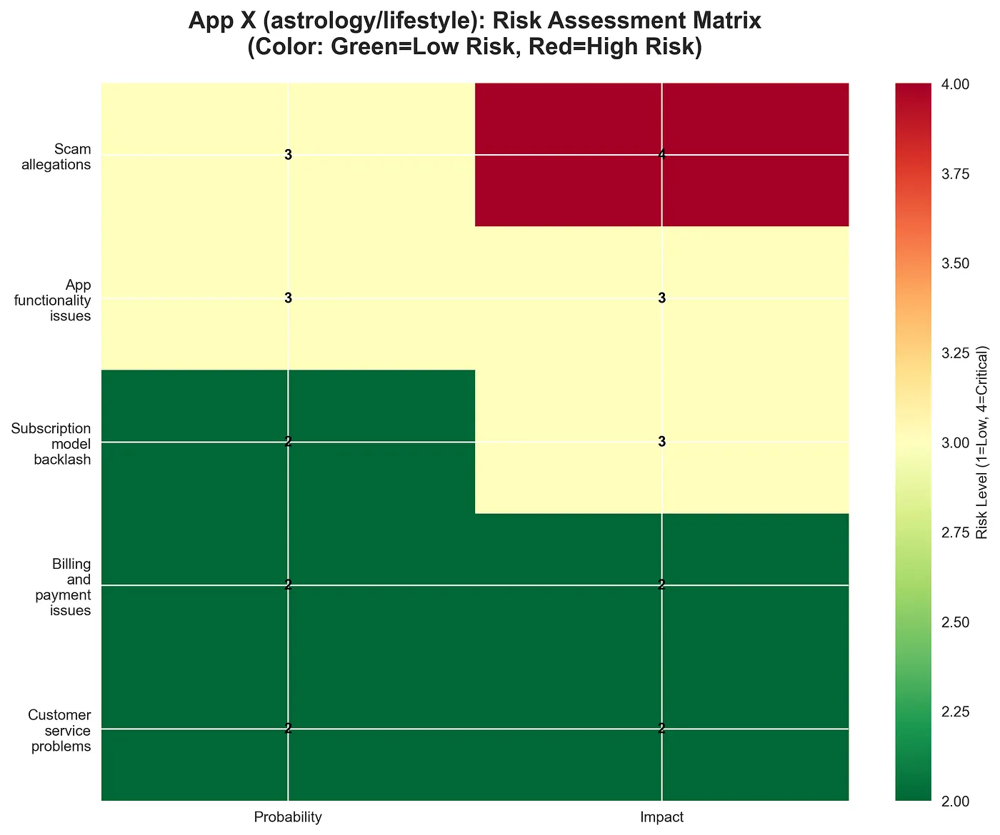
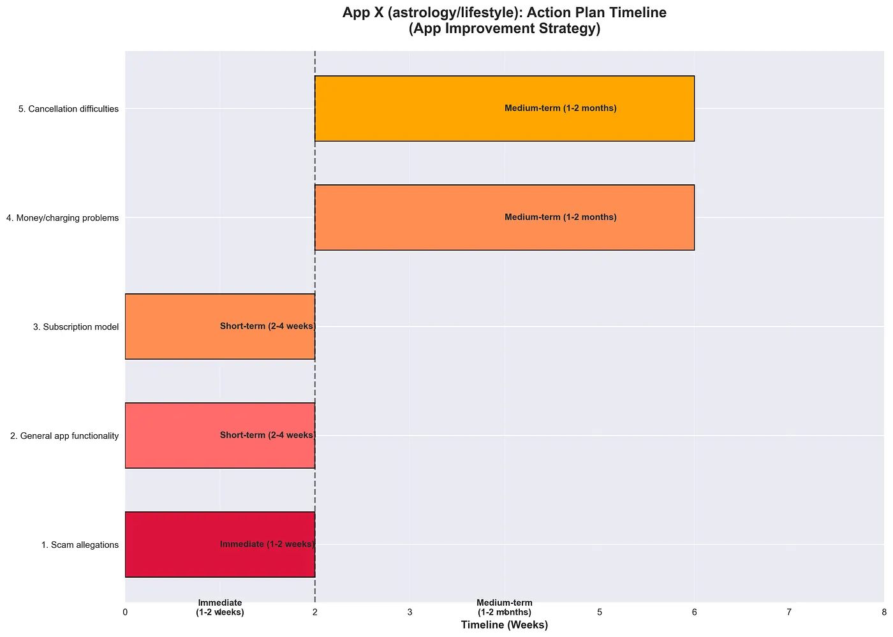

# Construir un pipeline de análisis de reseñas de App Store con Python NLP y visualización de datos

Las reseñas del App Store son más que calificaciones con estrellas: son historias humanas condensadas de satisfacción y frustración. En esos comentarios se esconden señales de tendencias emergentes y cambios en el sentimiento colectivo. Como parte de mi investigación más amplia del Global Forecasting System (GFS), me interesó cómo el feedback de usuarios puede reflejar dinámicas sociales, no solo rendimiento del producto.

Construí un pipeline de análisis de reseñas de Apple App Store usando Python, NLP, TF-IDF, VADER y visualización de datos para convertir rápidamente cientos de reseñas en insights estructurados. Este experimento muestra cómo el feedback cualitativo puede revelar tanto debilidades del producto como indicadores tempranos de patrones de comportamiento más amplios, el tipo de datos que más adelante podrían alimentar modelos predictivos.

Todo el código fuente de este análisis está disponible al final del artículo.

## Por qué las reseñas del App Store importan como señales sociales

Las reseñas de usuarios en el App Store pueden parecer específicas de un producto, pero su significado es más profundo. Funcionan como señales sociales: instantáneas del sentimiento y el comportamiento del consumidor que pueden reflejar tendencias más amplias.

**Comprensión del mercado.** Las reseñas revelan qué funciones desean o detestan los usuarios. Destacan preferencias emergentes, como la demanda de modo oscuro o funciones de IA, y puntos de dolor comunes. Es investigación de mercado gratuita que los equipos de producto pueden aprovechar para su estrategia.

**Estrategia y mejora de producto.** A nivel micro, los desarrolladores usan reseñas para priorizar correcciones de errores y actualizaciones de funciones. Un aumento repentino de quejas sobre problemas de inicio de sesión o precios de suscripción es un sistema de alerta temprana que muestra dónde el producto está fallando a sus usuarios.

**Insights de comportamiento.** Los patrones del lenguaje pueden insinuar psicología del usuario. ¿Usan los usuarios más lenguaje ansioso en reseñas de apps financieras durante una recesión? ¿Mencionan las reseñas de apps de salud términos relacionados con una pandemia? Agregadas entre apps, las reseñas pueden reflejar corrientes socioeconómicas subyacentes.

**Reputación y confianza.** Las reseñas son una conversación pública sobre tu marca. Temas negativos, como acusaciones de "scam" o mal servicio al cliente, pueden dañar la reputación de una app más allá del producto. Monitorearlos ayuda a las empresas a controlar daños y mantener la confianza.

En el contexto de GFS, estas señales de reseñas podrían ser una pieza de un rompecabezas mayor. Imagina correlacionar una negatividad creciente en reseñas de apps de gig economy con tendencias más amplias del mercado laboral, o analizar el sentimiento en reseñas de apps de viajes como proxy de confianza del consumidor. El App Store es un enorme repositorio en tiempo real de sentimiento humano. Nuestro desafío es extraer e interpretar esas señales de forma sistemática.


*Fig. 1. Boceto conceptual monocromático que muestra figuras humanas interconectadas por líneas de datos fluidas e iconos de estrellas, simbolizando inteligencia colectiva y conciencia compartida dentro de ecosistemas digitales.*

Quizá lo más importante es que las estrellas por sí solas pueden engañar. Una app puede mantener una alta calificación promedio de 4,5 estrellas y, aun así, ocultar un núcleo de descontento serio en reseñas recientes. Al profundizar en el feedback textual, descubrimos matices que los promedios de estrellas ocultan. En el caso de estudio de abajo, App X, una app de astrología/lifestyle, tiene una calificación oficial alta, pero el análisis expuso puntos de fricción claros que merecían atención. Esto subraya por qué un sistema dedicado de análisis de reseñas importa para cualquier estrategia de producto basada en datos.

## Arquitectura del sistema: FastAPI, pipeline NLP modular y por qué no un agente Google ADK "All-in-One"

Construir este sistema de análisis en Python fue un ejercicio de modularidad y escalabilidad pese a la prisa. En lugar de un script monolítico o un único "agente" que manejara todo, dividí la lógica en componentes claros. Esto hace que el sistema sea más fácil de mantener, probar y extender. Elegí FastAPI para levantar rápidamente una API web, permitir que el análisis se active mediante solicitudes HTTP y ofrecer una interfaz con documentación interactiva para que otros usen la herramienta.

Resumen de la arquitectura:

**Aplicación FastAPI.** El punto de entrada expone un endpoint `/analyze` que orquesta todo el pipeline. FastAPI aporta velocidad y Swagger UI generado automáticamente, permitiéndome consultar un app ID y obtener resultados JSON en minutos.

**Fetcher de información de app y reseñas.** Este componente recupera metadatos de la app, incluyendo nombre, desarrollador y categoría, mediante la iTunes Lookup API, y reseñas de usuarios mediante el feed RSS de Apple. Desacoplar esta lógica permite expandirse fácilmente a otras fuentes como Google Play sin cambiar la capa de análisis.

**Procesamiento de reseñas.** La capa de procesamiento limpia y normaliza texto: combina título y cuerpo, elimina duplicados, HTML, URLs y ruido, y tokeniza usando regex. Por simplicidad omití lematización pesada, aunque spaCy o NLTK podrían conectarse. El resultado es un corpus limpio listo para análisis.

**Análisis de sentimiento.** El pipeline usa VADER, un analizador de sentimiento basado en léxico, combinado con calificaciones de estrellas en una puntuación híbrida:

```text
sentiment = 0.6 * text_sentiment + 0.4 * star_rating
```

Esto equilibra casos como una reseña de 1 estrella que dice "good app" o una de 5 estrellas que dice "crashes often". Las reseñas se etiquetan como positivas, neutrales o negativas con umbrales ajustables.

**Extracción de keywords e issues.** TF-IDF identifica frases clave en reseñas negativas, como "subscription cost" o "login bug". Las keywords se mapean a categorías de issues más amplias, como Payment o Performance. Cada issue se puntúa por frecuencia, proporción de reseñas negativas y calificación promedio. La severidad combina reglas, como "scam" significa Critical, con datos como frecuencia e impacto.

**Motor de insights.** La capa final produce un informe JSON estructurado: desglose de sentimiento, principales issues, tendencias emergentes y prioridades sugeridas. Una capa basada en reglas asigna plazos, como Immediate, Short-term o Long-term, según la severidad, convirtiendo feedback textual en estrategia accionable.

La estructura modular hizo simples el desarrollo y las pruebas. Cada parte, desde la obtención y limpieza hasta sentimiento e insights, funciona de forma independiente. Puedo verificar detalles como si el limpiador elimina URLs correctamente o si la ponderación de sentimiento se comporta como se espera. Esta separación también mantiene el sistema fácil de extender: añadir sentimiento basado en GPT o extracción desde Google Play solo requeriría actualizar un módulo.

Usar una única IA end-to-end podría ser más rápido, pero sacrifica reproducibilidad y resultados medibles. El diseño determinista del pipeline garantiza resultados consistentes y auditables en miles de reseñas, algo esencial para confiabilidad de nivel investigativo como en GFS. La implementación usa FastAPI, pandas, NLTK VADER, scikit-learn TF-IDF y Matplotlib/Seaborn para visualización. Procesa unas 500 reseñas en pocos segundos, y el caching podría hacerlo aún más rápido.

## Recolección de datos: aprovechar los feeds RSS de Apple sin una API de pago

Apple no ofrece una API pública oficial de reseñas que entregue fácilmente todas las reseñas de una vez, pero sí tiene un feed RSS que puede aprovecharse para este propósito. Una de mis restricciones de diseño fue costo cero: sin servicios de terceros ni scrapers no oficiales que pudieran romperse. Opté por usar los endpoints propios de Apple documentados para iTunes.

Para cualquier app del App Store, puedes obtener reseñas en formato JSON llamando una URL como esta:

```text
https://itunes.apple.com/<country_code>/rss/customerreviews/id=<APP_ID>/sortBy=mostRecent/page=<N>/json
```

Mi fetcher itera por páginas hasta alcanzar el límite configurado, 300 por defecto y elevado a 500 para App X, o hasta que no queden más reseñas. Pausa un segundo entre solicitudes para evitar rate limits. Cada reseña incluye estrellas, título, texto, autor, versión y fecha. Guardo datos crudos como JSONL para depuración y filtro duplicados por review ID.

No se necesitan API keys ni acceso pago: es un endpoint público oficial. Los metadatos de la app, como calificación, categoría y fecha de lanzamiento, vienen de la iTunes Lookup API. Con JSON limpio y estructurado y una simple solicitud GET, la recolección es rápida y confiable. Las únicas peculiaridades son añadir un header User-Agent y normalizar las respuestas inconsistentes de Apple entre listas y diccionarios.

## Preprocesamiento de datos: limpiar texto y prepararlo para NLP

Las reseñas crudas son desordenadas. Errores tipográficos, emojis, spam de puntuación y artefactos HTML distorsionan el análisis. El módulo de preprocesamiento limpia todo esto en varias pasadas.

Combino título y cuerpo para que ambos contribuyan al sentimiento. Una palabra como "Scam!!!" en un título no debería perderse. Con `ftfy`, corrijo problemas de codificación. BeautifulSoup elimina HTML y entidades especiales. URLs, emails y menciones se eliminan. Los emojis se descartan aquí, aunque el sistema podría conservarlos o traducirlos. El texto se pasa a minúsculas, los espacios se normalizan y la tokenización usa regex. Contracciones como "didn't" se preservan.

TF-IDF filtra stopwords automáticamente más adelante, así que no hizo falta eliminarlas explícitamente. Omití lematización por velocidad, aunque añadir spaCy mejoraría agrupaciones, por ejemplo "crash" frente a "crashing". Un detector ligero de idioma confirmó que el 95 % de las reseñas estaban en inglés. Las reseñas con menos de tres tokens, como "ok", se excluyen.

La salida es una lista limpia de reseñas normalizadas con tokens, lista para análisis de sentimiento y keywords. Incluso este pipeline básico mejora drásticamente la calidad e interpretabilidad del texto.

## Análisis NLP: puntuación de sentimiento y extracción de issues

Después de la limpieza, ejecuté dos análisis: puntuación de sentimiento y extracción de issues. Para sentimiento usé VADER, que puntúa texto desde -1, negativo, hasta +1, positivo. La puntuación de cada reseña se combinó con su calificación de estrellas:

```text
sentiment = 0.6 * VADER + 0.4 * normalized_star
```

Los umbrales fueron simples: por encima de 0,2 positivo, por debajo de -0,2 negativo, y todo lo demás neutral. Este modelo híbrido equilibró sarcasmo y reseñas contradictorias, como una reseña de 5 estrellas que dice "love it but crashes". Las comprobaciones de correlación mostraron que calificaciones y sentimiento textual se alineaban bien, confirmando la calidad de los datos.

Para issues, analicé reseñas negativas con un vectorizador TF-IDF usando unigramas y bigramas y eliminando stopwords inglesas. Luego mapeé las principales keywords a categorías predefinidas como Functionality, Payment/Refunds, Cancellations y Trust/Scam. Cada issue se puntuó por frecuencia, importancia TF-IDF y severidad: Critical, High, Medium o Low. Por ejemplo, términos de "scam" se clasificaron como Critical, "bugs" como High y sugerencias de UI como Low. Los problemas emergentes se detectaron comparando menciones recientes frente a antiguas, como errores de login después de actualizaciones.

La salida final resumió sentimiento general, cinco principales issues y tendencias, cada uno con contexto como impacto y urgencia recomendada: Immediate, Short-term o Long-term. Estos resultados formaron la base de la etapa de visualización que siguió.

## Visualización de datos: convertir texto de reseñas en prioridades de producto

Los números cuentan parte de la historia, pero los gráficos hacen que los insights sean inmediatos. Abajo están los gráficos clave del análisis de reseñas de la app de astrología/lifestyle App X, basados en aproximadamente 500 reseñas, mostrando sentimiento, distribución de calificaciones y principales issues.


*Fig. 2. Dashboard que resume el análisis de reseñas de App X con gráfico circular de sentimiento mostrando 79 % de reseñas positivas y 21 % negativas, un gráfico de barras que compara la calificación oficial del App Store (4,6) con el promedio de la muestra (3,9), y los tres principales issues críticos listados abajo.*

El dashboard resume sentimiento, calificaciones promedio e issues principales. Aproximadamente el 79 % de las reseñas son positivas y el 21 % negativas. La satisfacción general es fuerte, pero no perfecta. La calificación promedio de la muestra, 3,9, es menor que la calificación oficial del App Store, 4,6, lo que sugiere una caída reciente o sesgo hacia reseñas más nuevas y críticas. Las tres principales áreas problemáticas resaltan dónde importa más mejorar.


*Fig. 3. Gráfico de barras que muestra la distribución de 500 reseñas de App X: 68 % cinco estrellas, 10 % cuatro estrellas, 3 % tres estrellas, 1 % dos estrellas y 18 % una estrella, ilustrando una fuerte polarización entre satisfacción y descontento.*

La distribución está polarizada: 68 % de usuarios dan 5 estrellas y 18 % dan 1 estrella, casi sin punto medio. La app claramente encanta a la mayoría, pero frustra a una minoría más pequeña y vocal. Este desequilibrio sugiere una fuerte percepción de valor mezclada con puntos de fricción serios para algunos.


*Fig. 4. Gráfico de barras horizontal que clasifica los cinco principales issues negativos de App X por importancia TF-IDF: problemas de funcionalidad, acusaciones de scam, quejas sobre modelo de suscripción, problemas de facturación y dificultades de cancelación.*

Las principales quejas se agrupan en cinco categorías:

1. Problemas de funcionalidad, como crashes y lag, que representan el 59 % de las reseñas negativas.
2. Acusaciones de scam, 30 %.
3. Preocupaciones sobre el modelo de suscripción, 27 %.
4. Problemas de facturación, 21 %.
5. Dificultades de cancelación, 28 %.

Juntas pintan una imagen consistente: la confiabilidad técnica y la confianza en la monetización impulsan el sentimiento del usuario más que la calidad del contenido.


*Fig. 5. Diagrama de dispersión que mapea frecuencia de issues contra importancia TF-IDF; los problemas de funcionalidad y scam aparecen en el cuadrante superior derecho como frecuentes y muy importantes.*

La frecuencia de cada issue y su importancia TF-IDF se alinean estrechamente, confirmando la priorización. Los issues de funcionalidad y relacionados con scam dominan ambos ejes, señalando dónde debe ir primero la atención.


*Fig. 6. Matriz de heatmap que cruza probabilidad e impacto para issues principales; acusaciones de scam y problemas de funcionalidad aparecen en zonas rojas de alto riesgo, mientras suscripción y facturación permanecen en verde o amarillo.*

Un heatmap de probabilidad versus impacto muestra solo dos zonas rojas: acusaciones de scam, un riesgo crítico de confianza, y problemas de funcionalidad, un riesgo para la experiencia central. Los demás caen en rango medio o bajo, adecuados para optimización gradual.


*Fig. 7. Línea de tiempo horizontal que muestra correcciones priorizadas para App X: acusaciones de scam como inmediato (1-2 semanas), mejoras de funcionalidad y suscripción a corto plazo (2-4 semanas), correcciones de facturación y cancelación a medio plazo (1-2 meses).*

El roadmap organiza correcciones por urgencia:

1. Inmediato: abordar la percepción de scam y la claridad de comunicación.
2. Corto plazo, 2-4 semanas: enfocarse en estabilidad y UX de suscripción.
3. Medio plazo, 1-2 meses: mejorar confiabilidad de facturación y flujo de cancelación.

Si estas acciones se ejecutan, la mayoría de los issues críticos podrían mitigarse en uno o dos ciclos de release.

Para resumir el caso de la app de astrología/lifestyle App X: después de aplicar este análisis, el equipo tiene una lista clara de acciones. Corregir bugs críticos y reparar la confianza del usuario son las prioridades principales. La expectativa es que hacerlo no solo reduzca reseñas negativas, mejorando la calificación e imagen general de la app, sino que probablemente también mejore retención e ingresos. Los usuarios satisfechos se quedan y están más dispuestos a pagar.

Este tipo de insight es exactamente por lo que considero valioso tratar las reseñas de apps no como una tarea molesta, sino como una fuente de orientación. En cuestión de horas descubrimos formas concretas de hacer más felices a miles de usuarios y fortalecer la posición de mercado de la app.

## Conclusión

Construir este sistema de análisis de reseñas del App Store mostró lo rápido que el feedback crudo puede convertirse en insight estructurado. En solo unas horas transformé miles de palabras en tendencias y prioridades medibles. Para App X, este proceso reveló lo que los usuarios valoran más y dónde se acumula la frustración, convirtiendo reseñas subjetivas en datos accionables.

A escala, el mismo método puede revelar señales más amplias de consumidores o mercado. Dentro del contexto del Global Forecasting System, analizar sentimiento en muchas apps podría destacar cambios en temas como privacidad, IA o confianza: indicadores tempranos de cambios sociales o económicos mayores. Las reseñas son trazas pequeñas pero poderosas de percepción de usuario. Agregadas, forman patrones cuantificables.

Mejoras futuras podrían incluir añadir datos de Google Play, aplicar topic modeling o sentimiento basado en aspectos, y construir un dashboard interactivo para monitoreo continuo. Cada paso se acerca a un sistema de inteligencia de feedback en tiempo real.

En última instancia, el objetivo es simple: escuchar sistemáticamente. Las reseñas ya no son ruido. Son señales estructuradas que muestran qué importa a las personas. Convertir esas señales en insight ayuda a los equipos a construir mejores productos y a los investigadores a comprender mejor el comportamiento humano mediante datos.

El repositorio del proyecto, appstore-insights en GitHub, está abierto para que cualquiera lo explore y contribuya.
