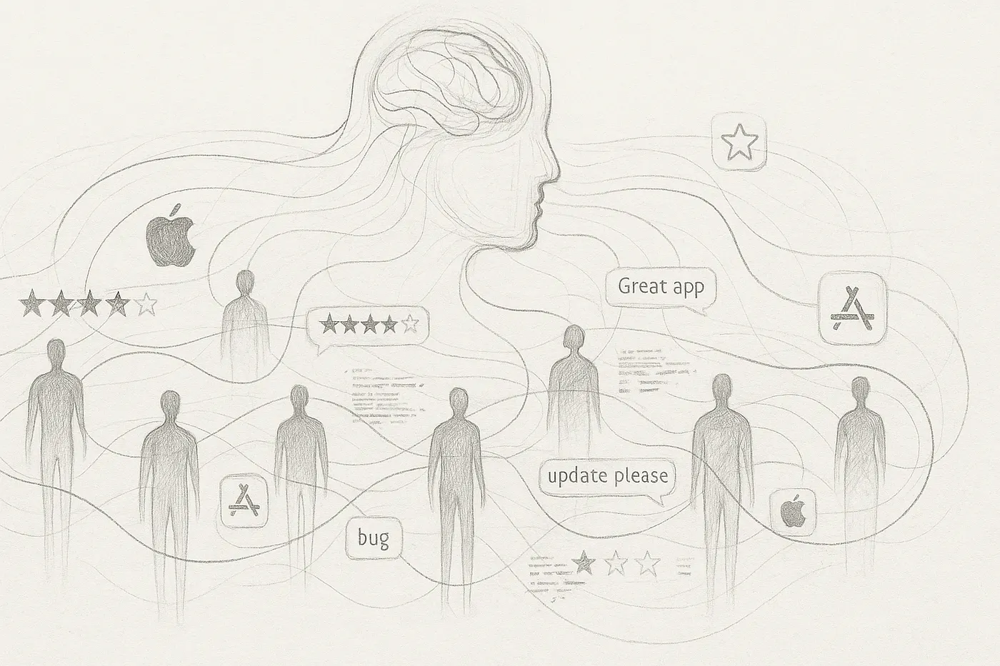
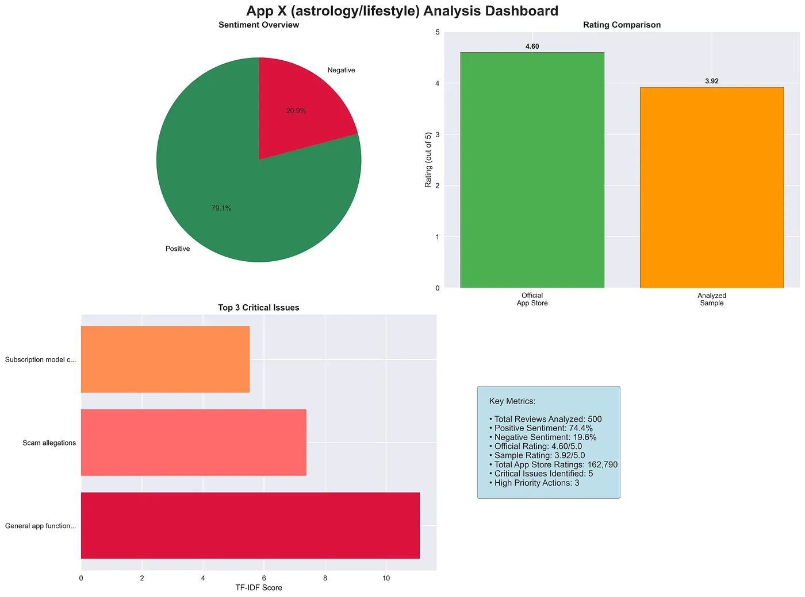
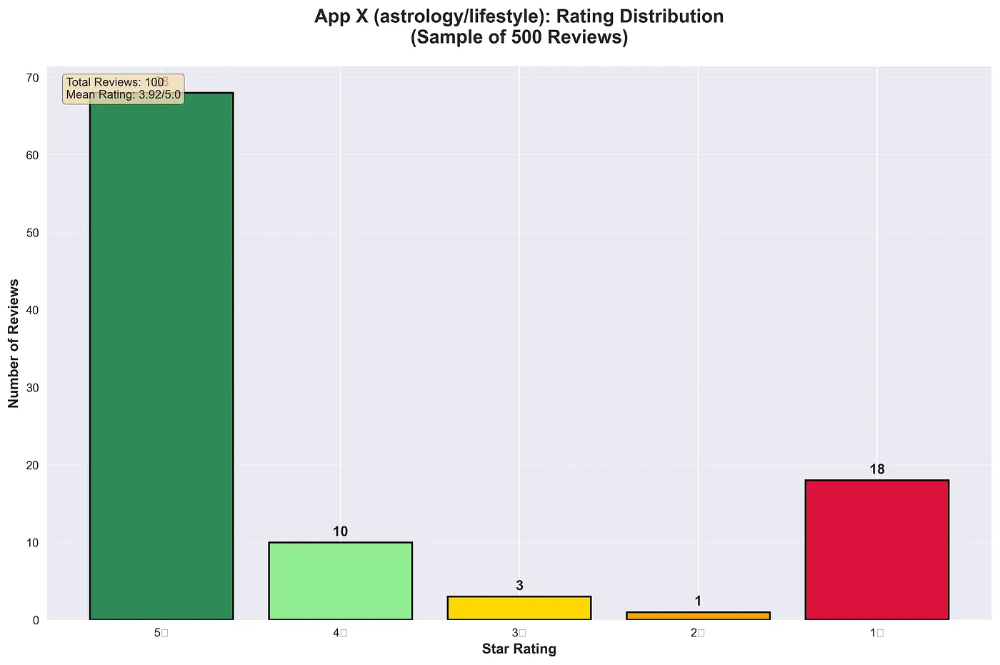
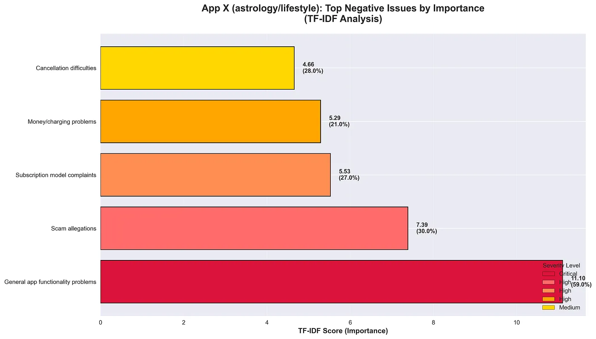
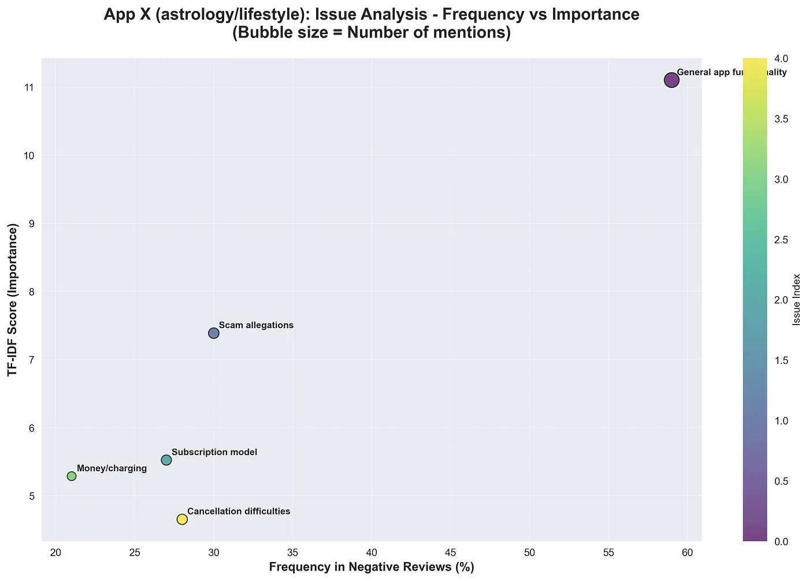
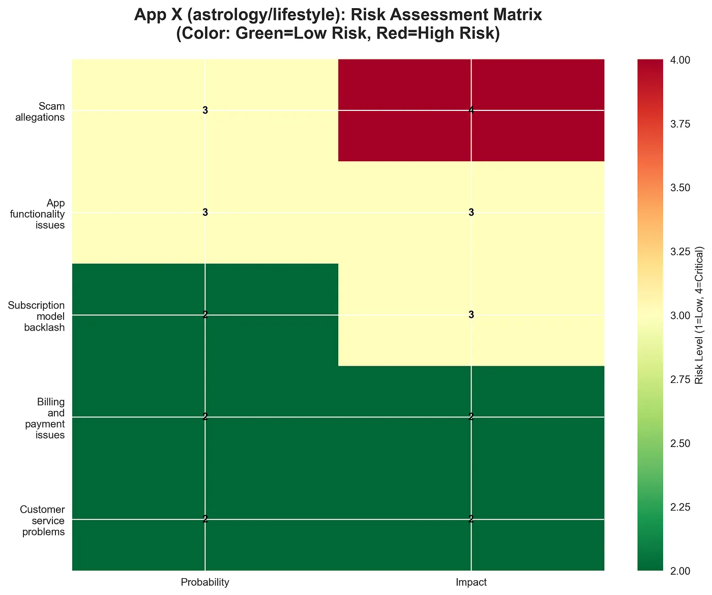
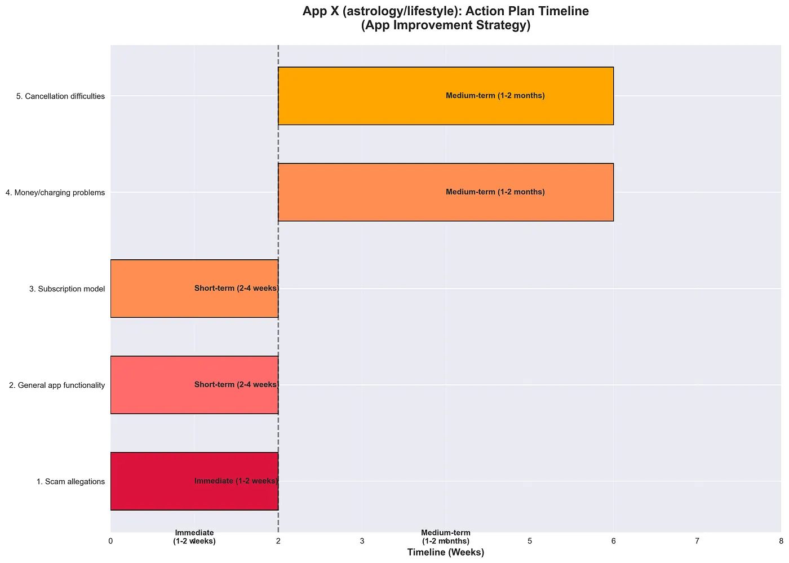

# Построение pipeline для анализа отзывов App Store с Python NLP и визуализацией данных

Отзывы в App Store — это больше, чем звёздные рейтинги: это сжатые человеческие истории восторга и разочарования. В комментариях скрыты сигналы зарождающихся трендов и сдвигов коллективного настроения. В рамках моего более широкого исследования Global Forecasting System (GFS) мне стало интересно, как пользовательский feedback может отражать социальную динамику, а не только качество продукта.

Я построил pipeline для анализа отзывов Apple App Store с использованием Python, NLP, TF-IDF, VADER и визуализации данных, чтобы быстро превращать сотни отзывов в структурированные insights. Этот эксперимент показывает, как качественный feedback может выявлять не только слабые места продукта, но и ранние индикаторы более широких поведенческих паттернов — такие данные в будущем могут попасть в predictive models.

Весь исходный код анализа доступен в конце статьи.

## Почему отзывы App Store важны как социальные сигналы

Отзывы пользователей в App Store могут казаться привязанными к конкретному продукту, но их значение глубже. Они работают как социальные сигналы: снимки пользовательских настроений и поведения, которые могут отражать более широкие тренды.

**Понимание рынка.** Отзывы показывают, какие функции пользователи хотят или ненавидят. Они подсвечивают новые consumer preferences, например спрос на dark mode или AI features, а также типичные pain points. Это бесплатное market research, которое продуктовые команды могут использовать в стратегии.

**Product strategy and improvement.** На микроуровне разработчики приложений используют отзывы, чтобы приоритизировать bug fixes и feature updates. Резкий рост жалоб на login issues или subscription pricing — ранний warning system, показывающий, где продукт подводит пользователей.

**Behavioral insights.** Паттерны языка могут намекать на психологию пользователей. Используют ли пользователи больше тревожной лексики в отзывах на finance apps во время экономического спада? Упоминают ли health app reviews термины, связанные с пандемией? В агрегированном виде отзывы по приложениям могут отражать socio-economic undercurrents.

**Reputation and trust.** Отзывы — это публичный разговор о бренде. Негативные темы, например обвинения в "scam" или плохом customer service, могут повредить репутации приложения за пределами самого продукта. Мониторинг таких тем помогает компаниям снижать ущерб и поддерживать доверие.

В контексте GFS такие сигналы из app reviews могут быть одной частью большой картины. Представьте корреляцию растущего негатива в отзывах gig-economy apps с более широкими тенденциями рынка труда или анализ sentiment в travel app reviews как proxy для consumer confidence. App Store — огромный real-time repository человеческого sentiment. Наша задача — системно извлекать и интерпретировать эти сигналы.


*Рис. 1. Монохромный концептуальный sketch: взаимосвязанные человеческие фигуры, соединённые потоками данных и иконками звёзд, символизируют collective intelligence и shared consciousness внутри digital ecosystems.*

Пожалуй, самое важное: одни только star ratings могут вводить в заблуждение. Приложение может удерживать высокий средний рейтинг 4.5, но при этом скрывать очаг серьёзного недовольства в свежих отзывах. Разбирая текстовый feedback, мы раскрываем нюансы, которые маскируются средними оценками. В case study ниже App X, приложение в категории astrology/lifestyle, имеет высокий официальный рейтинг, но анализ выявил явные friction points, требующие внимания. Это подчёркивает, почему отдельная система анализа отзывов важна для любой data-driven product strategy.

## Архитектура системы: FastAPI, модульный NLP pipeline и почему не "all-in-one" Google ADK agent

Построение этой системы анализа на Python было упражнением в сохранении модульности и масштабируемости, несмотря на спешку. Вместо монолитного script или одного "agent", который делает всё, я разделил логику на понятные компоненты. Так систему легче поддерживать, тестировать и расширять. Я выбрал FastAPI, чтобы быстро поднять web API: анализ можно запускать через HTTP requests, а интерактивная документация позволяет другим пользоваться инструментом.

Обзор архитектуры:

**FastAPI application.** Entry point открывает endpoint `/analyze`, который оркестрирует весь pipeline. FastAPI даёт скорость и auto-generated Swagger UI, позволяя за минуты запросить app ID и получить JSON results.

**App info and review fetcher.** Этот компонент получает app metadata, включая name, developer и category, через iTunes Lookup API, а user reviews — через Apple's RSS feed. Отделение этой логики позволяет легко расшириться на другие источники, например Google Play, без изменения analysis layer.

**Review processing.** Processing layer очищает и нормализует текст: объединяет title и body, удаляет duplicates, HTML, URLs и noise, а tokenization делает через regex. Ради простоты я пропустил тяжёлую lemmatization, хотя spaCy или NLTK можно подключить. Результат — чистый corpus, готовый к анализу.

**Sentiment analysis.** Pipeline использует VADER, lexicon-based sentiment analyzer, в сочетании со star ratings в hybrid score:

```text
sentiment = 0.6 * text_sentiment + 0.4 * star_rating
```

Это балансирует случаи вроде 1-star "good app" review или 5-star "crashes often" review. Reviews размечаются как positive, neutral или negative с настраиваемыми thresholds.

**Keyword and issue extraction.** TF-IDF определяет key phrases в negative reviews, например "subscription cost" или "login bug". Keywords сопоставляются с более широкими issue categories вроде Payment или Performance. Каждый issue оценивается по frequency, доле negative reviews и average rating. Severity объединяет rules, например "scam" означает Critical, с данными вроде frequency и impact.

**Insights engine.** Финальный слой выдаёт structured JSON report: sentiment breakdown, top issues, emerging trends и suggested priorities. Rule-based layer назначает timelines — Immediate, Short-term или Long-term — на основе severity, превращая текстовый feedback в actionable strategy.

Модульная структура упростила разработку и тестирование. Каждая часть — от fetching и cleaning до sentiment и insights — работает независимо. Я могу проверять детали вроде того, удаляет ли cleaner URLs корректно или ведёт ли себя sentiment weighting ожидаемо. Такое разделение также сохраняет систему расширяемой: добавление GPT-based sentiment или Google Play fetching потребует обновления только одного модуля.

Единый end-to-end AI мог бы быть быстрее, но он жертвует reproducibility и измеримыми outputs. Детерминированный дизайн pipeline обеспечивает стабильные и auditable results на тысячах отзывов, что важно для исследовательской надёжности уровня GFS. Реализация использует FastAPI, pandas, NLTK VADER, scikit-learn TF-IDF и Matplotlib/Seaborn для визуализации. Она обрабатывает около 500 отзывов за несколько секунд, а caching может сделать её ещё быстрее.

## Сбор данных: использование Apple's RSS feeds без платного API

Apple не предоставляет официальный публичный API для отзывов, который легко отдавал бы все отзывы за один раз, но у Apple есть RSS feed, который можно использовать для этой задачи. Одним из моих design constraints была нулевая стоимость: без third-party services и unofficial scrapers, которые могут сломаться. Я решил использовать собственные endpoints Apple, documented для iTunes.

Для любого приложения App Store можно получить reviews в JSON format по URL такого вида:

```text
https://itunes.apple.com/<country_code>/rss/customerreviews/id=<APP_ID>/sortBy=mostRecent/page=<N>/json
```

Мой fetcher проходит по страницам, пока не достигнет заданного лимита, по умолчанию 300 и повышенного до 500 для App X, или пока не закончатся reviews. Между запросами он делает паузу в одну секунду, чтобы избежать rate limits. Каждый review содержит stars, title, text, author, version и date. Я сохраняю raw data как JSONL для debugging и фильтрую duplicates по review ID.

Не нужны API keys или paid access: это официальный публичный endpoint. App metadata, например rating, category и release date, приходит из iTunes Lookup API. С чистым structured JSON и простым GET request сбор быстрый и надёжный. Единственные особенности — добавить User-Agent header и нормализовать непоследовательные list/dict responses Apple.

## Data preprocessing: очистка текста и подготовка к NLP

Raw reviews шумные. Typos, emojis, punctuation spam и HTML artifacts искажают анализ. Модуль preprocessing очищает это в несколько проходов.

Я объединяю title и body, чтобы оба влияли на sentiment. Слово вроде "Scam!!!" в title не должно потеряться. С помощью `ftfy` я исправляю encoding issues. BeautifulSoup убирает HTML и special entities. URLs, emails и mentions удаляются. Emojis здесь отбрасываются, хотя система может сохранять или переводить их. Текст приводится к lowercase, whitespace нормализуется, tokenization использует regex. Contractions вроде "didn't" сохраняются.

TF-IDF позже автоматически фильтрует stopwords, поэтому явное удаление не понадобилось. Я пропустил lemmatization ради скорости, хотя добавление spaCy улучшило бы группировку, например "crash" и "crashing". Лёгкий language detector подтвердил, что 95% reviews были на английском. Reviews короче трёх tokens, например "ok", исключаются.

Выход — чистый список нормализованных reviews с tokens, готовый к sentiment и keyword analysis. Даже такой базовый pipeline резко улучшает качество и интерпретируемость текста.

## NLP analysis: sentiment scoring и issue extraction

После очистки я запустил два анализа: sentiment scoring и issue extraction. Для sentiment я использовал VADER, который оценивает текст от -1, negative, до +1, positive. Score каждого review смешивался с его star rating:

```text
sentiment = 0.6 * VADER + 0.4 * normalized_star
```

Thresholds были простыми: выше 0.2 — positive, ниже -0.2 — negative, всё остальное — neutral. Такая hybrid model балансировала sarcasm и mismatched reviews, например 5-star review с текстом "love it but crashes". Correlation checks показали, что ratings и text sentiment хорошо согласуются, подтверждая качество данных.

Для issues я анализировал negative reviews с помощью TF-IDF vectorizer с unigrams и bigrams, удаляя English stopwords. Затем сопоставлял top keywords с predefined categories: Functionality, Payment/Refunds, Cancellations и Trust/Scam. Каждый issue оценивался по frequency, TF-IDF importance и severity: Critical, High, Medium или Low. Например, "scam" terms попадали в Critical, "bugs" — в High, а UI suggestions — в Low. Emerging problems определялись сравнением recent и older mentions, например login errors после updates.

Финальный output суммировал overall sentiment, top five issues и trends, каждый с context вроде impact и recommended urgency: Immediate, Short-term или Long-term. Эти результаты стали основой для следующего этапа визуализации.

## Визуализация данных: превращаем review text в product priorities

Числа рассказывают часть истории, но visuals делают insights мгновенными. Ниже — ключевые charts из анализа App X в категории astrology/lifestyle, основанные примерно на 500 reviews и показывающие sentiment, rating distribution и top issues.


*Рис. 2. Dashboard с анализом reviews App X: pie chart sentiment показывает 79% positive и 21% negative reviews, bar chart сравнивает официальный App Store rating (4.6) с sample average (3.9), а ниже перечислены три top critical issues.*

Dashboard суммирует sentiment, average ratings и основные issues. Около 79% reviews positive и 21% negative. Overall satisfaction сильный, но не безупречный. Average rating в выборке — 3.9 — ниже официального App Store rating 4.6, что намекает на недавнее снижение или bias в сторону более новых, критичных reviews. Три главные problem areas показывают, где улучшения важнее всего.


*Рис. 3. Bar chart распределения 500 reviews App X: 68% пятизвёздочных, 10% четырёхзвёздочных, 3% трёхзвёздочных, 1% двухзвёздочных и 18% однозвёздочных оценок; видна сильная polarization между любовью и недовольством.*

Распределение поляризовано: 68% пользователей ставят 5 stars и 18% — 1 star, почти без middle ground. Приложение явно радует большинство пользователей, но раздражает меньшую, громкую группу. Такой imbalance указывает на сильное value perception, смешанное с серьёзными friction points для части аудитории.


*Рис. 4. Horizontal bar chart пяти основных negative issues App X по TF-IDF importance: functionality problems, scam allegations, subscription model complaints, billing issues и cancellation difficulties.*

Главные жалобы группируются вокруг пяти категорий:

1. Functionality issues, например crashes и lag, — 59% negative reviews.
2. Scam allegations — 30%.
3. Subscription model concerns — 27%.
4. Billing problems — 21%.
5. Cancellation difficulties — 28%.

Вместе они показывают устойчивую картину: technical reliability и trust in monetization влияют на user sentiment сильнее, чем content quality.


*Рис. 5. Scatter plot, сопоставляющий issue frequency и TF-IDF importance; functionality и scam issues находятся в верхнем правом квадранте как одновременно частые и важные.*

Frequency каждого issue и TF-IDF importance хорошо совпадают, подтверждая prioritization. Functionality и scam-related issues доминируют по обеим осям, показывая, куда стоит направить внимание в первую очередь.


*Рис. 6. Heatmap matrix вероятности и impact для основных issues; scam allegations и functionality issues попадают в красные high-risk zones, а subscription и billing issues остаются в зелёной или жёлтой зоне.*

Heatmap probability versus impact показывает только две красные зоны: scam allegations — критический риск доверия, и functionality issues — риск core experience. Остальные находятся в medium или low range и подходят для постепенной оптимизации.


*Рис. 7. Horizontal timeline chart с prioritised fixes для App X: scam allegations как immediate (1-2 weeks), functionality и subscription improvements как short-term (2-4 weeks), billing и cancellation fixes как medium-term (1-2 months).*

Roadmap организует fixes по urgency:

1. Immediate: разобраться с scam perception и прозрачностью коммуникации.
2. Short-term, 2-4 weeks: сфокусироваться на stability и subscription UX.
3. Medium-term, 1-2 months: улучшить billing reliability и cancellation flow.

Если эти действия выполнить, большинство critical issues можно снизить за один-два release cycles.

Подводя итог case App X astrology/lifestyle: после такого анализа у команды появляется ясный action list. Исправление критических bugs и восстановление user trust — главные приоритеты. Ожидание простое: это не только уменьшит количество negative reviews, улучшив общий rating и image приложения, но, вероятно, повысит user retention и revenue. Довольные пользователи остаются дольше и охотнее платят.

Именно поэтому я считаю полезным относиться к app reviews не как к рутинной обязанности, а как к источнику guidance. За несколько часов мы нашли конкретные способы сделать тысячи пользователей счастливее и укрепить market position приложения.

## Заключение

Построение этой системы анализа App Store reviews показало, как быстро raw feedback может превращаться в structured insight. За несколько часов я превратил тысячи слов в измеримые trends и priorities. Для App X этот процесс выявил, что пользователи ценят больше всего и где накапливается frustration, превращая субъективные reviews в actionable data.

В масштабе тот же метод может выявлять более широкие consumer или market signals. В контексте Global Forecasting System анализ sentiment по множеству приложений мог бы подсвечивать сдвиги в темах вроде privacy, AI или trust — ранние индикаторы крупных социальных или экономических изменений. Reviews — маленькие, но мощные следы пользовательского восприятия. В агрегированном виде они формируют quantifiable patterns.

Будущие улучшения могут включать добавление Google Play data, topic modeling или aspect-based sentiment, а также построение interactive dashboard для continuous monitoring. Каждый шаг приближает систему к real-time feedback intelligence.

В конечном счёте цель проста: слушать системно. Reviews больше не noise. Это structured signals, показывающие, что важно людям. Превращение этих сигналов в insight помогает командам строить лучшие продукты, а исследователям — лучше понимать человеческое поведение через данные.

Репозиторий проекта appstore-insights на GitHub открыт для всех, кто хочет изучить его и внести вклад.
