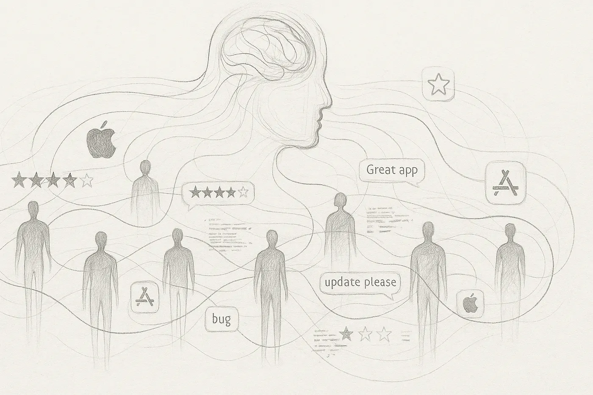
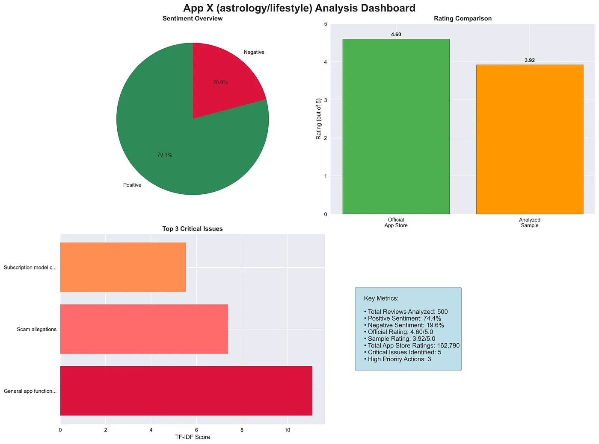
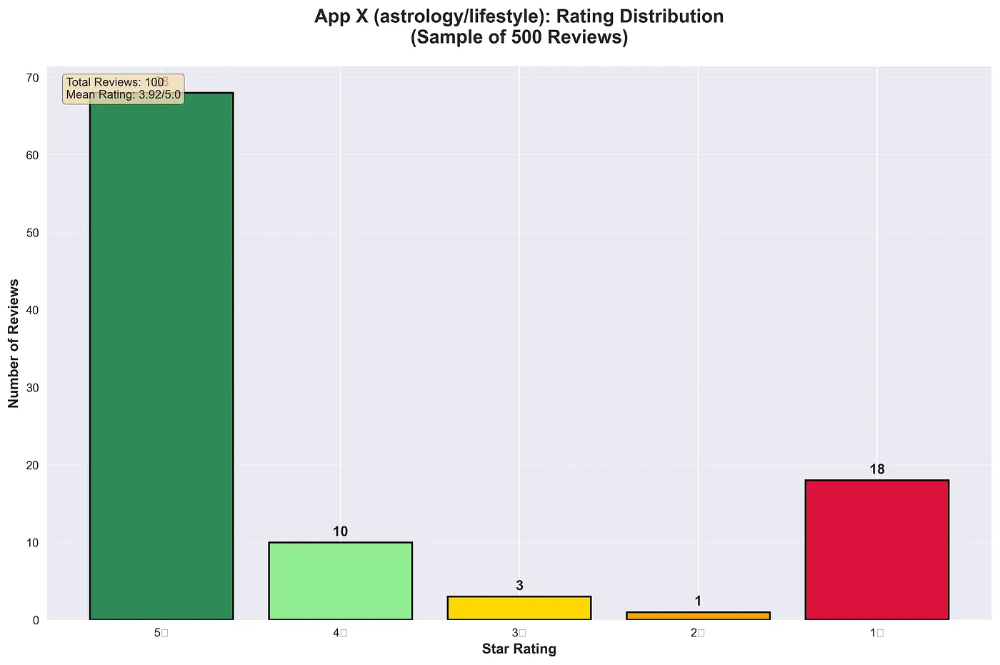
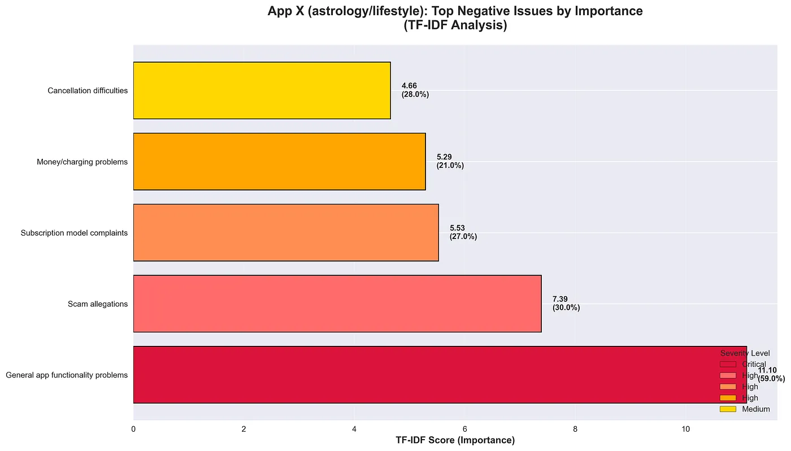
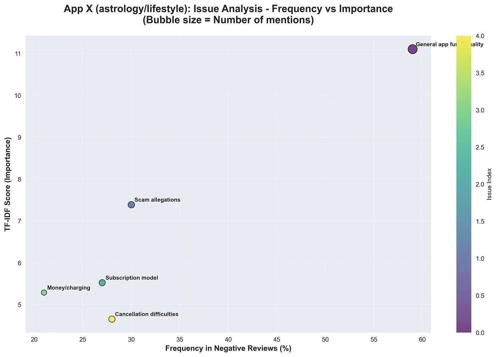
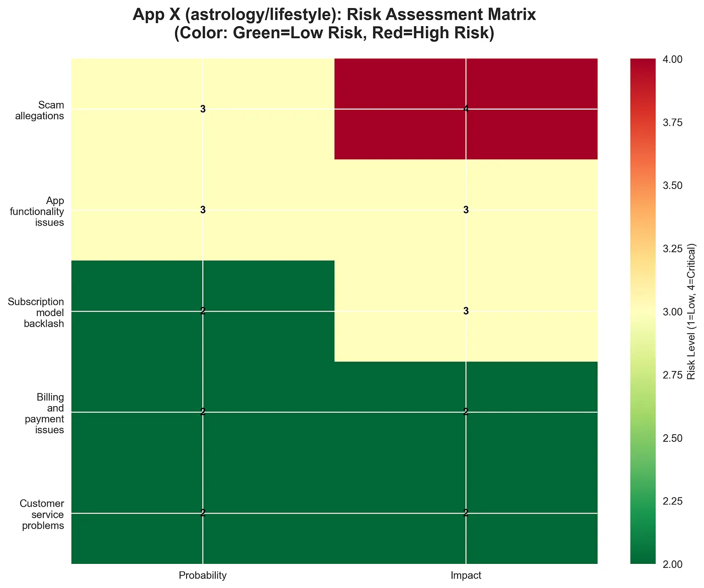
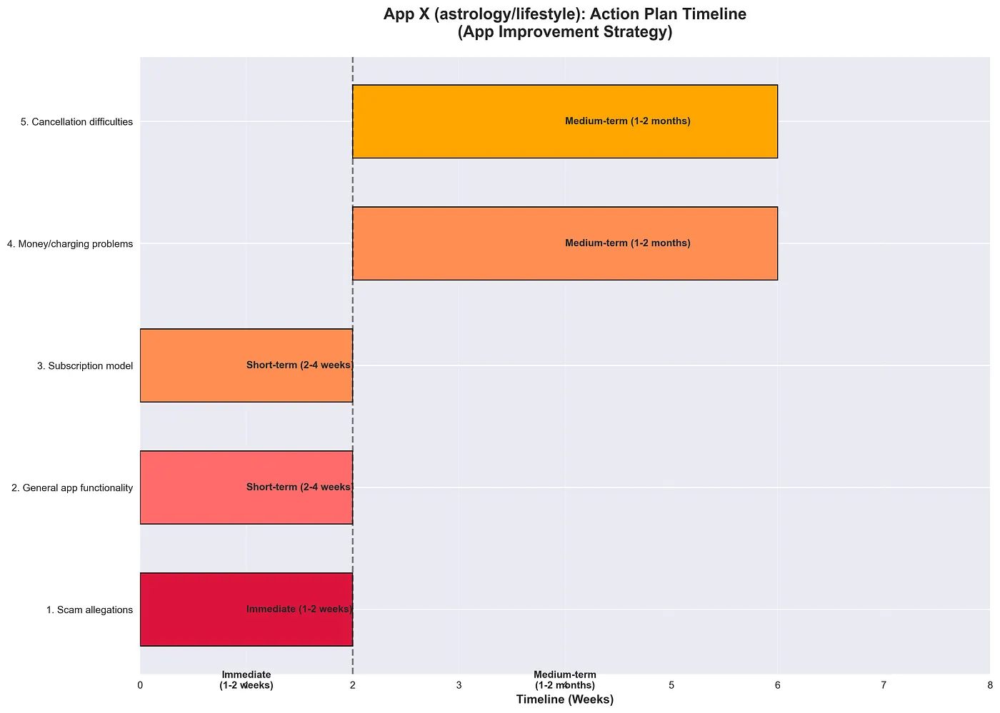

# Побудова pipeline для аналізу відгуків App Store з Python NLP і візуалізацією даних

Відгуки в App Store — це більше, ніж зіркові рейтинги: це стислі людські історії захвату й розчарування. У коментарях приховані сигнали нових трендів і зсувів колективного настрою. У межах мого ширшого дослідження Global Forecasting System (GFS) мені стало цікаво, як user feedback може відображати соціальну динаміку, а не лише якість продукту.

Я побудував pipeline для аналізу відгуків Apple App Store з використанням Python, NLP, TF-IDF, VADER і візуалізації даних, щоб швидко перетворювати сотні відгуків на структуровані insights. Цей експеримент показує, як якісний feedback може виявляти не лише слабкі місця продукту, а й ранні індикатори ширших поведінкових патернів — такі дані в майбутньому можуть потрапити в predictive models.

Увесь вихідний код аналізу доступний наприкінці статті.

## Чому відгуки App Store важливі як соціальні сигнали

Відгуки користувачів в App Store можуть здаватися прив'язаними до конкретного продукту, але їхнє значення глибше. Вони працюють як соціальні сигнали: знімки користувацьких настроїв і поведінки, які можуть відображати ширші тренди.

**Розуміння ринку.** Відгуки показують, які функції користувачі хочуть або ненавидять. Вони підсвічують нові consumer preferences, наприклад попит на dark mode або AI features, а також типові pain points. Це безкоштовне market research, яке продуктові команди можуть використовувати в стратегії.

**Product strategy and improvement.** На мікрорівні розробники застосунків використовують відгуки, щоб пріоритизувати bug fixes і feature updates. Різкий ріст скарг на login issues або subscription pricing — ранній warning system, який показує, де продукт підводить користувачів.

**Behavioral insights.** Патерни мови можуть натякати на психологію користувачів. Чи використовують користувачі більше тривожної лексики у відгуках на finance apps під час економічного спаду? Чи згадують health app reviews терміни, пов'язані з пандемією? В агрегованому вигляді відгуки по застосунках можуть відображати socio-economic undercurrents.

**Reputation and trust.** Відгуки — це публічна розмова про бренд. Негативні теми, наприклад звинувачення у "scam" або поганому customer service, можуть зашкодити репутації застосунку за межами самого продукту. Моніторинг таких тем допомагає компаніям зменшувати шкоду й підтримувати довіру.

У контексті GFS такі сигнали з app reviews можуть бути однією частиною великої картини. Уявіть кореляцію зростання негативу у відгуках gig-economy apps із ширшими тенденціями ринку праці або аналіз sentiment у travel app reviews як proxy для consumer confidence. App Store — величезний real-time repository людського sentiment. Наше завдання — системно витягувати й інтерпретувати ці сигнали.


*Рис. 1. Монохромний концептуальний sketch: взаємопов'язані людські фігури, поєднані потоками даних та іконками зірок, символізують collective intelligence і shared consciousness у digital ecosystems.*

Мабуть, найважливіше: самі лише star ratings можуть вводити в оману. Застосунок може утримувати високий середній рейтинг 4.5, але приховувати осередок серйозного невдоволення у свіжих відгуках. Розбираючи текстовий feedback, ми відкриваємо нюанси, які маскуються середніми оцінками. У case study нижче App X, застосунок у категорії astrology/lifestyle, має високий офіційний рейтинг, але аналіз виявив явні friction points, які потребують уваги. Це підкреслює, чому окрема система аналізу відгуків важлива для будь-якої data-driven product strategy.

## Архітектура системи: FastAPI, модульний NLP pipeline і чому не "all-in-one" Google ADK agent

Побудова цієї системи аналізу на Python була вправою в збереженні модульності й масштабованості попри поспіх. Замість монолітного script або одного "agent", який робить усе, я розділив логіку на зрозумілі компоненти. Так систему легше підтримувати, тестувати й розширювати. Я обрав FastAPI, щоб швидко підняти web API: аналіз можна запускати через HTTP requests, а інтерактивна документація дозволяє іншим користуватися інструментом.

Огляд архітектури:

**FastAPI application.** Entry point відкриває endpoint `/analyze`, який оркеструє весь pipeline. FastAPI дає швидкість і auto-generated Swagger UI, дозволяючи за хвилини запросити app ID і отримати JSON results.

**App info and review fetcher.** Цей компонент отримує app metadata, включно з name, developer і category, через iTunes Lookup API, а user reviews — через Apple's RSS feed. Відокремлення цієї логіки дозволяє легко розширитися на інші джерела, наприклад Google Play, без зміни analysis layer.

**Review processing.** Processing layer очищає й нормалізує текст: об'єднує title і body, видаляє duplicates, HTML, URLs і noise, а tokenization робить через regex. Заради простоти я пропустив важку lemmatization, хоча spaCy або NLTK можна підключити. Результат — чистий corpus, готовий до аналізу.

**Sentiment analysis.** Pipeline використовує VADER, lexicon-based sentiment analyzer, у поєднанні зі star ratings у hybrid score:

```text
sentiment = 0.6 * text_sentiment + 0.4 * star_rating
```

Це балансує випадки на кшталт 1-star "good app" review або 5-star "crashes often" review. Reviews розмічаються як positive, neutral або negative з налаштовуваними thresholds.

**Keyword and issue extraction.** TF-IDF визначає key phrases у negative reviews, наприклад "subscription cost" або "login bug". Keywords зіставляються з ширшими issue categories на кшталт Payment або Performance. Кожен issue оцінюється за frequency, часткою negative reviews і average rating. Severity поєднує rules, наприклад "scam" означає Critical, з даними на кшталт frequency і impact.

**Insights engine.** Фінальний шар видає structured JSON report: sentiment breakdown, top issues, emerging trends і suggested priorities. Rule-based layer призначає timelines — Immediate, Short-term або Long-term — на основі severity, перетворюючи текстовий feedback на actionable strategy.

Модульна структура спростила розробку й тестування. Кожна частина — від fetching і cleaning до sentiment та insights — працює незалежно. Я можу перевіряти деталі, наприклад чи правильно cleaner видаляє URLs або чи поводиться sentiment weighting очікувано. Таке розділення також зберігає систему розширюваною: додавання GPT-based sentiment або Google Play fetching потребуватиме оновлення лише одного модуля.

Єдиний end-to-end AI міг би бути швидшим, але він жертвує reproducibility і вимірюваними outputs. Детермінований дизайн pipeline забезпечує стабільні й auditable results на тисячах відгуків, що важливо для дослідницької надійності рівня GFS. Реалізація використовує FastAPI, pandas, NLTK VADER, scikit-learn TF-IDF і Matplotlib/Seaborn для візуалізації. Вона обробляє близько 500 відгуків за кілька секунд, а caching може зробити її ще швидшою.

## Збір даних: використання Apple's RSS feeds без платного API

Apple не надає офіційний публічний API для відгуків, який легко віддавав би всі відгуки за один раз, але в Apple є RSS feed, який можна використати для цієї задачі. Одним із моїх design constraints була нульова вартість: без third-party services і unofficial scrapers, які можуть зламатися. Я вирішив використовувати власні endpoints Apple, documented для iTunes.

Для будь-якого застосунку App Store можна отримати reviews у JSON format за URL такого вигляду:

```text
https://itunes.apple.com/<country_code>/rss/customerreviews/id=<APP_ID>/sortBy=mostRecent/page=<N>/json
```

Мій fetcher проходить сторінками, доки не досягне заданого ліміту, за замовчуванням 300 і підвищеного до 500 для App X, або доки не закінчаться reviews. Між запитами він робить паузу в одну секунду, щоб уникнути rate limits. Кожен review містить stars, title, text, author, version і date. Я зберігаю raw data як JSONL для debugging і фільтрую duplicates за review ID.

Не потрібні API keys або paid access: це офіційний публічний endpoint. App metadata, наприклад rating, category і release date, приходить з iTunes Lookup API. З чистим structured JSON і простим GET request збір швидкий і надійний. Єдині особливості — додати User-Agent header і нормалізувати непослідовні list/dict responses Apple.

## Data preprocessing: очищення тексту й підготовка до NLP

Raw reviews шумні. Typos, emojis, punctuation spam і HTML artifacts спотворюють аналіз. Модуль preprocessing очищає це в кілька проходів.

Я об'єдную title і body, щоб обидва впливали на sentiment. Слово на кшталт "Scam!!!" у title не має загубитися. За допомогою `ftfy` я виправляю encoding issues. BeautifulSoup прибирає HTML і special entities. URLs, emails і mentions видаляються. Emojis тут відкидаються, хоча система може зберігати або перекладати їх. Текст приводиться до lowercase, whitespace нормалізується, tokenization використовує regex. Contractions на кшталт "didn't" зберігаються.

TF-IDF пізніше автоматично фільтрує stopwords, тому явне видалення не знадобилося. Я пропустив lemmatization заради швидкості, хоча додавання spaCy покращило б групування, наприклад "crash" і "crashing". Легкий language detector підтвердив, що 95% reviews були англійською. Reviews коротші за три tokens, наприклад "ok", виключаються.

Вихід — чистий список нормалізованих reviews із tokens, готовий до sentiment і keyword analysis. Навіть такий базовий pipeline різко покращує якість та інтерпретованість тексту.

## NLP analysis: sentiment scoring і issue extraction

Після очищення я запустив два аналізи: sentiment scoring і issue extraction. Для sentiment я використовував VADER, який оцінює текст від -1, negative, до +1, positive. Score кожного review змішувався з його star rating:

```text
sentiment = 0.6 * VADER + 0.4 * normalized_star
```

Thresholds були простими: вище 0.2 — positive, нижче -0.2 — negative, усе інше — neutral. Така hybrid model балансувала sarcasm і mismatched reviews, наприклад 5-star review з текстом "love it but crashes". Correlation checks показали, що ratings і text sentiment добре узгоджуються, підтверджуючи якість даних.

Для issues я аналізував negative reviews за допомогою TF-IDF vectorizer з unigrams і bigrams, видаляючи English stopwords. Потім зіставляв top keywords з predefined categories: Functionality, Payment/Refunds, Cancellations і Trust/Scam. Кожен issue оцінювався за frequency, TF-IDF importance і severity: Critical, High, Medium або Low. Наприклад, "scam" terms потрапляли в Critical, "bugs" — у High, а UI suggestions — у Low. Emerging problems визначалися порівнянням recent і older mentions, наприклад login errors після updates.

Фінальний output підсумовував overall sentiment, top five issues і trends, кожен із context на кшталт impact і recommended urgency: Immediate, Short-term або Long-term. Ці результати стали основою для наступного етапу візуалізації.

## Візуалізація даних: перетворюємо review text на product priorities

Числа розповідають частину історії, але visuals роблять insights миттєвими. Нижче — ключові charts з аналізу App X у категорії astrology/lifestyle, основані приблизно на 500 reviews і такі, що показують sentiment, rating distribution і top issues.


*Рис. 2. Dashboard з аналізом reviews App X: pie chart sentiment показує 79% positive і 21% negative reviews, bar chart порівнює офіційний App Store rating (4.6) із sample average (3.9), а нижче перелічені три top critical issues.*

Dashboard підсумовує sentiment, average ratings і основні issues. Близько 79% reviews positive і 21% negative. Overall satisfaction сильний, але не бездоганний. Average rating у вибірці — 3.9 — нижчий за офіційний App Store rating 4.6, що натякає на недавнє зниження або bias у бік новіших, критичніших reviews. Три головні problem areas показують, де покращення найважливіші.


*Рис. 3. Bar chart розподілу 500 reviews App X: 68% п'ятизіркових, 10% чотиризіркових, 3% тризіркових, 1% двозіркових і 18% однозіркових оцінок; видно сильну polarization між любов'ю і невдоволенням.*

Розподіл поляризований: 68% користувачів ставлять 5 stars і 18% — 1 star, майже без middle ground. Застосунок явно радує більшість користувачів, але дратує меншу, голосну групу. Такий imbalance вказує на сильне value perception, змішане із серйозними friction points для частини аудиторії.


*Рис. 4. Horizontal bar chart п'яти основних negative issues App X за TF-IDF importance: functionality problems, scam allegations, subscription model complaints, billing issues і cancellation difficulties.*

Головні скарги групуються навколо п'яти категорій:

1. Functionality issues, наприклад crashes і lag, — 59% negative reviews.
2. Scam allegations — 30%.
3. Subscription model concerns — 27%.
4. Billing problems — 21%.
5. Cancellation difficulties — 28%.

Разом вони показують стійку картину: technical reliability і trust in monetization впливають на user sentiment сильніше, ніж content quality.


*Рис. 5. Scatter plot, що зіставляє issue frequency і TF-IDF importance; functionality і scam issues перебувають у верхньому правому квадранті як одночасно часті й важливі.*

Frequency кожного issue і TF-IDF importance добре збігаються, підтверджуючи prioritization. Functionality і scam-related issues домінують за обома осями, показуючи, куди варто спрямувати увагу насамперед.


*Рис. 6. Heatmap matrix ймовірності та impact для основних issues; scam allegations і functionality issues потрапляють у червоні high-risk zones, а subscription і billing issues лишаються в зеленій або жовтій зоні.*

Heatmap probability versus impact показує лише дві червоні зони: scam allegations — критичний ризик довіри, і functionality issues — ризик core experience. Інші перебувають у medium або low range і підходять для поступової оптимізації.


*Рис. 7. Horizontal timeline chart з prioritised fixes для App X: scam allegations як immediate (1-2 weeks), functionality і subscription improvements як short-term (2-4 weeks), billing і cancellation fixes як medium-term (1-2 months).*

Roadmap організовує fixes за urgency:

1. Immediate: розібратися зі scam perception і прозорістю комунікації.
2. Short-term, 2-4 weeks: сфокусуватися на stability і subscription UX.
3. Medium-term, 1-2 months: покращити billing reliability і cancellation flow.

Якщо ці дії виконати, більшість critical issues можна зменшити за один-два release cycles.

Підсумовуючи case App X astrology/lifestyle: після такого аналізу в команди з'являється ясний action list. Виправлення критичних bugs і відновлення user trust — головні пріоритети. Очікування просте: це не лише зменшить кількість negative reviews, покращивши загальний rating та image застосунку, а й, імовірно, підвищить user retention і revenue. Задоволені користувачі залишаються довше й охочіше платять.

Саме тому я вважаю корисним ставитися до app reviews не як до рутинного обов'язку, а як до джерела guidance. За кілька годин ми знайшли конкретні способи зробити тисячі користувачів щасливішими й посилити market position застосунку.

## Висновок

Побудова цієї системи аналізу App Store reviews показала, як швидко raw feedback може перетворюватися на structured insight. За кілька годин я перетворив тисячі слів на вимірювані trends і priorities. Для App X цей процес виявив, що користувачі цінують найбільше і де накопичується frustration, перетворюючи суб'єктивні reviews на actionable data.

У масштабі той самий метод може виявляти ширші consumer або market signals. У контексті Global Forecasting System аналіз sentiment по багатьох застосунках міг би підсвічувати зсуви в темах на кшталт privacy, AI або trust — ранні індикатори великих соціальних чи економічних змін. Reviews — маленькі, але потужні сліди користувацького сприйняття. В агрегованому вигляді вони формують quantifiable patterns.

Майбутні покращення можуть включати додавання Google Play data, topic modeling або aspect-based sentiment, а також побудову interactive dashboard для continuous monitoring. Кожен крок наближає систему до real-time feedback intelligence.

Зрештою мета проста: слухати системно. Reviews більше не noise. Це structured signals, які показують, що важливо людям. Перетворення цих сигналів на insight допомагає командам будувати кращі продукти, а дослідникам — краще розуміти людську поведінку через дані.

Репозиторій проєкту appstore-insights на GitHub відкритий для всіх, хто хоче вивчити його й долучитися.
