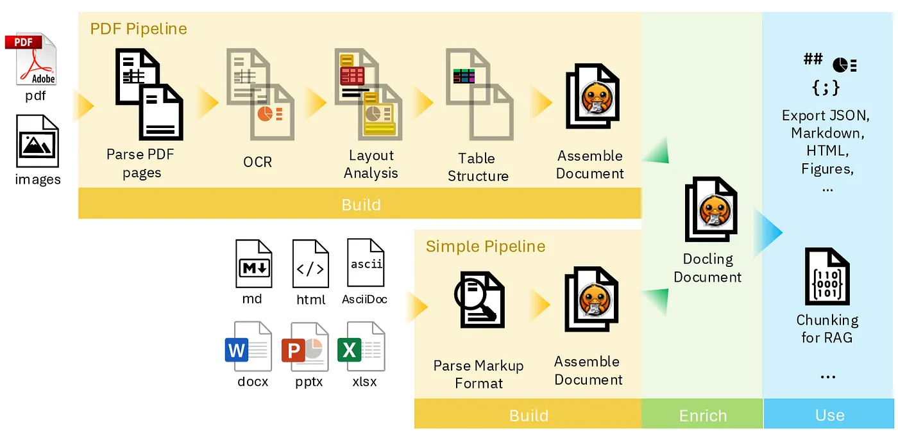

# Docling in der Arbeit mit Texten, Sprachen und Wissen

**Autor:** Mykhailo Kapustin (@kapustinomm)  
**Veröffentlicht auf Habr:** 9. August 2025  
**Schwierigkeit:** Mittel | **Lesezeit:** 20 min | **Reichweite:** 14K

**Tags:** Docling, LLM, IBM, AI, Python, Backend, NLP  
**Hubs:** Python, Artificial Intelligence, PDF, Image Processing


Hallo zusammen. Im Kontext unseres Forschungsprojekts arbeiteten wir an der Automatisierung akademischer Einreichungsprozesse, was uns zu einer Plattform namens **Docling** führte.

Gemeinsam untersuchen wir die Rolle von Docling dabei, neu zu gestalten, wie Forschungsdaten in sowohl menschen- als auch maschinenlesbaren Formaten repräsentiert, wiederverwendet und logisch erschlossen werden können.

Im Rahmen der Entwicklung eines wissenschaftlichen Forschungsprojekts namens "Advanced Scientific Research Projects" (ASRP), das auf die Schaffung einer akademischen Zeitschrift der neuen Generation namens ASRP.science abzielt, stießen wir auf eine Reihe methodischer und technischer Herausforderungen. Eine der zentralen Fragen war die Automatisierung des Parsings wissenschaftlicher Forschungsdokumente, um Einreichung, Verarbeitung und Archivierung der von Forschern bereitgestellten Materialien zu beschleunigen.

Während der ersten Analyse- und Prototyping-Phasen formulierten wir folgendes Ziel:

> Eine Plattform entwickeln oder anpassen, die linguistisch und konzeptionell annotierte Texte effektiv verarbeiten kann, mit akademischen Publikationsformaten kompatibel ist und Export sowie Interoperabilität mit LLM-Pipelines und Wissensbasen unterstützt.

Bei der Untersuchung verfügbarer Lösungen stießen wir auf ein Open-Source-Projekt namens **Docling**, das für Linguisten, Forscher und Digital Humanists entwickelt wurde. Obwohl es ursprünglich für die Arbeit mit Sprache und Text in einem linguistischen Kontext gebaut wurde, erwies sich Docling als überraschend gut auf unsere Anforderungen abgestimmt.

## Warum Docling eine relevante Wahl war

- **Strukturiertes Datenformat (JSON):** Docling speichert Daten in einem strukturierten, leichtgewichtigen JSON-Format, das sich einfach in Forschungspipelines und Softwareentwicklungs-Workflows integrieren lässt.
- **Graph- und baumbasierte Wissensrepräsentation:** Es unterstützt Graph- und Baumrepräsentationen von Wissen, entscheidend für semantisches Parsing und die Verknüpfung von Konzepten. Ein Forschungspapier wird in Docling zu einem Netzwerk miteinander verbundener Knoten.
- **Flexible Korpuserstellung:** Flexible Korpora einschließlich lexikalischer Datenbanken oder grammatischer Beschreibungen können in derselben Umgebung erstellt werden — nützlich für den Aufbau eines "Spracharchivs" von Begriffen und Definitionen.
- **Visualisierung und Erweiterbarkeit:** Docling bietet Baumansichten, Tabellen und ist modular/erweiterbar für eigene Skripte.
- **Schnittstelle zu KI-Systemen:** Docling kann als Schnittstelle für die Interaktion mit KI-Systemen dienen, einschließlich LLMs, indem es strukturierte JSON-Ausgaben für Machine-Learning-Pipelines bereitstellt.

## Docling in akademischen Einreichungsworkflows

Docling erlaubt Nutzern, komplexe Forschungsdokumente in modulare, verknüpfte Knoten aufzuteilen (Hypothesen, Argumente, Zitate, Definitionen), statt ein Dokument als einen großen Textblock zu behandeln.

In unserer Projektpipeline nutzen wir Doclings API, um ein hochgeladenes PDF in einen Graphen von Knoten zu parsen:

```python
from docling.document_converter import DocumentConverter

converter = DocumentConverter()
docling_doc = converter.convert("sample_article.pdf").document
for node, _ in docling_doc.iterate_items():
    data = node.model_dump()
    print(f"{data['label']}: {data['text'][:50]}...")
```

Jeder Knoten ist ein Docling `DocItem` mit einem `label` (Inhaltstyp) und `text`-Inhalt. Diese automatische Segmentierung bedeutet, dass ein eingereichtes Paper zu einer Hierarchie miteinander verbundener Teile wird, statt zu einem einzelnen Textklumpen.

### Zentrale Vorteile

- **Hybrid aus Text + Metadaten:** Jeder Knoten kann Text und zugehörige Metadaten enthalten (Autor, Quelle, Tags, Seitenzahlen, Confidence Scores). Doclings Pydantic-basiertes Datenmodell macht den Umgang mit Metadaten unkompliziert.
- **Wissensgraph des Papers:** Ein eingereichtes Paper wird zu einem Mini-Wissensgraphen. Abschnitte, Argumente und Konzepte sind verbunden und abfragbar, wodurch ein lineares Dokument in ein Informationsnetzwerk transformiert wird.
- **Bessere Vorbereitung des Peer Reviews:** Gutachter können die Argumentationsstruktur intuitiv durchlaufen — die zentrale Hypothese isolieren und alle damit verknüpften Evidenzknoten sehen.
- **Interoperabilität mit Forschungsplattformen:** Die JSON-Struktur lässt sich einfach mit Zotero, Elasticsearch und ML-Pipelines integrieren.

Zum Beispiel mit einem LangChain-gestützten Agenten, der ein Docling-Dokument abfragt:

```python
query = "Extract all metadata from the document and return a single JSON object."
input_data = {
    "messages": [("user", query)],
    "file_path": "sample_article.pdf"
}
result_state = agent_executor.ainvoke(input_data)
final_answer = result_state["messages"][-1].content
metadata = json.loads(final_answer)
```

Der Agent gibt strukturierte Metadaten wie diese zurück:

```json
{
    "title": "Forecasting Social, Geopolitical, and Economic Events...",
    "authors": ["Denis Banchenko", "Mykhailo Kapustin"],
    "abstract": "This article presents a study on...",
    "doi": "10.33425/2690-8077.1119",
    "keywords": ["states", "predictions", "forecasting", "event", "synchronization"]
}
```

## Doclings interne Struktur: JSON, Knoten und Wissensgraphen



### Alles ist ein Knoten

In Docling werden sowohl linguistische Elemente als auch Textsegmente als Knoten in einem Graph gespeichert. Ein Wort, ein Satz, ein Kommentar, ein lexikalischer Eintrag — alles wird als Objekt behandelt, das verknüpft werden kann.

### JSON-basiertes Format

Docling speichert Daten in sauberem, menschenlesbarem JSON. Jeder Knoten hat Felder wie eine `id` (eindeutige Kennung), `type` oder `label`, `text`-Inhalt und Verweise auf andere Knoten (über IDs in einem `links`-Array):

```json
{
    "id": "node123",
    "type": "text",
    "label": "Sentence",
    "text": "The quick brown fox jumps over the lazy dog.",
    "links": ["node124", "node125"]
}
```

### Graph-Beziehungen

- **Parent-child (hierarchical):** paragraph → sentences, chapter → sections
- **Semantische Links:** "related-to", "supports", "contradicts"
- **Alignment-Links:** parallele Texte oder Übersetzungen

### Eigene Annotationen

Nutzer können Annotationsebenen definieren: grammatische Tags, Glossen, Kommentare, Metadaten wie Quelle/Autor/Confidence Scores. In unserem Use Case trägt jedes `DocItem` ein `prov`-Feld, das auf die PDF-Seitennummer verweist.

### Unterstützung multimodaler Inhalte

Docling unterstützt Anhänge wie Audio oder Bilder und verknüpft sie mit Transkriptknoten — nützlich für Oral-History-Korpora oder Daten gesprochener Sprache.

### Exportfunktionen

Daten können als vollständiges Projekt-JSON, gefilterte Teilmengen, CSV für strukturierte Daten oder statisches HTML zur Archivierung exportiert werden.

## Use Case: Docling in Aktion

Stellen wir uns eine Forscherin vor, die an einer Studie mit dem Titel "Digital Inequality in Rural Education Systems" arbeitet. Statt ein statisches PDF einzureichen, importiert sie es in Docling:

1. **Import und Segmentierung:** Der Text wird in logische Teile segmentiert — Einführung, Hypothesen, Methodik, Ergebnisse, Fazit. Jeder Absatz wird zu einem Knoten.
2. **Semantisches Tagging:** Schlüsselbegriffe wie "digital divide", "infrastructure", "policy intervention" werden zu getaggten Konzeptknoten, wobei jede Erwähnung mit ihnen verknüpft wird.
3. **Argument-Mapping:** Die zentrale Hypothese wird zu einem Knoten mit unterstützenden Evidenzen als Kindknoten in einem Reasoning Tree.
4. **Peer-Kollaboration:** Co-Autoren fügen Kommentare zu bestimmten Argumentationsketten hinzu und verlinken separate Korpora zu verwandten Themen.
5. **Export und Integration:** Der Graph wird als JSON für LLM-Pipelines oder als HTML für öffentliche Repositories exportiert.

Das Ergebnis ist ein Paper, das durchsuchbar, interaktiv, modular und in ein breiteres Wissensökosystem integriert ist.

## Verbindung zu LLMs und KI

Doclings strukturierter Ansatz macht es im Zeitalter der KI besonders leistungsfähig:

- **Strukturierte Korpora fürs Training:** Statt einem LLM rohen Text zu geben, liefert man JSON, das Abschnitte, Beziehungen und Metadaten explizit markiert — das verbessert Fine-Tuning und Prompt Engineering.
- **Docling als Reasoning Interface:** Ein LLM kann den Wissensgraphen über Tools navigieren und gezielt nach bestimmten Teilen fragen, statt den gesamten Text blind zu lesen. Dieser MRKL-Ansatz liefert genauere und besser nachvollziehbare Ergebnisse.
- **Integrationspipelines:** JSON-Ausgaben können ML-Pipelines für automatisierte Analyse oder Review-Unterstützung speisen.

## Erweiterung und Publizieren

### Kollaborationsfunktionen

- **Multi-User Editing:** Diskrete Knoten erlauben Kollaboratoren, gleichzeitig an verschiedenen Teilen zu arbeiten.
- **Versionskontrolle:** Textbasierte JSON-Dateien funktionieren natürlich mit Git und ermöglichen klare Änderungsverfolgung.
- **Peer-Review-Modus:** Gutachterkommentare werden zu verknüpften Knoten im Wissensgraphen.

### Integration mit anderen Tools

- **Zotero:** Referenzen aus Docling-Knoten in Citation Manager exportieren.
- **ELAN und FLEx:** Linguistische Annotationen aus spezialisierten Tools in Doclings Graphstruktur importieren.
- **Obsidian & Notion:** Jeder Docling-Knoten kann zu einer Notiz mit Backlinks werden und akademische Daten mit persönlichem Wissensmanagement verbinden.

### Bildungspotenzial

- **Interaktive Aufgaben:** Studierende erkunden Argumentknoten und identifizieren Schwächen im Reasoning.
- **Eigene Lehrkorpora:** Lehrende bauen maßgeschneiderte linguistische Korpora für den Sprachunterricht.
- **Fallstudien:** Wissenschaftliche Artikel werden zu interaktiven Lernmodulen mit anklickbaren Konzepten und Multimedia.

## Fazit

### Was uns besonders gefiel

- **Modulare Struktur und JSON-Backbone:** Enorme Flexibilität und Interoperabilität mit minimaler Reibung.
- **Graphbasierte Oberfläche:** Intuitive Navigation komplexer Forschungsbeziehungen — wie eine Mindmap des Dokuments.
- **Open Source und leichtgewichtig:** Einfach zu übernehmen, zu forken oder zu erweitern, ohne Vendor Lock-in.
- **Multidisziplinäre Reichweite:** Spricht Linguisten, KI-Forscher, Digital Humanists und Lehrende gleichermaßen an.

### Was verbessert werden könnte

- **Dokumentation:** Mehr Tutorials, Templates und reale Beispiele würden das Onboarding erleichtern.
- **Benutzeroberfläche:** Eine ausgereiftere, nutzerfreundlichere Oberfläche würde die Verbreitung bei weniger technischen Nutzern erhöhen.
- **Lokalisierung und Barrierefreiheit:** Bessere i18n- und Accessibility-Standards würden Docling inklusiver machen.

### Warum wir Docling gewählt haben

Beim Aufbau einer Forschungs-Publikationsplattform brauchten wir ein Werkzeug, um wissenschaftliches Denken zu **strukturieren**, nicht nur zu speichern. Docling fiel als seltene Kombination aus linguistischer Tiefe, technischer Offenheit und Anpassungsfähigkeit an moderne KI-Workflows auf. Sein Potenzial als Reasoning Interface passte eng zu unserem Ziel, akademische Werkzeuge der nächsten Generation zu entwickeln, die Wissen als dynamisch und vernetzt behandeln.

### Was als Nächstes kommt

Wir planen, einen Piloten in der Einreichungspipeline unseres Journals umzusetzen und Docling zu nutzen, um ausgewählte Artikel zu parsen und anzureichern. Autoren könnten ein Paper einreichen und zusätzlich zum üblichen PDF eine Docling-Repräsentation für Peer Review und erweiterte Publikationsformate erhalten. Außerdem bauen wir eine eigene JSON-to-LLM-Pipeline für semantische Analyse und untersuchen Lehrmodule auf Basis von Docling für Argument-Mapping und linguistische Analyse.

### Schlussgedanke

Docling ist nicht einfach ein weiteres digitales Werkzeug — es ist ein philosophischer Wandel darin, wie wir über Text, Struktur und Bedeutung nachdenken. In einer Welt, die zunehmend von großen Sprachmodellen und automatisierten Workflows geprägt ist, helfen Plattformen wie Docling, Absicht, Logik und Nuance in unseren Dokumenten zu bewahren — Knoten für Knoten.

---

[← Back to articles](../README.md)
