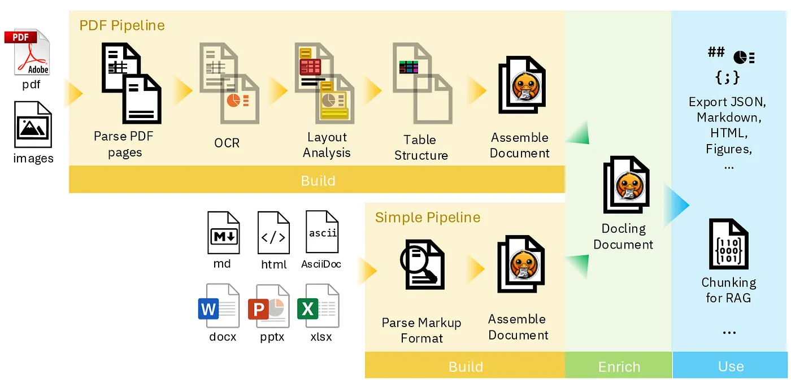

# Docling en el trabajo con textos, lenguas y conocimiento

**Autor:** Mykhailo Kapustin (@kapustinomm)  
**Publicado en Habr:** 9 de agosto de 2025  
**Dificultad:** Media | **Tiempo de lectura:** 20 min | **Alcance:** 14K

**Tags:** Docling, LLM, IBM, AI, Python, Backend, NLP  
**Hubs:** Python, Artificial Intelligence, PDF, Image Processing


Hola a todos. En el contexto de nuestro proyecto de investigación, estábamos resolviendo el problema de automatizar workflows de envío académico, lo que nos llevó a descubrir una plataforma llamada **Docling**.

Juntos exploramos el papel de Docling en transformar cómo los datos de investigación pueden representarse, reutilizarse y razonarse tanto en formatos legibles por humanos como por máquinas.

Como parte del desarrollo de un proyecto de investigación científica llamado "Advanced Scientific Research Projects" (ASRP), orientado a crear una revista académica de nueva generación llamada ASRP.science, encontramos varios desafíos metodológicos y técnicos. Uno de los temas clave fue la automatización del parsing de documentos académicos de investigación para agilizar el envío, procesamiento y archivado de materiales proporcionados por investigadores.

Durante las etapas iniciales de análisis y prototipado, formulamos el siguiente objetivo:

> Desarrollar o adaptar una plataforma capaz de manejar eficazmente textos anotados lingüística y conceptualmente, compatible con formatos de publicación académica y con soporte para exportación e interoperabilidad con pipelines LLM y bases de conocimiento.

Al explorar soluciones disponibles, encontramos un proyecto open-source llamado **Docling**, diseñado para lingüistas, investigadores y humanistas digitales. Aunque originalmente fue creado para trabajar con lengua y texto en un contexto lingüístico, Docling resultó estar sorprendentemente alineado con nuestras necesidades.

## Por qué Docling fue una elección relevante

- **Formato de datos estructurado (JSON):** Docling almacena datos en un formato JSON estructurado y ligero, que se integra fácilmente en pipelines de investigación y workflows de desarrollo de software.
- **Representación de conocimiento basada en grafos y árboles:** Soporta representaciones de conocimiento en grafo y árbol, cruciales para parsing semántico y vinculación de conceptos. Un paper de investigación en Docling se convierte en una red de nodos interrelacionados.
- **Creación flexible de corpus:** Permite crear corpus flexibles, incluyendo bases léxicas o descripciones gramaticales dentro del mismo entorno, útil para construir un "archivo lingüístico" de términos y definiciones.
- **Visualización y extensibilidad:** Docling ofrece vistas de árbol, tablas, y es modular/extensible para scripts personalizados.
- **Interfaz con sistemas de IA:** Docling puede servir como interfaz de interacción con sistemas de IA, incluidos LLMs, proporcionando salidas JSON estructuradas para pipelines de machine learning.

## Docling en workflows de envío académico

Docling permite dividir documentos de investigación complejos en nodos modulares e interconectados (hipótesis, argumentos, citas, definiciones) en lugar de tratar un documento como un gran bloque de texto.

En el pipeline de nuestro proyecto usamos la API de Docling para parsear un PDF subido en un grafo de nodos:

```python
from docling.document_converter import DocumentConverter

converter = DocumentConverter()
docling_doc = converter.convert("sample_article.pdf").document
for node, _ in docling_doc.iterate_items():
    data = node.model_dump()
    print(f"{data['label']}: {data['text'][:50]}...")
```

Cada nodo es un `DocItem` de Docling con un `label` (tipo de contenido) y contenido `text`. Esta segmentación automática significa que un paper enviado se convierte en una jerarquía de partes interrelacionadas, no en un único bloque de texto.

### Beneficios clave

- **Híbrido de texto + metadatos:** Cada nodo puede contener texto y metadatos asociados (autor, fuente, tags, números de página, confidence scores). El modelo de datos basado en Pydantic de Docling hace que manejar metadatos sea directo.
- **Grafo de conocimiento del paper:** Un paper enviado se convierte en un mini grafo de conocimiento. Secciones, argumentos y conceptos están conectados y son consultables, transformando un documento lineal en una red de información.
- **Mejor preparación para peer review:** Los revisores pueden recorrer intuitivamente la estructura argumental, aislando la hipótesis central y viendo todos los nodos de evidencia vinculados a ella.
- **Interoperabilidad con plataformas de investigación:** La estructura JSON se integra fácilmente con Zotero, Elasticsearch y pipelines ML.

Por ejemplo, usando un agente impulsado por LangChain para consultar un documento Docling:

```python
query = "Extract all metadata from the document and return a single JSON object."
input_data = {
    "messages": [("user", query)],
    "file_path": "sample_article.pdf"
}
result_state = agent_executor.ainvoke(input_data)
final_answer = result_state["messages"][-1].content
metadata = json.loads(final_answer)
```

El agente devuelve metadatos estructurados como:

```json
{
    "title": "Forecasting Social, Geopolitical, and Economic Events...",
    "authors": ["Denis Banchenko", "Mykhailo Kapustin"],
    "abstract": "This article presents a study on...",
    "doi": "10.33425/2690-8077.1119",
    "keywords": ["states", "predictions", "forecasting", "event", "synchronization"]
}
```

## Estructura interna de Docling: JSON, nodos y grafos de conocimiento



### Todo es un nodo

En Docling, tanto los elementos lingüísticos como los segmentos de texto se almacenan como nodos en un grafo. Una palabra, una oración, un comentario, una entrada léxica: todo se trata como un objeto que puede vincularse.

### Formato basado en JSON

Docling almacena datos en JSON limpio y legible por humanos. Cada nodo tiene campos como `id` (identificador único), `type` o `label`, contenido `text` y referencias a otros nodos (mediante IDs en un array `links`):

```json
{
    "id": "node123",
    "type": "text",
    "label": "Sentence",
    "text": "The quick brown fox jumps over the lazy dog.",
    "links": ["node124", "node125"]
}
```

### Relaciones de grafo

- **Parent-child (hierarchical):** paragraph → sentences, chapter → sections
- **Enlaces semánticos:** "related-to", "supports", "contradicts"
- **Enlaces de alineación:** textos paralelos o traducciones

### Anotaciones personalizadas

Los usuarios pueden definir capas de anotación: etiquetas gramaticales, glosas, comentarios, metadatos como fuente/autor/confidence scores. En nuestro caso de uso, cada `DocItem` lleva un campo `prov` que referencia el número de página del PDF.

### Soporte para contenido multimodal

Docling soporta adjuntos como audio o imágenes, vinculándolos a nodos de transcripción, útil para corpus de historia oral o datos de lengua hablada.

### Capacidades de exportación

Exporta datos como JSON completo del proyecto, subconjuntos filtrados, CSV para datos estructurados o HTML estático para archivado.

## Caso de uso: Docling en acción

Imagina una investigadora trabajando en un estudio titulado "Digital Inequality in Rural Education Systems". En lugar de enviar un PDF estático, lo importa en Docling:

1. **Importación y segmentación:** El texto se segmenta en partes lógicas: introducción, hipótesis, metodología, hallazgos, conclusión. Cada párrafo se convierte en un nodo.
2. **Etiquetado semántico:** Términos clave como "digital divide", "infrastructure", "policy intervention" se convierten en nodos de concepto etiquetados, con cada mención vinculada a ellos.
3. **Mapeo de argumentos:** La hipótesis central se convierte en un nodo con evidencia de apoyo como nodos hijos en un árbol de razonamiento.
4. **Colaboración entre pares:** Coautores añaden comentarios a cadenas argumentales específicas, enlazando a corpus separados sobre temas relacionados.
5. **Exportación e integración:** El grafo se exporta como JSON para pipelines LLM o como HTML para repositorios públicos.

El resultado es un paper buscable, interactivo, modular e integrado con un ecosistema de conocimiento más amplio.

## Conexión con LLMs e IA

El enfoque estructurado de Docling lo hace potente en la era de la IA:

- **Corpus estructurados para entrenamiento:** En lugar de alimentar un LLM con texto crudo, se le entrega JSON que etiqueta explícitamente secciones, relaciones y metadatos, mejorando fine-tuning y prompt engineering.
- **Docling como interfaz de razonamiento:** Un LLM puede navegar el grafo de conocimiento mediante herramientas, pidiendo piezas específicas en lugar de leer todo el texto a ciegas. Este enfoque MRKL produce resultados más precisos y trazables.
- **Pipelines de integración:** Las salidas JSON pueden alimentar pipelines ML para análisis automatizado o soporte de revisión.

## Expansión y publicación

### Funciones de colaboración

- **Edición multiusuario:** Los nodos discretos permiten que colaboradores trabajen en distintas partes simultáneamente.
- **Control de versiones:** Los archivos JSON basados en texto funcionan de forma natural con Git para un seguimiento claro de cambios.
- **Modo peer-review:** Los comentarios de revisores se convierten en nodos vinculados en el grafo de conocimiento.

### Integración con otras herramientas

- **Zotero:** Exportar referencias desde nodos Docling a gestores de citas.
- **ELAN y FLEx:** Importar anotaciones lingüísticas desde herramientas especializadas a la estructura de grafo de Docling.
- **Obsidian & Notion:** Cada nodo Docling puede convertirse en una nota con backlinks, conectando datos académicos con gestión personal del conocimiento.

### Potencial educativo

- **Tareas interactivas:** Los estudiantes exploran nodos de argumentos e identifican debilidades en el razonamiento.
- **Corpus docentes personalizados:** Los instructores construyen corpus lingüísticos adaptados para aprendizaje de lenguas.
- **Estudios de caso:** Los artículos académicos se convierten en módulos de aprendizaje interactivos con conceptos clicables y multimedia.

## Conclusión

### Lo que nos gustó especialmente

- **Estructura modular y backbone JSON:** Flexibilidad e interoperabilidad increíbles con fricción mínima.
- **Interfaz basada en grafos:** Navegación intuitiva de relaciones de investigación complejas, como tener un mapa mental de tu documento.
- **Open-source y ligero:** Fácil de adoptar, bifurcar o extender sin vendor lock-in.
- **Alcance multidisciplinario:** Atrae por igual a lingüistas, investigadores de IA, humanistas digitales y educadores.

### Qué podría mejorarse

- **Documentación:** Se beneficiaría de más tutoriales, templates y ejemplos reales para onboarding.
- **Interfaz de usuario:** Una interfaz más pulida y amigable ampliaría la adopción entre usuarios menos técnicos.
- **Localización y accesibilidad:** Mejor soporte para estándares i18n y accesibilidad haría Docling más inclusivo.

### Por qué elegimos Docling

En el contexto de construir una plataforma de publicación científica, necesitábamos una herramienta para **estructurar** el pensamiento científico, no solo almacenarlo. Docling destacó como una rara combinación de profundidad lingüística, apertura técnica y adaptabilidad a workflows modernos de IA. Su potencial como interfaz de razonamiento se alineaba estrechamente con nuestro objetivo de desarrollar herramientas académicas de nueva generación que traten el conocimiento como dinámico y conectado.

### Qué sigue

Planeamos implementar un piloto en el pipeline de envíos de nuestra revista, usando Docling para parsear y enriquecer artículos seleccionados. Los autores podrían enviar un paper y recibir una representación Docling junto al PDF habitual para peer review y formatos de publicación mejorados. También estamos construyendo un pipeline personalizado JSON-to-LLM para análisis semántico, y explorando módulos docentes basados en Docling para mapeo de argumentos y análisis lingüístico.

### Pensamiento final

Docling no es solo otra herramienta digital: es un cambio filosófico en cómo pensamos sobre texto, estructura y significado. En un mundo cada vez más impulsado por grandes modelos de lenguaje y workflows automatizados, plataformas como Docling nos ayudan a preservar intención, lógica y matiz en nuestros documentos, nodo por nodo.

---

[← Back to articles](../README.md)
