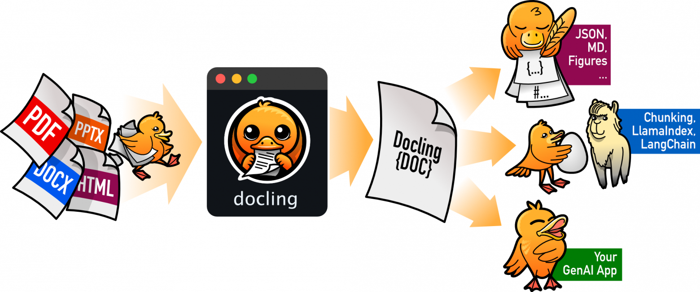
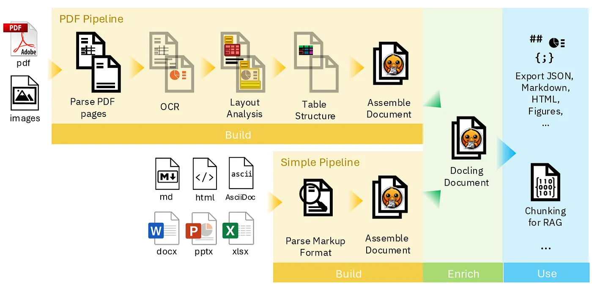

# Docling in Working with Texts, Languages, and Knowledge

**Author:** Mykhailo Kapustin (@kapustinomm)  
**Published on Habr:** August 9, 2025  
**Difficulty:** Medium | **Reading time:** 20 min | **Reach:** 14K

**Tags:** Docling, LLM, IBM, AI, Python, Backend, NLP  
**Hubs:** Python, Artificial Intelligence, PDF, Image Processing



Hi everyone. In the context of our research project, we were solving the problem of automating academic submission workflows, which led us to discover a platform called **Docling**.

Together, we explore the role of Docling in reshaping how research data can be represented, reused, and reasoned over in both human and machine-readable formats.

As part of the development of a scientific research project "Advanced Scientific Research Projects" (ASRP) aimed at creating a new-generation academic journal named ASRP.science, we encountered a number of methodological and technical challenges. One of the key issues was the automation of parsing academic research documents in order to streamline the submission, processing, and archiving of materials provided by researchers.

During the initial stages of analysis and prototyping, we formulated the following goal:

> Develop or adapt a platform capable of effectively handling linguistically and conceptually annotated texts, compatible with academic publication formats, and supporting export and interoperability with LLM pipelines and knowledge bases.

While exploring available solutions, we came across an open-source project called **Docling**, designed for linguists, researchers, and digital humanists. Although originally built for working with language and text in a linguistic context, Docling turned out to be surprisingly well-aligned with our needs.

## Why Docling Was a Relevant Choice

- **Structured data format (JSON):** Docling stores data in a structured, lightweight JSON format, which integrates easily into research pipelines and software development workflows.
- **Graph- and tree-based knowledge representation:** It supports graph and tree representations of knowledge, crucial for semantic parsing and linking concepts. A research paper in Docling becomes a network of interrelated nodes.
- **Flexible corpora creation:** Create flexible corpora including lexical databases or grammatical descriptions within the same environment — useful for building a "language archive" of terms and definitions.
- **Visualization and extensibility:** Docling offers tree views, tables, and is modular/extensible for custom scripts.
- **Interface with AI systems:** Docling can serve as an interface for interaction with AI systems, including LLMs, by providing structured JSON outputs for machine learning pipelines.

## Docling in Academic Submission Workflows

Docling allows users to break down complex research documents into modular, interlinked nodes (hypotheses, arguments, citations, definitions) instead of treating a document as one big block of text.

In our project pipeline, we use Docling's API to parse an uploaded PDF into a graph of nodes:

```python
from docling.document_converter import DocumentConverter

converter = DocumentConverter()
docling_doc = converter.convert("sample_article.pdf").document
for node, _ in docling_doc.iterate_items():
    data = node.model_dump()
    print(f"{data['label']}: {data['text'][:50]}...")
```

Each node is a Docling `DocItem` with a `label` (type of content) and `text` content. This automated segmentation means a submitted paper becomes a hierarchy of interrelated parts rather than a single blob of text.

### Key Benefits

- **Text + metadata hybrid:** Each node can contain text and associated metadata (author, source, tags, page numbers, confidence scores). Docling's Pydantic-based data model makes metadata handling straightforward.
- **Knowledge graph of the paper:** A submitted paper becomes a mini knowledge graph. Sections, arguments, and concepts are connected and queryable, transforming a linear document into a network of information.
- **Better peer-review preparation:** Reviewers can traverse the argumentation structure intuitively — isolating the central hypothesis and seeing all evidence nodes linked to it.
- **Interoperability with research platforms:** JSON structure integrates easily with Zotero, Elasticsearch, and ML pipelines.

For example, using a LangChain-powered agent to query a Docling document:

```python
query = "Extract all metadata from the document and return a single JSON object."
input_data = {
    "messages": [("user", query)],
    "file_path": "sample_article.pdf"
}
result_state = agent_executor.ainvoke(input_data)
final_answer = result_state["messages"][-1].content
metadata = json.loads(final_answer)
```

The agent returns structured metadata like:

```json
{
    "title": "Forecasting Social, Geopolitical, and Economic Events...",
    "authors": ["Denis Banchenko", "Mykhailo Kapustin"],
    "abstract": "This article presents a study on...",
    "doi": "10.33425/2690-8077.1119",
    "keywords": ["states", "predictions", "forecasting", "event", "synchronization"]
}
```

## Docling's Internal Structure: JSON, Nodes, and Knowledge Graphs



### Everything is a Node

In Docling, both linguistic elements and text segments are stored as nodes in a graph. A word, a sentence, a comment, a lexical entry — all are treated as objects that can be linked.

### JSON-Based Format

Docling stores data in clean, human-readable JSON. Each node has fields such as an `id` (unique identifier), `type` or `label`, `text` content, and references to other nodes (via IDs in a `links` array):

```json
{
    "id": "node123",
    "type": "text",
    "label": "Sentence",
    "text": "The quick brown fox jumps over the lazy dog.",
    "links": ["node124", "node125"]
}
```

### Graph Relationships

- **Parent-child (hierarchical):** paragraph → sentences, chapter → sections
- **Semantic links:** "related-to", "supports", "contradicts"
- **Alignment links:** parallel texts or translations

### Custom Annotations

Users can define annotation layers: grammatical tags, glosses, comments, metadata like source/author/confidence scores. In our use case, each `DocItem` carries a `prov` field referencing the PDF page number.

### Multimodal Content Support

Docling supports attachments like audio or images, linking them to transcript nodes — useful for oral history corpora or spoken language data.

### Export Capabilities

Export data as complete project JSON, filtered subsets, CSV for structured data, or static HTML for archiving.

## Use Case: Docling in Action

Imagine a researcher working on a study titled "Digital Inequality in Rural Education Systems." Rather than submitting a static PDF, the researcher imports it into Docling:

1. **Import and segmentation:** The text is segmented into logical parts — introduction, hypotheses, methodology, findings, conclusion. Each paragraph becomes a node.
2. **Semantic tagging:** Key terms like "digital divide," "infrastructure," "policy intervention" become tagged concept nodes, with every mention linked back to them.
3. **Argument mapping:** The central hypothesis becomes a node with supporting evidence as child nodes in a reasoning tree.
4. **Peer collaboration:** Co-authors add comments to specific argument chains, linking to separate corpora on related topics.
5. **Export and integration:** The graph exports as JSON for LLM pipelines or as HTML for public repositories.

The outcome is a paper that is searchable, interactive, modular, and integrated with a broader knowledge ecosystem.

## Connection to LLMs and AI

Docling's structured approach makes it powerful in the age of AI:

- **Structured corpora for training:** Instead of feeding an LLM raw text, feed it JSON that explicitly labels sections, relationships, and metadata — improving fine-tuning and prompt engineering.
- **Docling as a reasoning interface:** An LLM can navigate the knowledge graph via tools, asking for specific pieces rather than reading the entire text blindly. This MRKL approach produces more accurate and traceable results.
- **Integration pipelines:** JSON outputs can feed ML pipelines for automated analysis or review support.

## Expansion and Publishing

### Collaboration Features

- **Multi-user editing:** Discrete nodes allow collaborators to work on different parts simultaneously.
- **Version control:** Text-based JSON files work naturally with Git for clear change tracking.
- **Peer-review mode:** Reviewer comments become linked nodes in the knowledge graph.

### Integration with Other Tools

- **Zotero:** Export references from Docling nodes to citation managers.
- **ELAN and FLEx:** Import linguistic annotations from specialized tools into Docling's graph structure.
- **Obsidian & Notion:** Each Docling node can become a note with backlinks, bridging academic data with personal knowledge management.

### Educational Potential

- **Interactive assignments:** Students explore argument nodes and identify weaknesses in reasoning.
- **Custom teaching corpora:** Instructors build tailored linguistic corpora for language learning.
- **Case studies:** Academic articles become interactive learning modules with clickable concepts and multimedia.

## Conclusion

### What We Especially Liked

- **Modular structure and JSON backbone:** Incredible flexibility and interoperability with minimal friction.
- **Graph-based interface:** Intuitive navigation of complex research relationships — like having a mind-map of your document.
- **Open-source and lightweight:** Easy to adopt, fork, or extend without vendor lock-in.
- **Multidisciplinary scope:** Appeals to linguists, AI researchers, digital humanists, and educators alike.

### What Could Be Improved

- **Documentation:** Could benefit from more tutorials, templates, and real-world examples for onboarding.
- **User Interface:** A more polished, user-friendly interface would broaden adoption for less technical users.
- **Localization and accessibility:** Better i18n and accessibility standards support would make Docling more inclusive.

### Why We Chose Docling

In the context of building a research publication platform, we needed a tool to **structure** scientific thought, not just store it. Docling stood out as a rare blend of linguistic depth, technical openness, and adaptability to modern AI workflows. Its potential as a reasoning interface aligned closely with our goal of developing next-generation academic tools that treat knowledge as dynamic and connected.

### What's Next

We plan to implement a pilot in our journal's submission pipeline, using Docling to parse and enrich selected articles. Authors might submit a paper and receive a Docling representation alongside the usual PDF for peer review and enhanced publication formats. We're also building a custom JSON-to-LLM pipeline for semantic analysis, and exploring teaching modules based on Docling for argument mapping and linguistic analysis.

### Final Thought

Docling isn't just another digital tool — it's a philosophical shift in how we think about text, structure, and meaning. In a world increasingly driven by large language models and automated workflows, platforms like Docling help us preserve intention, logic, and nuance in our documents — one node at a time.

---

*Originally published on [Habr](https://habr.com/en/articles/935584/).*
