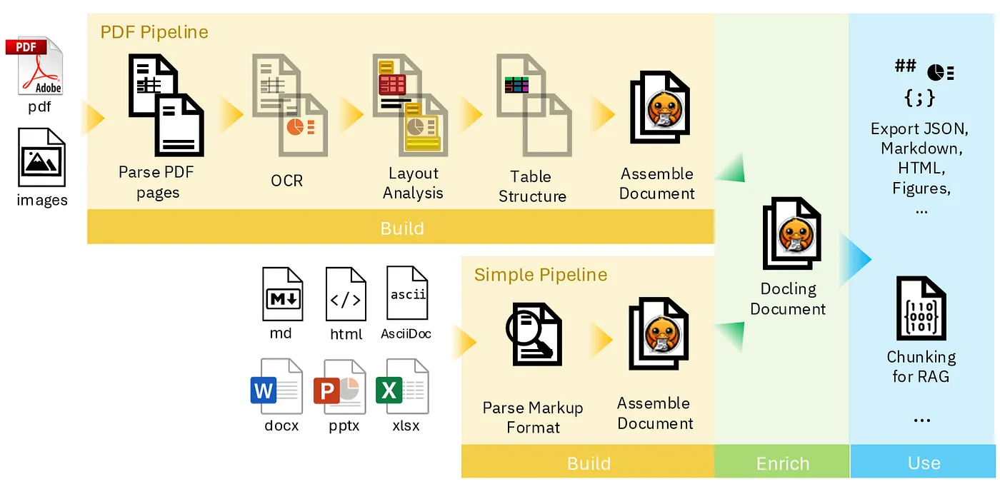

# Docling в работе с текстами, языками и знаниями

**Автор:** Mykhailo Kapustin (@kapustinomm)  
**Опубликовано на Habr:** 9 августа 2025  
**Сложность:** средняя | **Время чтения:** 20 мин | **Охват:** 14K

**Теги:** Docling, LLM, IBM, AI, Python, Backend, NLP  
**Хабы:** Python, Artificial Intelligence, PDF, Image Processing


Всем привет. В рамках нашего исследовательского проекта мы решали задачу автоматизации academic submission workflows, и это привело нас к платформе **Docling**.

Вместе мы исследуем роль Docling в том, как можно по-новому представлять, переиспользовать и осмыслять исследовательские данные — как в человекочитаемых, так и в машиночитаемых форматах.

В процессе разработки научно-исследовательского проекта "Advanced Scientific Research Projects" (ASRP), направленного на создание академического журнала нового поколения ASRP.science, мы столкнулись с рядом методологических и технических вызовов. Одной из ключевых задач стала автоматизация parsing академических исследовательских документов, чтобы упростить submission, обработку и архивирование материалов, которые предоставляют исследователи.

На ранних этапах анализа и прототипирования мы сформулировали следующую цель:

> Разработать или адаптировать платформу, способную эффективно работать с лингвистически и концептуально аннотированными текстами, совместимую с форматами академических публикаций и поддерживающую export и interoperability с LLM pipelines и knowledge bases.

Изучая доступные решения, мы нашли open-source проект **Docling**, созданный для лингвистов, исследователей и digital humanists. Хотя изначально он был построен для работы с языком и текстом в лингвистическом контексте, Docling неожиданно хорошо совпал с нашими задачами.

## Почему Docling оказался релевантным выбором

- **Структурированный формат данных (JSON):** Docling хранит данные в структурированном и лёгком JSON-формате, который легко интегрируется в research pipelines и software development workflows.
- **Graph- и tree-based представление знаний:** поддерживает графовые и древовидные представления знаний, важные для semantic parsing и связывания концептов. Научная статья в Docling превращается в сеть взаимосвязанных nodes.
- **Гибкое создание corpora:** можно создавать гибкие corpora, включая lexical databases или grammatical descriptions, в одной среде — полезно для построения "language archive" терминов и определений.
- **Visualization и extensibility:** Docling предлагает tree views, tables и модульную/extensible архитектуру для custom scripts.
- **Interface with AI systems:** Docling может служить интерфейсом для взаимодействия с AI-системами, включая LLM, предоставляя структурированные JSON outputs для machine learning pipelines.

## Docling в academic submission workflows

Docling позволяет разбивать сложные исследовательские документы на модульные, взаимосвязанные nodes (hypotheses, arguments, citations, definitions), вместо того чтобы воспринимать документ как один большой блок текста.

В pipeline нашего проекта мы используем API Docling, чтобы разобрать загруженный PDF в graph of nodes:

```python
from docling.document_converter import DocumentConverter

converter = DocumentConverter()
docling_doc = converter.convert("sample_article.pdf").document
for node, _ in docling_doc.iterate_items():
    data = node.model_dump()
    print(f"{data['label']}: {data['text'][:50]}...")
```

Каждый node — это `DocItem` Docling с `label` (типом содержимого) и текстовым content. Такая автоматическая segmentation означает, что submitted paper становится иерархией взаимосвязанных частей, а не единым blob of text.

### Ключевые преимущества

- **Гибрид текста и metadata:** каждый node может содержать текст и связанные metadata (author, source, tags, page numbers, confidence scores). Pydantic-based data model в Docling упрощает работу с metadata.
- **Knowledge graph статьи:** submitted paper становится мини-графом знаний. Sections, arguments и concepts связаны и доступны для query, превращая линейный документ в сеть информации.
- **Лучшая подготовка к peer review:** reviewers могут интуитивно проходить по структуре аргументации — выделять центральную гипотезу и видеть все evidence nodes, связанные с ней.
- **Interoperability с research platforms:** JSON-структура легко интегрируется с Zotero, Elasticsearch и ML pipelines.

Например, LangChain-powered agent может делать query к документу Docling:

```python
query = "Extract all metadata from the document and return a single JSON object."
input_data = {
    "messages": [("user", query)],
    "file_path": "sample_article.pdf"
}
result_state = agent_executor.ainvoke(input_data)
final_answer = result_state["messages"][-1].content
metadata = json.loads(final_answer)
```

Агент возвращает structured metadata вроде:

```json
{
    "title": "Forecasting Social, Geopolitical, and Economic Events...",
    "authors": ["Denis Banchenko", "Mykhailo Kapustin"],
    "abstract": "This article presents a study on...",
    "doi": "10.33425/2690-8077.1119",
    "keywords": ["states", "predictions", "forecasting", "event", "synchronization"]
}
```

## Внутренняя структура Docling: JSON, nodes и knowledge graphs



### Всё является node

В Docling и лингвистические элементы, и текстовые сегменты хранятся как nodes в graph. Слово, предложение, комментарий, lexical entry — всё рассматривается как объект, который можно связать с другими объектами.

### JSON-based формат

Docling хранит данные в чистом, человекочитаемом JSON. У каждого node есть поля вроде `id` (уникальный идентификатор), `type` или `label`, текстовый content и ссылки на другие nodes (через IDs в массиве `links`):

```json
{
    "id": "node123",
    "type": "text",
    "label": "Sentence",
    "text": "The quick brown fox jumps over the lazy dog.",
    "links": ["node124", "node125"]
}
```

### Graph relationships

- **Parent-child (hierarchical):** paragraph → sentences, chapter → sections.
- **Semantic links:** "related-to", "supports", "contradicts".
- **Alignment links:** parallel texts или translations.

### Custom annotations

Пользователи могут определять annotation layers: grammatical tags, glosses, comments, metadata вроде source/author/confidence scores. В нашем use case каждый `DocItem` несёт поле `prov`, которое ссылается на номер страницы PDF.

### Поддержка multimodal content

Docling поддерживает attachments вроде audio или images, связывая их с transcript nodes — это полезно для oral history corpora или spoken language data.

### Возможности export

Данные можно экспортировать как полный project JSON, filtered subsets, CSV для structured data или static HTML для архивирования.

## Use case: Docling в действии

Представим исследователя, который работает над статьёй "Digital Inequality in Rural Education Systems". Вместо отправки статичного PDF он импортирует её в Docling:

1. **Import and segmentation:** текст сегментируется на логические части — introduction, hypotheses, methodology, findings, conclusion. Каждый paragraph становится node.
2. **Semantic tagging:** ключевые термины вроде "digital divide", "infrastructure", "policy intervention" становятся tagged concept nodes, и каждое упоминание связывается с ними.
3. **Argument mapping:** центральная гипотеза становится node, а supporting evidence — child nodes в reasoning tree.
4. **Peer collaboration:** co-authors добавляют comments к конкретным argument chains, связывая их с отдельными corpora по смежным темам.
5. **Export and integration:** graph экспортируется как JSON для LLM pipelines или как HTML для public repositories.

В результате получается статья, которая становится searchable, interactive, modular и integrated with a broader knowledge ecosystem.

## Связь с LLM и AI

Структурный подход Docling особенно силён в эпоху AI:

- **Structured corpora for training:** вместо передачи LLM сырого текста можно передавать JSON, где явно размечены sections, relationships и metadata, что улучшает fine-tuning и prompt engineering.
- **Docling as a reasoning interface:** LLM может перемещаться по knowledge graph через tools, запрашивая конкретные фрагменты вместо слепого чтения всего текста. Такой MRKL-подход даёт более точные и traceable результаты.
- **Integration pipelines:** JSON outputs можно передавать в ML pipelines для автоматического анализа или поддержки review.

## Расширение и публикация

### Collaboration features

- **Multi-user editing:** дискретные nodes позволяют collaborators одновременно работать над разными частями.
- **Version control:** текстовые JSON files естественно работают с Git и дают прозрачное отслеживание изменений.
- **Peer-review mode:** comments reviewers становятся linked nodes в knowledge graph.

### Интеграция с другими инструментами

- **Zotero:** export references из Docling nodes в citation managers.
- **ELAN and FLEx:** import linguistic annotations из специализированных инструментов в graph structure Docling.
- **Obsidian & Notion:** каждый Docling node может стать note с backlinks, связывая academic data с personal knowledge management.

### Educational potential

- **Interactive assignments:** студенты исследуют argument nodes и находят слабые места в reasoning.
- **Custom teaching corpora:** преподаватели создают tailored linguistic corpora для изучения языков.
- **Case studies:** академические статьи превращаются в interactive learning modules с clickable concepts и multimedia.

## Заключение

### Что нам особенно понравилось

- **Модульная структура и JSON backbone:** невероятная гибкость и interoperability с минимальным friction.
- **Graph-based interface:** интуитивная навигация по сложным исследовательским связям — как mind-map вашего документа.
- **Open-source and lightweight:** легко принять, fork или расширить без vendor lock-in.
- **Multidisciplinary scope:** подходит лингвистам, AI researchers, digital humanists и educators.

### Что можно улучшить

- **Documentation:** не помешало бы больше tutorials, templates и real-world examples для onboarding.
- **User Interface:** более polished и user-friendly interface расширил бы adoption среди менее технических пользователей.
- **Localization and accessibility:** лучшая поддержка i18n и accessibility standards сделала бы Docling более инклюзивным.

### Почему мы выбрали Docling

В контексте построения платформы для research publications нам нужен был инструмент, который помогает **структурировать** научную мысль, а не просто хранить её. Docling выделился редким сочетанием лингвистической глубины, технической открытости и адаптивности к современным AI workflows. Его потенциал как reasoning interface хорошо совпал с нашей целью — создавать академические инструменты нового поколения, где знания рассматриваются как динамичные и связанные.

### Что дальше

Мы планируем реализовать pilot в submission pipeline нашего журнала, используя Docling для parsing и enrichment выбранных статей. Авторы смогут отправлять paper и получать Docling representation вместе с привычным PDF для peer review и расширенных publication formats. Также мы строим custom JSON-to-LLM pipeline для semantic analysis и исследуем teaching modules на базе Docling для argument mapping и linguistic analysis.

### Финальная мысль

Docling — это не просто ещё один digital tool. Это философский сдвиг в том, как мы думаем о тексте, структуре и смысле. В мире, где всё больше процессов управляется large language models и automated workflows, платформы вроде Docling помогают сохранять intention, logic и nuance в наших документах — по одному node за раз.

---

[← Назад к статьям](../README.md)
