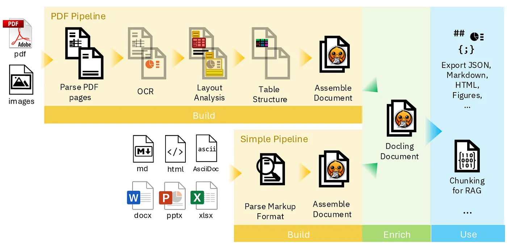

# Docling у роботі з текстами, мовами та знаннями

**Автор:** Mykhailo Kapustin (@kapustinomm)  
**Опубліковано на Habr:** 9 серпня 2025  
**Складність:** середня | **Час читання:** 20 хв | **Охоплення:** 14K

**Теги:** Docling, LLM, IBM, AI, Python, Backend, NLP  
**Хаби:** Python, Artificial Intelligence, PDF, Image Processing


Усім привіт. У межах нашого дослідницького проєкту ми розв'язували задачу автоматизації academic submission workflows, і це привело нас до платформи **Docling**.

Разом ми досліджуємо роль Docling у тому, як можна по-новому представляти, перевикористовувати й осмислювати дослідницькі дані — як у людиночитних, так і в машиночитних форматах.

У процесі розробки науково-дослідницького проєкту "Advanced Scientific Research Projects" (ASRP), спрямованого на створення академічного журналу нового покоління ASRP.science, ми зіткнулися з низкою методологічних і технічних викликів. Однією з ключових задач стала автоматизація parsing академічних дослідницьких документів, щоб спростити submission, обробку та архівування матеріалів, які надають дослідники.

На ранніх етапах аналізу й прототипування ми сформулювали таку ціль:

> Розробити або адаптувати платформу, здатну ефективно працювати з лінгвістично та концептуально анотованими текстами, сумісну з форматами академічних публікацій і таку, що підтримує export та interoperability з LLM pipelines і knowledge bases.

Вивчаючи доступні рішення, ми знайшли open-source проєкт **Docling**, створений для лінгвістів, дослідників і digital humanists. Хоча спочатку він був побудований для роботи з мовою й текстом у лінгвістичному контексті, Docling несподівано добре збігся з нашими задачами.

## Чому Docling виявився релевантним вибором

- **Структурований формат даних (JSON):** Docling зберігає дані у структурованому й легкому JSON-форматі, який легко інтегрується в research pipelines і software development workflows.
- **Graph- і tree-based представлення знань:** підтримує графові та деревоподібні представлення знань, важливі для semantic parsing і зв'язування концептів. Наукова стаття в Docling перетворюється на мережу взаємопов'язаних nodes.
- **Гнучке створення corpora:** можна створювати гнучкі corpora, включно з lexical databases або grammatical descriptions, в одному середовищі — корисно для побудови "language archive" термінів і визначень.
- **Visualization і extensibility:** Docling пропонує tree views, tables і модульну/extensible архітектуру для custom scripts.
- **Interface with AI systems:** Docling може бути інтерфейсом для взаємодії з AI-системами, включно з LLM, надаючи структуровані JSON outputs для machine learning pipelines.

## Docling в academic submission workflows

Docling дозволяє розбивати складні дослідницькі документи на модульні, взаємопов'язані nodes (hypotheses, arguments, citations, definitions), замість того щоб сприймати документ як один великий блок тексту.

У pipeline нашого проєкту ми використовуємо API Docling, щоб розібрати завантажений PDF у graph of nodes:

```python
from docling.document_converter import DocumentConverter

converter = DocumentConverter()
docling_doc = converter.convert("sample_article.pdf").document
for node, _ in docling_doc.iterate_items():
    data = node.model_dump()
    print(f"{data['label']}: {data['text'][:50]}...")
```

Кожен node — це `DocItem` Docling з `label` (типом вмісту) і текстовим content. Така автоматична segmentation означає, що submitted paper стає ієрархією взаємопов'язаних частин, а не єдиним blob of text.

### Ключові переваги

- **Гібрид тексту й metadata:** кожен node може містити текст і пов'язані metadata (author, source, tags, page numbers, confidence scores). Pydantic-based data model у Docling спрощує роботу з metadata.
- **Knowledge graph статті:** submitted paper стає міні-графом знань. Sections, arguments і concepts пов'язані та доступні для query, перетворюючи лінійний документ на мережу інформації.
- **Краща підготовка до peer review:** reviewers можуть інтуїтивно проходити структурою аргументації — виділяти центральну гіпотезу й бачити всі evidence nodes, пов'язані з нею.
- **Interoperability з research platforms:** JSON-структура легко інтегрується з Zotero, Elasticsearch і ML pipelines.

Наприклад, LangChain-powered agent може робити query до документа Docling:

```python
query = "Extract all metadata from the document and return a single JSON object."
input_data = {
    "messages": [("user", query)],
    "file_path": "sample_article.pdf"
}
result_state = agent_executor.ainvoke(input_data)
final_answer = result_state["messages"][-1].content
metadata = json.loads(final_answer)
```

Агент повертає structured metadata на кшталт:

```json
{
    "title": "Forecasting Social, Geopolitical, and Economic Events...",
    "authors": ["Denis Banchenko", "Mykhailo Kapustin"],
    "abstract": "This article presents a study on...",
    "doi": "10.33425/2690-8077.1119",
    "keywords": ["states", "predictions", "forecasting", "event", "synchronization"]
}
```

## Внутрішня структура Docling: JSON, nodes і knowledge graphs



### Усе є node

У Docling і лінгвістичні елементи, і текстові сегменти зберігаються як nodes у graph. Слово, речення, коментар, lexical entry — усе розглядається як об'єкт, який можна зв'язати з іншими об'єктами.

### JSON-based формат

Docling зберігає дані в чистому, людиночитному JSON. У кожного node є поля на кшталт `id` (унікальний ідентифікатор), `type` або `label`, текстовий content і посилання на інші nodes (через IDs у масиві `links`):

```json
{
    "id": "node123",
    "type": "text",
    "label": "Sentence",
    "text": "The quick brown fox jumps over the lazy dog.",
    "links": ["node124", "node125"]
}
```

### Graph relationships

- **Parent-child (hierarchical):** paragraph → sentences, chapter → sections.
- **Semantic links:** "related-to", "supports", "contradicts".
- **Alignment links:** parallel texts або translations.

### Custom annotations

Користувачі можуть визначати annotation layers: grammatical tags, glosses, comments, metadata на кшталт source/author/confidence scores. У нашому use case кожен `DocItem` несе поле `prov`, яке посилається на номер сторінки PDF.

### Підтримка multimodal content

Docling підтримує attachments на кшталт audio або images, зв'язуючи їх із transcript nodes — це корисно для oral history corpora або spoken language data.

### Можливості export

Дані можна експортувати як повний project JSON, filtered subsets, CSV для structured data або static HTML для архівування.

## Use case: Docling у дії

Уявімо дослідника, який працює над статтею "Digital Inequality in Rural Education Systems". Замість надсилання статичного PDF він імпортує її в Docling:

1. **Import and segmentation:** текст сегментується на логічні частини — introduction, hypotheses, methodology, findings, conclusion. Кожен paragraph стає node.
2. **Semantic tagging:** ключові терміни на кшталт "digital divide", "infrastructure", "policy intervention" стають tagged concept nodes, і кожна згадка зв'язується з ними.
3. **Argument mapping:** центральна гіпотеза стає node, а supporting evidence — child nodes у reasoning tree.
4. **Peer collaboration:** co-authors додають comments до конкретних argument chains, зв'язуючи їх з окремими corpora на суміжні теми.
5. **Export and integration:** graph експортується як JSON для LLM pipelines або як HTML для public repositories.

У результаті отримуємо статтю, яка стає searchable, interactive, modular і integrated with a broader knowledge ecosystem.

## Зв'язок із LLM та AI

Структурний підхід Docling особливо сильний в епоху AI:

- **Structured corpora for training:** замість передачі LLM сирого тексту можна передавати JSON, де явно розмічені sections, relationships і metadata, що покращує fine-tuning і prompt engineering.
- **Docling as a reasoning interface:** LLM може переміщатися knowledge graph через tools, запитуючи конкретні фрагменти замість сліпого читання всього тексту. Такий MRKL-підхід дає точніші й traceable результати.
- **Integration pipelines:** JSON outputs можна передавати в ML pipelines для автоматичного аналізу або підтримки review.

## Розширення і публікація

### Collaboration features

- **Multi-user editing:** дискретні nodes дозволяють collaborators одночасно працювати над різними частинами.
- **Version control:** текстові JSON files природно працюють із Git і дають прозоре відстеження змін.
- **Peer-review mode:** comments reviewers стають linked nodes у knowledge graph.

### Інтеграція з іншими інструментами

- **Zotero:** export references із Docling nodes у citation managers.
- **ELAN and FLEx:** import linguistic annotations зі спеціалізованих інструментів у graph structure Docling.
- **Obsidian & Notion:** кожен Docling node може стати note з backlinks, поєднуючи academic data з personal knowledge management.

### Educational potential

- **Interactive assignments:** студенти досліджують argument nodes і знаходять слабкі місця в reasoning.
- **Custom teaching corpora:** викладачі створюють tailored linguistic corpora для вивчення мов.
- **Case studies:** академічні статті перетворюються на interactive learning modules з clickable concepts і multimedia.

## Висновок

### Що нам особливо сподобалося

- **Модульна структура і JSON backbone:** неймовірна гнучкість та interoperability з мінімальним friction.
- **Graph-based interface:** інтуїтивна навігація складними дослідницькими зв'язками — як mind-map вашого документа.
- **Open-source and lightweight:** легко прийняти, fork або розширити без vendor lock-in.
- **Multidisciplinary scope:** підходить лінгвістам, AI researchers, digital humanists і educators.

### Що можна покращити

- **Documentation:** не завадило б більше tutorials, templates і real-world examples для onboarding.
- **User Interface:** більш polished і user-friendly interface розширив би adoption серед менш технічних користувачів.
- **Localization and accessibility:** краща підтримка i18n і accessibility standards зробила б Docling більш інклюзивним.

### Чому ми обрали Docling

У контексті побудови платформи для research publications нам був потрібен інструмент, який допомагає **структурувати** наукову думку, а не просто зберігати її. Docling вирізнився рідкісним поєднанням лінгвістичної глибини, технічної відкритості й адаптивності до сучасних AI workflows. Його потенціал як reasoning interface добре збігся з нашою метою — створювати академічні інструменти нового покоління, де знання розглядаються як динамічні та пов'язані.

### Що далі

Ми плануємо реалізувати pilot у submission pipeline нашого журналу, використовуючи Docling для parsing і enrichment вибраних статей. Автори зможуть надсилати paper і отримувати Docling representation разом зі звичним PDF для peer review і розширених publication formats. Також ми будуємо custom JSON-to-LLM pipeline для semantic analysis і досліджуємо teaching modules на базі Docling для argument mapping та linguistic analysis.

### Фінальна думка

Docling — це не просто ще один digital tool. Це філософський зсув у тому, як ми думаємо про текст, структуру й сенс. У світі, де дедалі більше процесів керуються large language models і automated workflows, платформи на кшталт Docling допомагають зберігати intention, logic і nuance в наших документах — по одному node за раз.

---

[← Назад до статей](../README.md)
