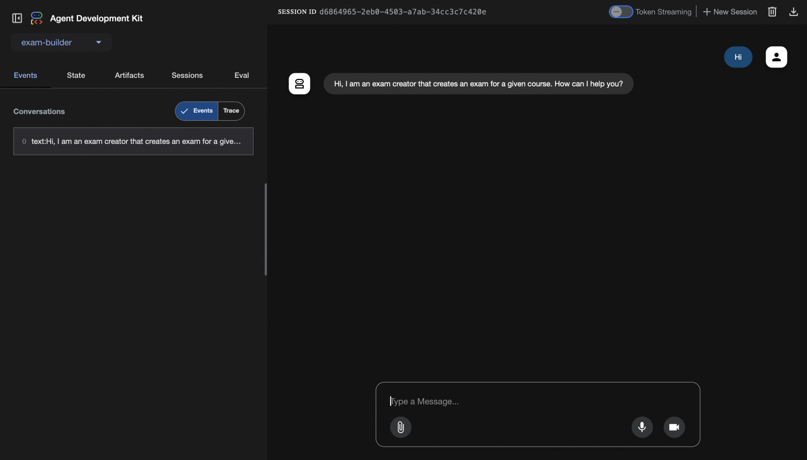
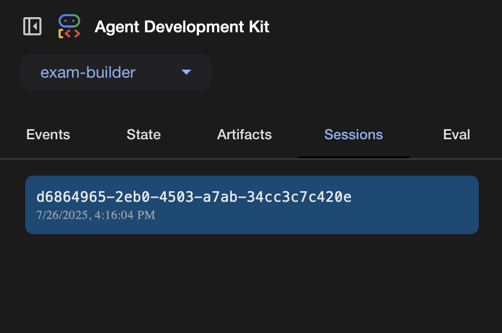
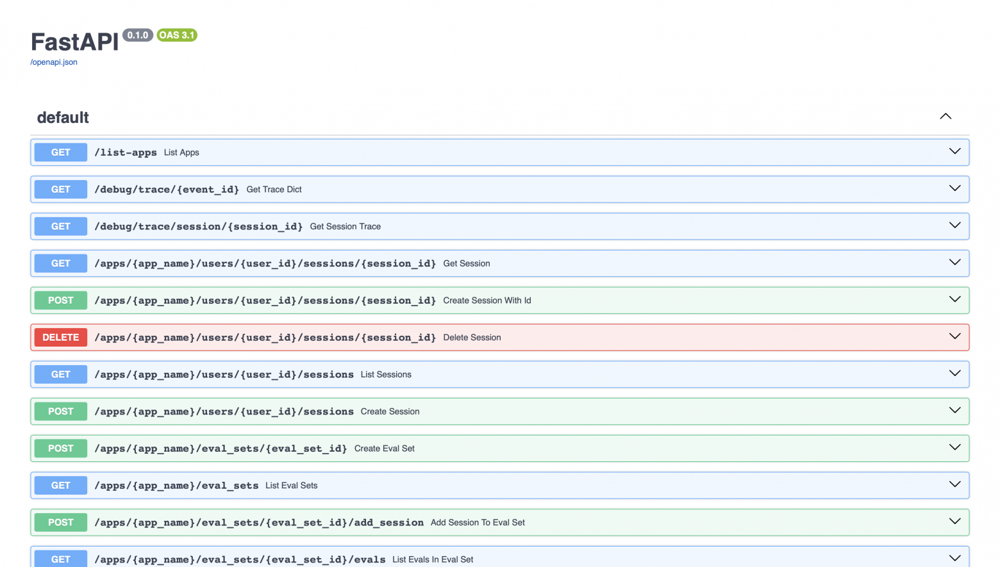
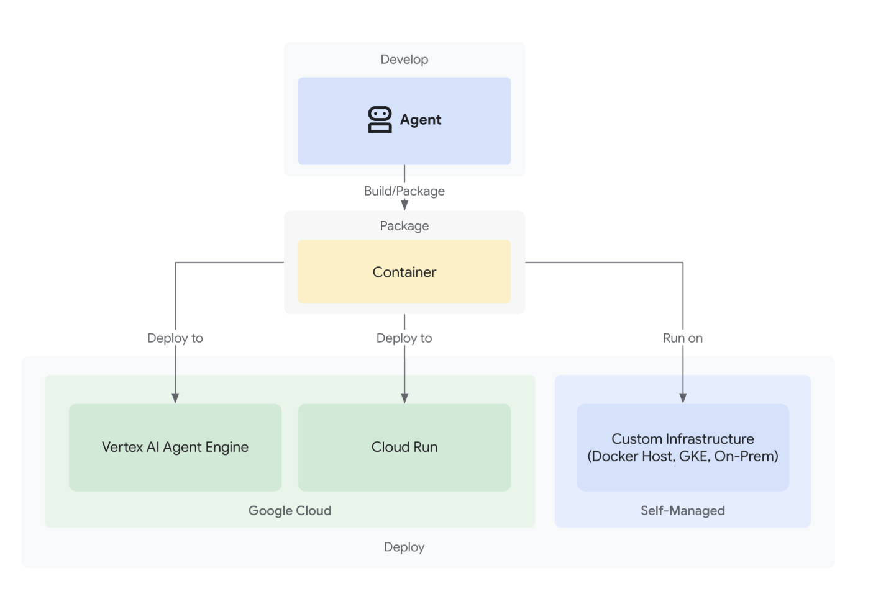
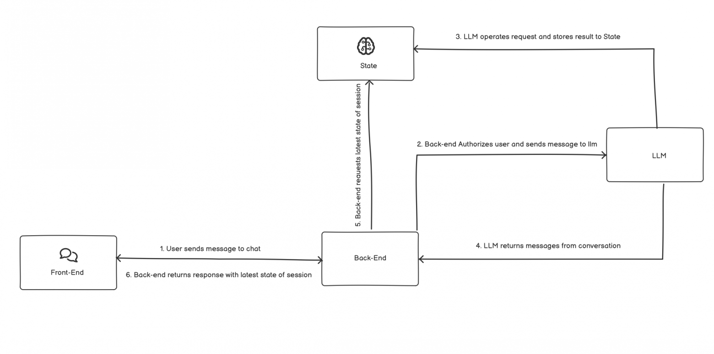

# Google ADK mit einem eigenen Interface integrieren: Schritt-für-Schritt-Anleitung mit Beispielen

**Autor:** Mykhailo Kapustin (@kapustinomm)  
**Veröffentlicht auf Habr:** 4. August 2025  
**Schwierigkeit:** Mittel | **Lesezeit:** 9 min | **Reichweite:** 7.8K

**Tags:** Google ADK, AI Agent, AI Agent Tutorial, Google Agent Engine, Python  
**Hubs:** Cloud Services, Google API, Google Cloud Platform, Artificial Intelligence, Python


Hallo zusammen!

Mein Name ist Mykhailo Kapustin, ich bin Entwickler mit 10 Jahren Erfahrung, Co-Founder und CTO des Forschungsprojekts Advanced Scientific Research Projects.

Vor Kurzem stand ich vor einer Herausforderung: einen eigenen interaktiven Agenten mit eigener UI zu bauen, der in eine bestehende Projektinfrastruktur eingebettet werden konnte. Ich begann zu recherchieren, führte Meetings mit anderen Engineers, darunter Grigory Nosyrev (Senior Software Engineer, Workato), und erkannte: Es gibt fast kein Material dazu, wie man das Google Agent Development Kit (ADK) in reale Interfaces integriert.

## Was ist Google ADK: Ein kurzer Überblick

Google Agent Development Kit (ADK) ist ein Open-Source-Toolkit von Google, veröffentlicht am 9. April 2025. Es ist für die Erstellung von LLM-Agenten gedacht, die Dialoge führen, externe Funktionen aufrufen, mit internem Zustand arbeiten, Dokumente anbinden und Reasoning-Prozesse aufbauen können. ADK erlaubt die lokale oder cloudbasierte Entwicklung von Agenten mit wenig Code und einer recht transparenten Architektur.

ADK entwickelt sich aktiv weiter. Das Google-Team verbessert es kontinuierlich, und hinter jeder Änderung erkennt man den Wunsch, Agentenarchitektur vorhersehbarer, transparenter und beherrschbarer zu machen.

## Einen einfachen Agenten mit Google ADK erstellen

Google ADK ist eine bemerkenswert klare Technologie. Die Interfaces sind einfach, die Dokumentation ist knapp, und für die meisten grundlegenden Use Cases ist nicht viel Code nötig. Hier ist ein Beispiel für einen minimalen Agenten mit dem offiziellen `adk-python`-Paket:

```python
from google.adk.agents import Agent
from google.adk.tools import google_search

root_agent = Agent(
    name="search_assistant",
    model="gemini-2.0-flash",
    instruction="You are a helpful assistant. Answer user questions using Google Search when needed.",
    description="An assistant that can search the web.",
    tools=[google_search]
)
```

Man beschreibt die Instruction, verbindet ein Tool (`google_search`), und das war es. Der Agent ist bereit, zu kommunizieren und Informationen über Google Search zu suchen.

Zum Starten des Agenten ausführen: `adk web` — dadurch startet ein fertiges Webinterface, in dem man sofort mit dem Agenten chatten kann.


*Abbildung 1: Agentendemonstration im Webinterface des Agent Development Kit. Session-Initialisierung und die erste Nachricht des Agenten sind sichtbar.*

## Google-ADK-Agentenarchitektur: Sessions, Reasoning, State

Wenn du im `adk web`-Interface die erste Nachricht über das Feld "Type a message..." sendest, erstellt Google ADK automatisch eine eindeutige Session für den aktuellen Dialog. Ab diesem Moment wird alles, was zwischen dir und dem LLM passiert, im Kontext dieser Session gespeichert.


*Abbildung 2: Vertex AI Agent Development Kit Sessions-Tab mit einer aktiven `exam-builder`-Agentensession. Sessions erlauben es, den Interaktionsfortschritt zu verfolgen, Zustand zu speichern und Dialoge per session_id wiederherzustellen.*

Innerhalb jeder Session verwaltet der Agent seinen eigenen internen Zustand, der Folgendes umfasst:

- Nachrichtenverlauf
- Gedanken und Zwischenschritte des Reasonings
- Liste aufgerufener Funktionen und Events
- Artefakte, falls vom Agenten erzeugt

Wenn du `adk web` verwendest, musst du dich nicht um das Erstellen von Sessions oder manuelles Weiterreichen von State kümmern — alles passiert automatisch.

## Eine eigene UI über FastAPI mit Google ADK verbinden

Nach den ersten Experimenten mit `adk web` hatte ich eine naheliegende Frage: Wenn das Webinterface bereits weiß, wie es mit dem Agenten kommuniziert, muss darunter eine API liegen — kann ich diese API für mein eigenes Interface nutzen?

Die Antwort ist ja. Google ADK stellt einen vollständigen FastAPI-Server bereit, und `adk web` nutzt ihn direkt. Um die ADK API zu starten, genügt:

```bash
adk api_server
```

Dadurch startet ein FastAPI-Interface auf Port 8000:

```
INFO:     Started server process [18018]
INFO:     Uvicorn running on http://127.0.0.1:8000 (Press CTRL+C to quit)
```

Die Google-ADK-API-Dokumentation ist unter `http://127.0.0.1:8000/docs` erreichbar.


*Abbildung 3: OpenAPI-Dokumentation mit der vollständigen Liste verfügbarer FastAPI-Server-Endpunkte, einschließlich Sessions, Tracing, Evaluations und Artifacts.*

Die verfügbaren Routen umfassen:

- `POST /run` — für einzelne Agentenaufrufe
- `GET /run_sse` — für Streaming-Antworten (SSE)
- `POST /sessions` — zur Verwaltung von User Sessions
- `POST /evals` — zum Ausführen eingebauter Evaluierungsverfahren
- `GET /artifacts` — für die Arbeit mit vom Agenten erzeugten Artefakten

Damit kann man die Funktionalität von `adk web` effektiv nachbilden — aber innerhalb der eigenen Anwendung.

## Den Agenten deployen: Vertex AI, Cloud Run oder Docker

Google bietet drei offizielle Deployment-Methoden, die jeweils Containerisierung des Agenten beinhalten:

1. **Vertex AI Agent Engine** — vollständig gemanagte Lösung von Google Cloud
2. **Cloud Run** — einfache Möglichkeit, einen Container in der Cloud auszuführen
3. **Custom Infrastructure** — selbst verwaltet über Docker, GKE oder On-Premise


*Abbildung 4: Google-ADK-Agenten-Deployment-Diagramm: Container-Build und Start auf Vertex AI Agent Engine, Cloud Run oder eigener Infrastruktur über Docker/GKE.*

Ich wählte Vertex AI Agent Engine — eine vollständig gemanagte Plattform, die speziell für das Production Deployment von LLM-Agenten entwickelt wurde. Der Deployment-Prozess ist sehr kompakt:

```python
app = reasoning_engines.AdkApp(
    agent=root_agent,
    enable_tracing=True,
)

remote_app = agent_engines.create(
    agent_engine=app,
    requirements=["google-cloud-aiplatform[adk,agent_engines]"],
    extra_packages=["./path_to_folder_with_agent"],
)
```

## Nach dem Deployment: Agent Engine API

Sobald dein Agent über Vertex AI Agent Engine deployed ist, interagierst du nicht mehr direkt mit der Google ADK API. Stattdessen arbeitest du mit einer separaten **Agent Engine API**, die Google auf ADK aufgebaut hat.

Wichtige Methoden für Session Management:

- `create_session` — neue Session erstellen
- `get_session` / `async_get_session` — Session-Informationen abrufen
- `list_sessions` — alle User Sessions auflisten
- `delete_session` — eine Session löschen

Wichtige Methoden für Agenteninteraktion:

- `stream_query` — primäre interaktive Kommunikationsmethode (über SSE)
- `async_stream_query` — asynchrone Variante
- `streaming_agent_run_with_events` — erweiterte Methode für Schritt-für-Schritt-Events (Reasoning, Function Calls, Artifacts)

## Production Integration: Das Modell mit deinem Produkt verbinden

Nach der Untersuchung mehrerer Architekturvarianten entschied ich mich für einen **Proxy-Backend**-Ansatz, der:

- Nutzer autorisiert
- Antworten filtert/anreichert
- Daten loggt
- Session State vom Modell abfragt

Der Workflow:

1. Frontend sendet eine Nachricht an das Backend
2. Backend delegiert an das LLM (`query` oder `stream_query`)
3. LLM verarbeitet die Anfrage und aktualisiert Session `state`
4. LLM gibt Antworten zurück
5. Backend fragt `state` per `session_id` ab
6. Das Endergebnis geht ans Frontend


*Abbildung 5: Interaktionsarchitekturdiagramm für ein eigenes Google-ADK-basiertes Interface.*

Die einzige Nuance ist Streaming: `stream_query` muss für Echtzeitantworten über WebSocket (oder SSE) geproxyt werden.

## Session State verwalten: State während Gesprächen aktualisieren

ADK stellt einen **Callback**-Mechanismus bereit — Funktionen, die nach der Antwortgenerierung oder Tool-Ausführung automatisch aufgerufen werden.

Hier ist ein einfaches Beispiel: eine `memorize_list`-Funktion, die einen Wert zu einer Liste unter einem bestimmten Schlüssel in `state` hinzufügt:

```python
def memorize_list(key: str, value: str, tool_context: ToolContext) -> dict:
    mem_dict = tool_context.state
    if key not in mem_dict:
        mem_dict[key] = []
    if value not in mem_dict[key]:
        mem_dict[key].append(value)
    return {"status": f'Stored "{key}": "{value}"'}
```

Du kannst sie über `after_model_callback` mit dem Agenten verbinden:

```python
def save_to_state(callback_context: CallbackContext, llm_response: LlmResponse) -> Optional[LlmResponse]:
    memorize_list("progress", llm_response.content.parts[0].text, callback_context)
```

Dieser Callback wird nach der Antwortgenerierung automatisch ausgeführt und erlaubt dem Agenten, seinen State ohne Beteiligung von Frontend oder Backend zu aktualisieren.

## Fazit

Google ADK und Vertex AI Agent Engine zu integrieren ist nicht nur eine Möglichkeit, ein LLM mit einem Produkt zu verbinden. Es ist eine Chance, eine flexible und skalierbare Architektur zu bauen, in der das Modell zu einem vollwertigen Dialogteilnehmer wird, nicht nur zu einem API-Wrapper über Text.

Mit State, Callbacks und durchdachter Architektur kannst du:

- Agentengedächtnis und Verhalten verwalten
- Sessions beobachten und analysieren
- Die Kommunikationserfahrung an die Bedürfnisse deines Produkts anpassen

Das Wichtigste ist: Du bist nicht eingeschränkt. Das LLM-Interface ist kein Endpunkt — es ist der Beginn eines neuen Zweigs in der Architektur deines Produkts.

---

[← Back to articles](../README.md)
