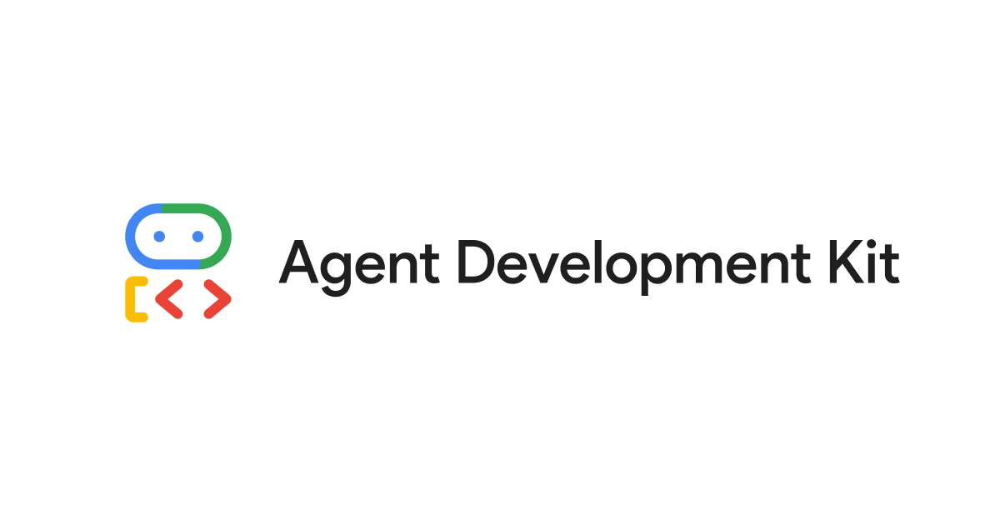
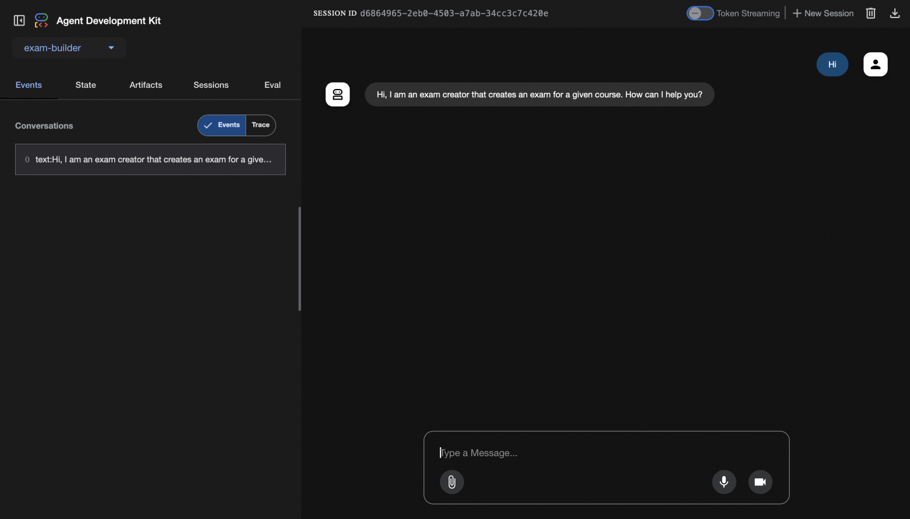
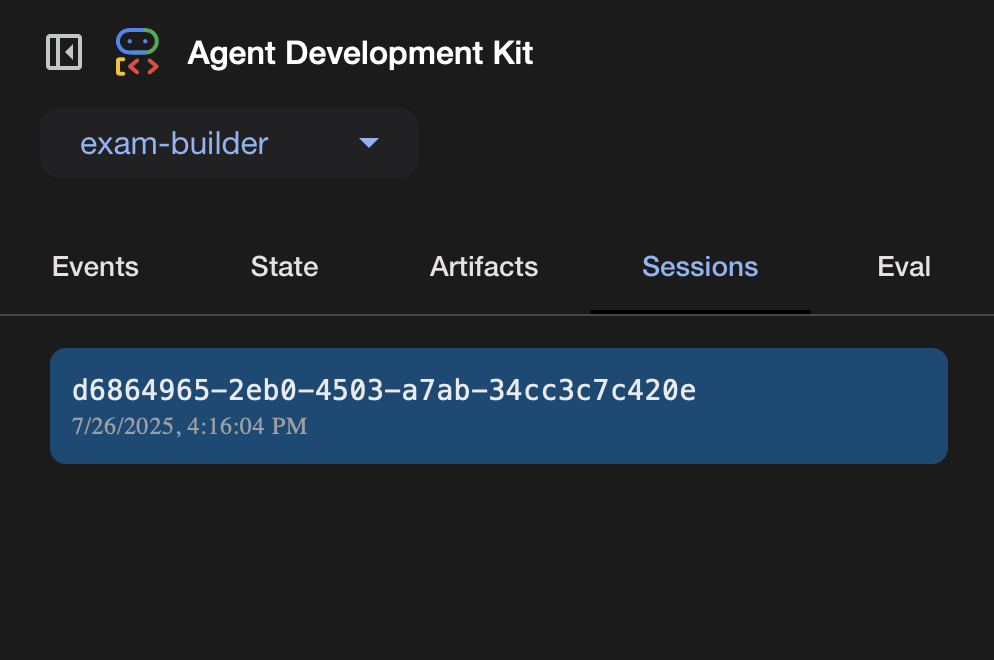
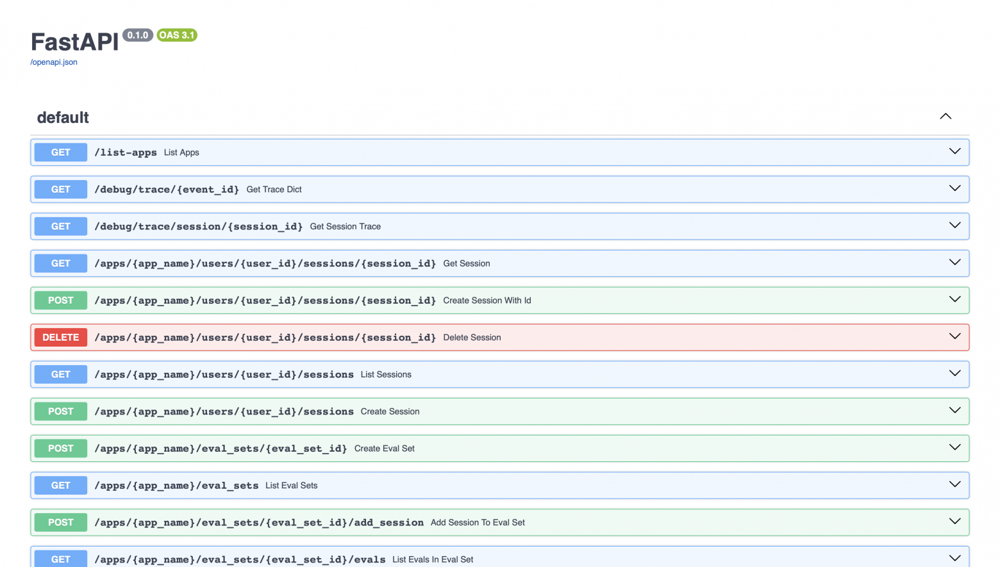
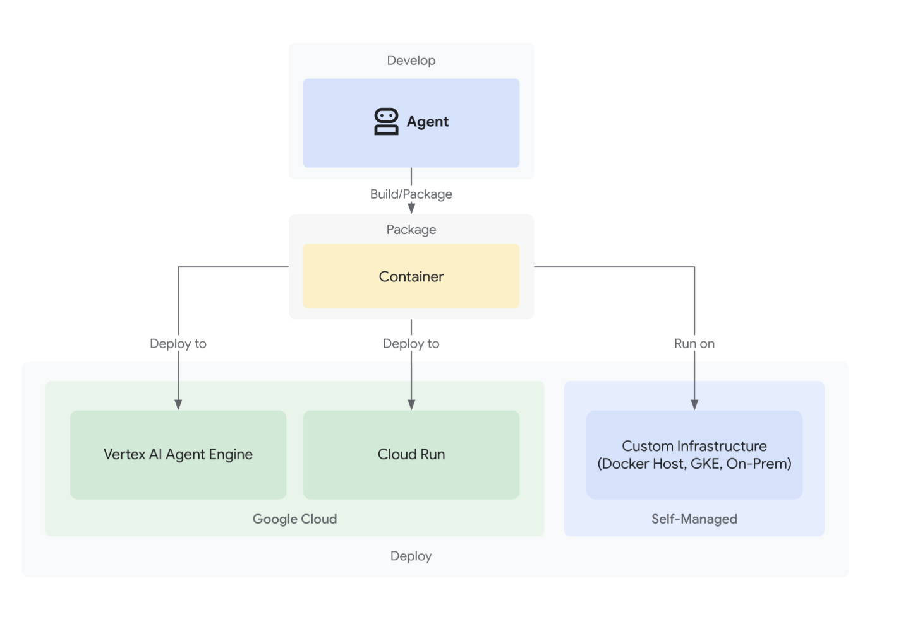
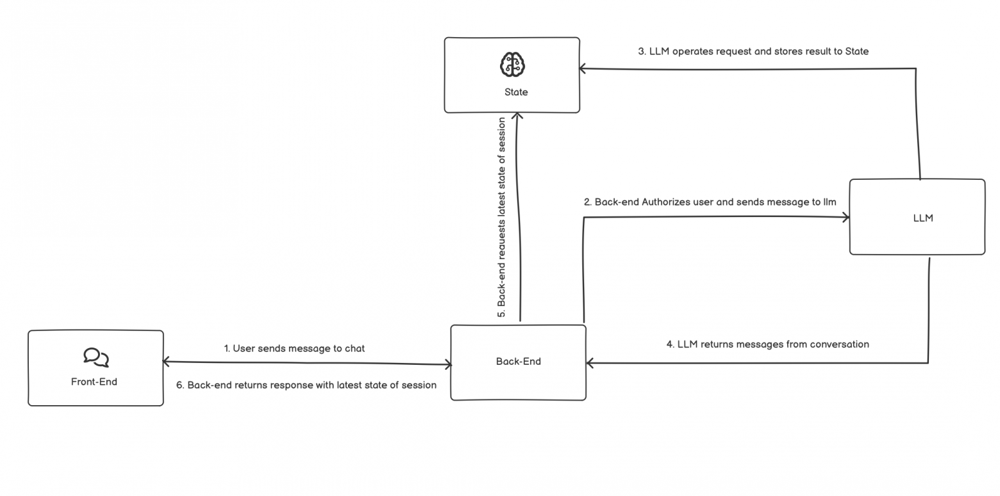

# How to Integrate Google ADK with a Custom Interface: Step-by-Step Guide with Examples

**Author:** Mykhailo Kapustin (@kapustinomm)  
**Published on Habr:** August 4, 2025  
**Difficulty:** Medium | **Reading time:** 9 min | **Reach:** 7.8K

**Tags:** Google ADK, AI Agent, AI Agent Tutorial, Google Agent Engine, Python  
**Hubs:** Cloud Services, Google API, Google Cloud Platform, Artificial Intelligence, Python



Hello everyone!

My name is Mykhailo Kapustin, a developer with 10 years of experience, co-founder and CTO of the research project Advanced Scientific Research Projects.

Recently, I faced a challenge — building a custom interactive agent with a custom UI that could be embedded into an existing project infrastructure. I started researching, held meetings with other engineers, including Grigory Nosyrev (Senior Software Engineer, Workato), and realized: there is almost no material on integrating Google Agent Development Kit (ADK) into real interfaces.

## What is Google ADK: A Brief Overview

Google Agent Development Kit (ADK) is an open-source toolkit from Google, released on April 9, 2025. It is designed for creating LLM agents capable of conducting dialogue, calling external functions, working with internal state, connecting documents, and building reasoning processes. ADK allows developing agents locally or in the cloud with minimal code and a fairly transparent architecture.

ADK is actively evolving. The Google team is continuously making improvements, and behind every change, you can see a desire to make agent architecture more predictable, transparent, and manageable.

## Creating a Simple Agent with Google ADK

Google ADK is a remarkably clean technology. The interfaces are simple, the documentation is concise, and for most basic use cases, not much code is needed. Here's an example of a minimal agent using the official `adk-python` package:

```python
from google.adk.agents import Agent
from google.adk.tools import google_search

root_agent = Agent(
    name="search_assistant",
    model="gemini-2.0-flash",
    instruction="You are a helpful assistant. Answer user questions using Google Search when needed.",
    description="An assistant that can search the web.",
    tools=[google_search]
)
```

You describe the instruction, connect a tool (`google_search`), and that's it. The agent is ready to communicate and search for information via Google Search.

To launch the agent, run: `adk web` — this starts a ready-made web interface where you can immediately chat with the agent.


*Figure 1: Agent demonstration in the Agent Development Kit web interface. Session initialization and the first message from the agent are visible.*

## Google ADK Agent Architecture: Sessions, Reasoning, State

When you send the first message through the "Type a message..." field in the `adk web` interface, Google ADK automatically creates a unique session for the current dialogue. From that moment on, everything that happens between you and the LLM is stored in the context of this session.


*Figure 2: Vertex AI Agent Development Kit Sessions tab with an active `exam-builder` agent session. Sessions allow tracking interaction progress, saving state, and restoring dialogue by session_id.*

Within each session, the agent maintains its own internal state, which includes:

- Message history
- Thoughts and intermediate reasoning steps
- List of called functions and events
- Artifacts, if generated by the agent

If you use `adk web`, you don't need to worry about creating sessions or manually passing state — everything happens automatically.

## Connecting a Custom UI to Google ADK via FastAPI

After the first experiments with `adk web`, I had a natural question: if the web interface already knows how to communicate with the agent, there must be an API under the hood — can I use this API for my own interface?

The answer is yes. Google ADK deploys a full FastAPI server, and `adk web` uses it directly. To start the ADK API, simply run:

```bash
adk api_server
```

This starts a FastAPI interface on port 8000:

```
INFO:     Started server process [18018]
INFO:     Uvicorn running on http://127.0.0.1:8000 (Press CTRL+C to quit)
```

You can open the Google ADK API documentation at `http://127.0.0.1:8000/docs`.


*Figure 3: OpenAPI documentation with the full list of available FastAPI server endpoints, including sessions, tracing, evaluations, and artifacts.*

The available routes include:

- `POST /run` — for single agent calls
- `GET /run_sse` — for streaming responses (SSE)
- `POST /sessions` — for managing user sessions
- `POST /evals` — for running built-in evaluation procedures
- `GET /artifacts` — for working with agent-generated artifacts

You can effectively replicate the functionality of `adk web` — but within your own application.

## Deploying the Agent: Vertex AI, Cloud Run, or Docker

Google offers three official deployment methods, each involving containerizing the agent:

1. **Vertex AI Agent Engine** — fully managed solution from Google Cloud
2. **Cloud Run** — simple way to run a container in the cloud
3. **Custom Infrastructure** — self-managed via Docker, GKE, or on-premise


*Figure 4: Google ADK agent deployment diagram: container build and launch on Vertex AI Agent Engine, Cloud Run, or custom infrastructure via Docker/GKE.*

I chose Vertex AI Agent Engine — a fully managed platform designed specifically for production deployment of LLM agents. The deployment process is very concise:

```python
app = reasoning_engines.AdkApp(
    agent=root_agent,
    enable_tracing=True,
)

remote_app = agent_engines.create(
    agent_engine=app,
    requirements=["google-cloud-aiplatform[adk,agent_engines]"],
    extra_packages=["./path_to_folder_with_agent"],
)
```

## After Deployment: Agent Engine API

Once your agent is deployed through Vertex AI Agent Engine, you no longer interact directly with the Google ADK API. Instead, you work with a separate **Agent Engine API** that Google developed on top of ADK.

Key session management methods:

- `create_session` — create a new session
- `get_session` / `async_get_session` — get session info
- `list_sessions` — list all user sessions
- `delete_session` — delete a session

Key agent interaction methods:

- `stream_query` — primary interactive communication method (via SSE)
- `async_stream_query` — async variant
- `streaming_agent_run_with_events` — extended method for step-by-step events (reasoning, function calls, artifacts)

## Production Integration: Connecting the Model to Your Product

After exploring several architectural options, I chose a **proxy backend** approach that:

- Authorizes users
- Filters/enriches responses
- Logs data
- Queries session state from the model

The workflow:

1. Frontend sends a message to the backend
2. Backend delegates to the LLM (`query` or `stream_query`)
3. LLM processes the request and updates session `state`
4. LLM returns responses
5. Backend queries `state` by `session_id`
6. Final result goes to the frontend


*Figure 5: Interaction architecture diagram for a custom Google ADK-based interface.*

The only nuance is streaming: you need to proxy `stream_query` through WebSocket (or SSE) for real-time responses.

## Managing Session State: Updating State During Conversations

ADK provides a **callback** mechanism — functions that are automatically called after response generation or tool execution.

Here's a basic example: a `memorize_list` function that adds a value to a list under a specific key in `state`:

```python
def memorize_list(key: str, value: str, tool_context: ToolContext) -> dict:
    mem_dict = tool_context.state
    if key not in mem_dict:
        mem_dict[key] = []
    if value not in mem_dict[key]:
        mem_dict[key].append(value)
    return {"status": f'Stored "{key}": "{value}"'}
```

You can connect this to the agent via `after_model_callback`:

```python
def save_to_state(callback_context: CallbackContext, llm_response: LlmResponse) -> Optional[LlmResponse]:
    memorize_list("progress", llm_response.content.parts[0].text, callback_context)
```

This callback will automatically run after response generation, allowing the agent to update its state without frontend or backend involvement.

## Conclusion

Integrating Google ADK and Vertex AI Agent Engine is not just a way to connect an LLM to a product. It's an opportunity to build a flexible and scalable architecture where the model becomes a full-fledged dialogue participant, not just an API wrapper over text.

With state, callbacks, and thoughtful architecture, you can:

- Manage agent memory and behavior
- Observe and analyze sessions
- Tailor the communication experience to your product's needs

The most important thing is that you are not limited. The LLM interface is not an endpoint — it's the beginning of a new branch in your product's architecture.

---

[← Back to articles](../README.md)
