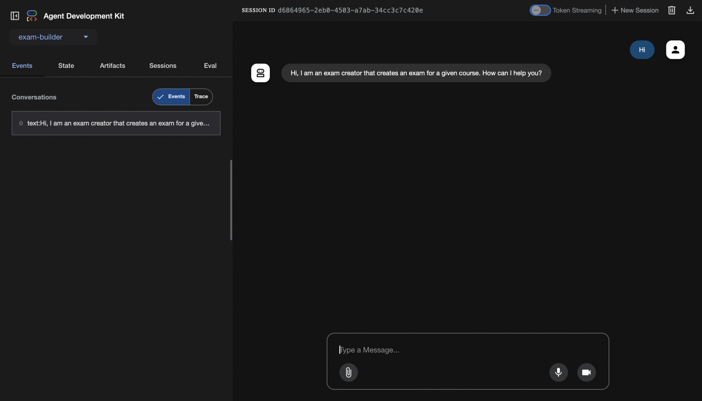
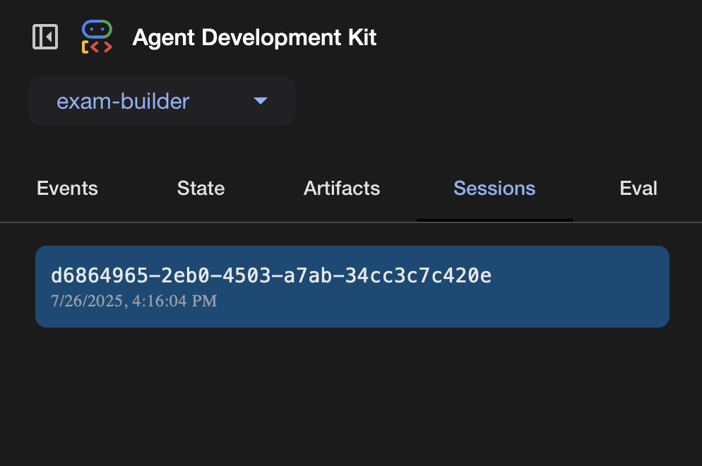
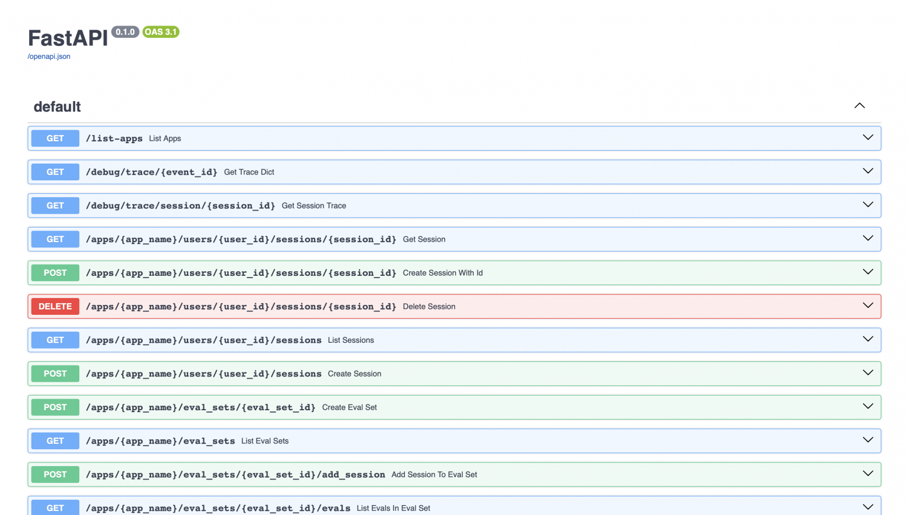
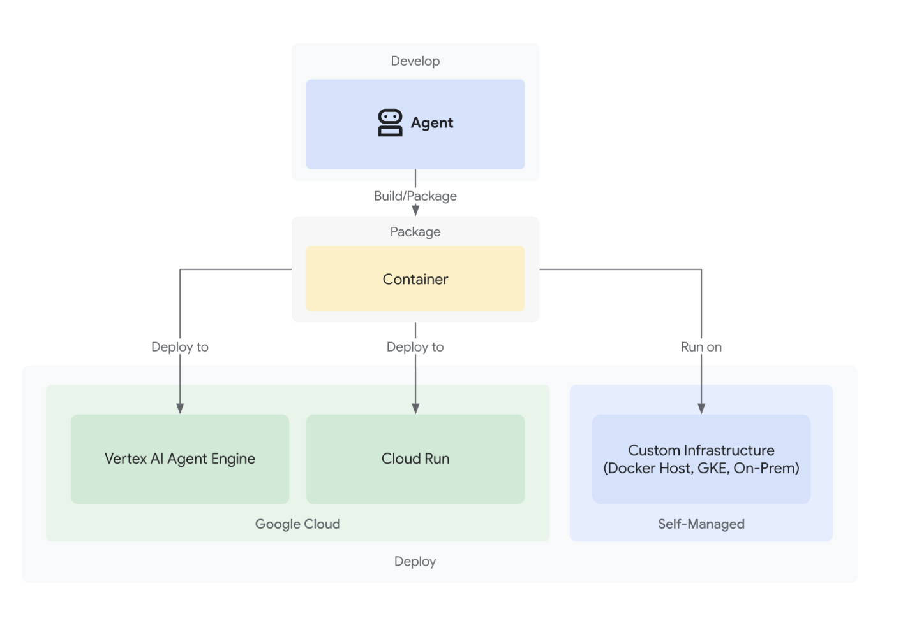
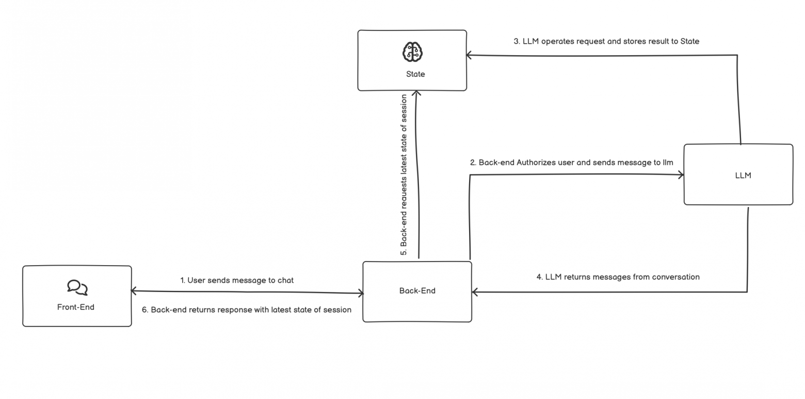

# Cómo integrar Google ADK con una interfaz personalizada: guía paso a paso con ejemplos

**Autor:** Mykhailo Kapustin (@kapustinomm)  
**Publicado en Habr:** 4 de agosto de 2025  
**Dificultad:** Media | **Tiempo de lectura:** 9 min | **Alcance:** 7.8K

**Tags:** Google ADK, AI Agent, AI Agent Tutorial, Google Agent Engine, Python  
**Hubs:** Cloud Services, Google API, Google Cloud Platform, Artificial Intelligence, Python


¡Hola a todos!

Mi nombre es Mykhailo Kapustin, desarrollador con 10 años de experiencia, cofundador y CTO del proyecto de investigación Advanced Scientific Research Projects.

Hace poco enfrenté un desafío: construir un agente interactivo personalizado con una UI propia que pudiera integrarse en una infraestructura de proyecto existente. Empecé a investigar, mantuve reuniones con otros ingenieros, incluido Grigory Nosyrev (Senior Software Engineer, Workato), y comprendí algo: casi no hay material sobre cómo integrar Google Agent Development Kit (ADK) en interfaces reales.

## Qué es Google ADK: breve panorama

Google Agent Development Kit (ADK) es un toolkit open-source de Google, lanzado el 9 de abril de 2025. Está diseñado para crear agentes LLM capaces de mantener diálogos, llamar funciones externas, trabajar con estado interno, conectar documentos y construir procesos de razonamiento. ADK permite desarrollar agentes localmente o en la nube con código mínimo y una arquitectura bastante transparente.

ADK evoluciona activamente. El equipo de Google introduce mejoras continuamente, y detrás de cada cambio se percibe el deseo de hacer que la arquitectura de agentes sea más predecible, transparente y manejable.

## Crear un agente simple con Google ADK

Google ADK es una tecnología notablemente limpia. Las interfaces son simples, la documentación es concisa y, para la mayoría de casos básicos, no se necesita mucho código. Este es un ejemplo de agente mínimo usando el paquete oficial `adk-python`:

```python
from google.adk.agents import Agent
from google.adk.tools import google_search

root_agent = Agent(
    name="search_assistant",
    model="gemini-2.0-flash",
    instruction="You are a helpful assistant. Answer user questions using Google Search when needed.",
    description="An assistant that can search the web.",
    tools=[google_search]
)
```

Describes la instrucción, conectas una herramienta (`google_search`) y listo. El agente está preparado para comunicarse y buscar información mediante Google Search.

Para lanzar el agente, ejecuta: `adk web`; esto inicia una interfaz web lista para usar donde puedes chatear inmediatamente con el agente.


*Figura 1: Demostración del agente en la interfaz web de Agent Development Kit. Se ve la inicialización de sesión y el primer mensaje del agente.*

## Arquitectura de agentes Google ADK: sesiones, razonamiento, estado

Cuando envías el primer mensaje mediante el campo "Type a message..." en la interfaz `adk web`, Google ADK crea automáticamente una sesión única para el diálogo actual. Desde ese momento, todo lo que ocurre entre tú y el LLM se almacena en el contexto de esa sesión.


*Figura 2: Pestaña Sessions de Vertex AI Agent Development Kit con una sesión activa del agente `exam-builder`. Las sesiones permiten seguir el progreso de interacción, guardar estado y restaurar el diálogo mediante session_id.*

Dentro de cada sesión, el agente mantiene su propio estado interno, que incluye:

- Historial de mensajes
- Pensamientos y pasos intermedios de razonamiento
- Lista de funciones llamadas y eventos
- Artefactos, si el agente los genera

Si usas `adk web`, no tienes que preocuparte por crear sesiones ni pasar estado manualmente: todo ocurre automáticamente.

## Conectar una UI personalizada a Google ADK mediante FastAPI

Después de los primeros experimentos con `adk web`, tuve una pregunta natural: si la interfaz web ya sabe comunicarse con el agente, debe haber una API por debajo; ¿puedo usar esa API para mi propia interfaz?

La respuesta es sí. Google ADK despliega un servidor FastAPI completo, y `adk web` lo usa directamente. Para iniciar la ADK API, simplemente ejecuta:

```bash
adk api_server
```

Esto inicia una interfaz FastAPI en el puerto 8000:

```
INFO:     Started server process [18018]
INFO:     Uvicorn running on http://127.0.0.1:8000 (Press CTRL+C to quit)
```

Puedes abrir la documentación de la Google ADK API en `http://127.0.0.1:8000/docs`.


*Figura 3: Documentación OpenAPI con la lista completa de endpoints disponibles del servidor FastAPI, incluidas sesiones, tracing, evaluaciones y artefactos.*

Las rutas disponibles incluyen:

- `POST /run`: para llamadas individuales al agente
- `GET /run_sse`: para respuestas en streaming (SSE)
- `POST /sessions`: para gestionar sesiones de usuario
- `POST /evals`: para ejecutar procedimientos de evaluación integrados
- `GET /artifacts`: para trabajar con artefactos generados por el agente

Puedes replicar eficazmente la funcionalidad de `adk web`, pero dentro de tu propia aplicación.

## Desplegar el agente: Vertex AI, Cloud Run o Docker

Google ofrece tres métodos oficiales de despliegue, cada uno con contenerización del agente:

1. **Vertex AI Agent Engine**: solución totalmente gestionada de Google Cloud
2. **Cloud Run**: forma simple de ejecutar un contenedor en la nube
3. **Custom Infrastructure**: autogestionada con Docker, GKE u on-premise


*Figura 4: Diagrama de despliegue de agente Google ADK: build del contenedor y ejecución en Vertex AI Agent Engine, Cloud Run o infraestructura personalizada mediante Docker/GKE.*

Elegí Vertex AI Agent Engine, una plataforma totalmente gestionada diseñada específicamente para despliegue en producción de agentes LLM. El proceso de despliegue es muy conciso:

```python
app = reasoning_engines.AdkApp(
    agent=root_agent,
    enable_tracing=True,
)

remote_app = agent_engines.create(
    agent_engine=app,
    requirements=["google-cloud-aiplatform[adk,agent_engines]"],
    extra_packages=["./path_to_folder_with_agent"],
)
```

## Después del despliegue: Agent Engine API

Una vez que tu agente está desplegado mediante Vertex AI Agent Engine, ya no interactúas directamente con la Google ADK API. En su lugar, trabajas con una **Agent Engine API** separada que Google desarrolló encima de ADK.

Métodos clave de gestión de sesiones:

- `create_session`: crear una sesión nueva
- `get_session` / `async_get_session`: obtener información de sesión
- `list_sessions`: listar todas las sesiones de usuario
- `delete_session`: eliminar una sesión

Métodos clave de interacción con el agente:

- `stream_query`: método principal de comunicación interactiva (mediante SSE)
- `async_stream_query`: variante asíncrona
- `streaming_agent_run_with_events`: método extendido para eventos paso a paso (razonamiento, llamadas a funciones, artefactos)

## Integración en producción: conectar el modelo con tu producto

Después de explorar varias opciones arquitectónicas, elegí un enfoque de **proxy backend** que:

- Autoriza usuarios
- Filtra/enriquece respuestas
- Registra datos
- Consulta el estado de sesión desde el modelo

El workflow:

1. Frontend envía un mensaje al backend
2. Backend delega al LLM (`query` o `stream_query`)
3. LLM procesa la solicitud y actualiza `state` de la sesión
4. LLM devuelve respuestas
5. Backend consulta `state` por `session_id`
6. El resultado final va al frontend


*Figura 5: Diagrama de arquitectura de interacción para una interfaz personalizada basada en Google ADK.*

El único matiz es el streaming: necesitas proxyear `stream_query` mediante WebSocket (o SSE) para respuestas en tiempo real.

## Gestionar estado de sesión: actualizar state durante conversaciones

ADK proporciona un mecanismo de **callback**: funciones que se llaman automáticamente después de la generación de respuesta o la ejecución de herramientas.

Este es un ejemplo básico: una función `memorize_list` que añade un valor a una lista bajo una clave específica en `state`:

```python
def memorize_list(key: str, value: str, tool_context: ToolContext) -> dict:
    mem_dict = tool_context.state
    if key not in mem_dict:
        mem_dict[key] = []
    if value not in mem_dict[key]:
        mem_dict[key].append(value)
    return {"status": f'Stored "{key}": "{value}"'}
```

Puedes conectarla al agente mediante `after_model_callback`:

```python
def save_to_state(callback_context: CallbackContext, llm_response: LlmResponse) -> Optional[LlmResponse]:
    memorize_list("progress", llm_response.content.parts[0].text, callback_context)
```

Este callback se ejecutará automáticamente después de la generación de respuesta, permitiendo que el agente actualice su estado sin intervención del frontend o backend.

## Conclusión

Integrar Google ADK y Vertex AI Agent Engine no es solo una forma de conectar un LLM a un producto. Es una oportunidad para construir una arquitectura flexible y escalable donde el modelo se convierte en un participante pleno del diálogo, no solo en un wrapper de API sobre texto.

Con estado, callbacks y una arquitectura pensada, puedes:

- Gestionar memoria y comportamiento del agente
- Observar y analizar sesiones
- Adaptar la experiencia de comunicación a las necesidades de tu producto

Lo más importante es que no estás limitado. La interfaz LLM no es un endpoint: es el comienzo de una nueva rama en la arquitectura de tu producto.

---

[← Back to articles](../README.md)
