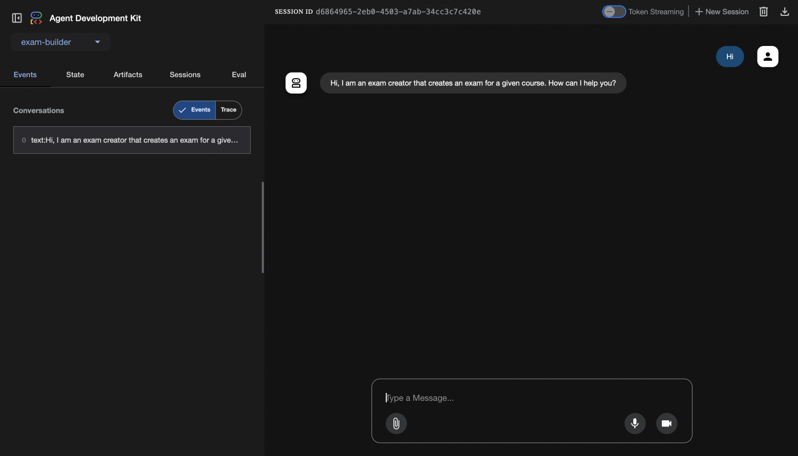
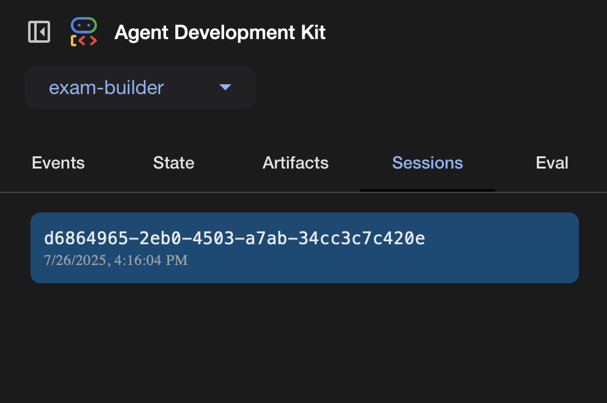
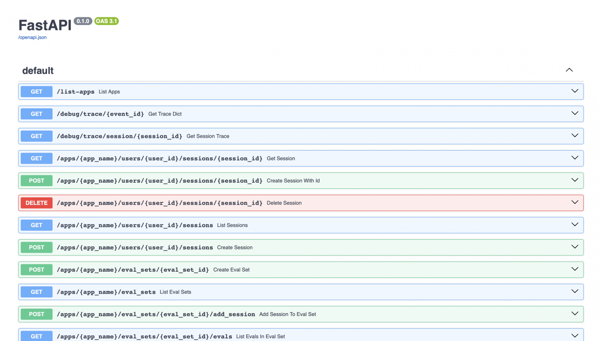
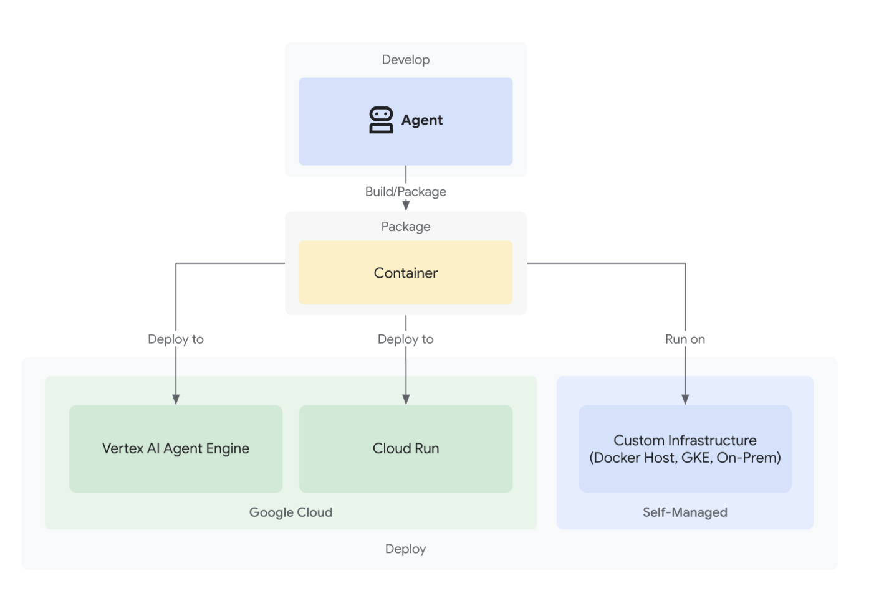
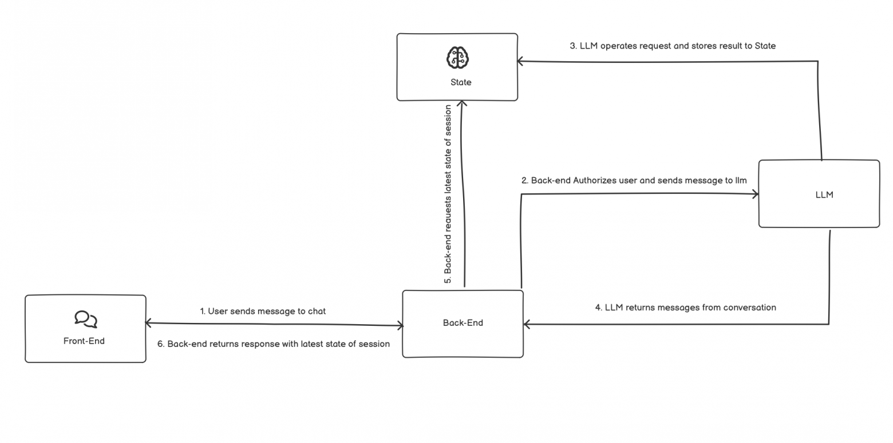

# Как интегрировать Google ADK с custom interface: пошаговое руководство с примерами

**Автор:** Mykhailo Kapustin (@kapustinomm)  
**Опубликовано на Habr:** 4 августа 2025  
**Сложность:** средняя | **Время чтения:** 9 мин | **Охват:** 7.8K

**Теги:** Google ADK, AI Agent, AI Agent Tutorial, Google Agent Engine, Python  
**Хабы:** Cloud Services, Google API, Google Cloud Platform, Artificial Intelligence, Python


Всем привет!

Меня зовут Mykhailo Kapustin, я разработчик с 10-летним опытом, co-founder и CTO исследовательского проекта Advanced Scientific Research Projects.

Недавно я столкнулся с задачей: нужно было построить custom interactive agent с собственным UI, который можно встроить в существующую инфраструктуру проекта. Я начал исследовать тему, провёл встречи с другими инженерами, включая Grigory Nosyrev (Senior Software Engineer, Workato), и понял: материалов об интеграции Google Agent Development Kit (ADK) в реальные интерфейсы почти нет.

## Что такое Google ADK: краткий обзор

Google Agent Development Kit (ADK) — open-source toolkit от Google, выпущенный 9 апреля 2025 года. Он предназначен для создания LLM-агентов, способных вести диалог, вызывать внешние функции, работать с внутренним состоянием, подключать документы и строить reasoning-процессы. ADK позволяет разрабатывать агентов локально или в cloud с минимальным количеством кода и достаточно прозрачной архитектурой.

ADK активно развивается. Команда Google постоянно вносит улучшения, и за каждым изменением видно стремление сделать агентную архитектуру более предсказуемой, прозрачной и управляемой.

## Создание простого агента с Google ADK

Google ADK — удивительно чистая технология. Интерфейсы простые, документация лаконичная, и для большинства базовых use cases требуется совсем немного кода. Вот пример минимального агента на официальном пакете `adk-python`:

```python
from google.adk.agents import Agent
from google.adk.tools import google_search

root_agent = Agent(
    name="search_assistant",
    model="gemini-2.0-flash",
    instruction="You are a helpful assistant. Answer user questions using Google Search when needed.",
    description="An assistant that can search the web.",
    tools=[google_search]
)
```

Вы описываете instruction, подключаете tool (`google_search`) — и всё. Агент готов общаться и искать информацию через Google Search.

Чтобы запустить агента, выполните: `adk web` — это стартует готовый web interface, где можно сразу общаться с агентом.


*Рисунок 1: демонстрация агента в web interface Agent Development Kit. Видны инициализация сессии и первое сообщение от агента.*

## Архитектура агента Google ADK: sessions, reasoning, state

Когда вы отправляете первое сообщение через поле "Type a message..." в интерфейсе `adk web`, Google ADK автоматически создаёт уникальную session для текущего диалога. С этого момента всё, что происходит между вами и LLM, хранится в контексте этой session.


*Рисунок 2: вкладка Sessions в Vertex AI Agent Development Kit с активной session агента `exam-builder`. Sessions позволяют отслеживать прогресс взаимодействия, сохранять state и восстанавливать диалог по session_id.*

Внутри каждой session агент поддерживает собственное внутреннее state, которое включает:

- историю сообщений;
- thoughts и промежуточные reasoning steps;
- список вызванных функций и events;
- artifacts, если они были созданы агентом.

Если вы используете `adk web`, вам не нужно заботиться о создании sessions или ручной передаче state — всё происходит автоматически.

## Подключение custom UI к Google ADK через FastAPI

После первых экспериментов с `adk web` у меня возник естественный вопрос: если web interface уже умеет общаться с агентом, значит под капотом должен быть API — могу ли я использовать этот API для собственного интерфейса?

Ответ — да. Google ADK разворачивает полноценный FastAPI server, а `adk web` напрямую его использует. Чтобы запустить ADK API, достаточно выполнить:

```bash
adk api_server
```

Это запускает FastAPI interface на порту 8000:

```
INFO:     Started server process [18018]
INFO:     Uvicorn running on http://127.0.0.1:8000 (Press CTRL+C to quit)
```

Документацию Google ADK API можно открыть по адресу `http://127.0.0.1:8000/docs`.


*Рисунок 3: OpenAPI-документация с полным списком доступных endpoints FastAPI server, включая sessions, tracing, evaluations и artifacts.*

Среди доступных routes:

- `POST /run` — для одиночных вызовов агента;
- `GET /run_sse` — для streaming responses (SSE);
- `POST /sessions` — для управления user sessions;
- `POST /evals` — для запуска встроенных evaluation procedures;
- `GET /artifacts` — для работы с artifacts, созданными агентом.

Фактически вы можете повторить функциональность `adk web`, но внутри собственного приложения.

## Deployment агента: Vertex AI, Cloud Run или Docker

Google предлагает три официальных способа deployment, и каждый предполагает containerizing агента:

1. **Vertex AI Agent Engine** — полностью управляемое решение от Google Cloud.
2. **Cloud Run** — простой способ запустить container в cloud.
3. **Custom Infrastructure** — самостоятельное управление через Docker, GKE или on-premise.


*Рисунок 4: схема deployment агента Google ADK: сборка container и запуск на Vertex AI Agent Engine, Cloud Run или custom infrastructure через Docker/GKE.*

Я выбрал Vertex AI Agent Engine — полностью управляемую платформу, специально предназначенную для production deployment LLM-агентов. Процесс deployment очень лаконичный:

```python
app = reasoning_engines.AdkApp(
    agent=root_agent,
    enable_tracing=True,
)

remote_app = agent_engines.create(
    agent_engine=app,
    requirements=["google-cloud-aiplatform[adk,agent_engines]"],
    extra_packages=["./path_to_folder_with_agent"],
)
```

## После deployment: Agent Engine API

После deployment агента через Vertex AI Agent Engine вы больше не взаимодействуете напрямую с Google ADK API. Вместо этого вы работаете с отдельным **Agent Engine API**, который Google разработал поверх ADK.

Ключевые методы управления sessions:

- `create_session` — создать новую session;
- `get_session` / `async_get_session` — получить информацию о session;
- `list_sessions` — получить список всех user sessions;
- `delete_session` — удалить session.

Ключевые методы взаимодействия с агентом:

- `stream_query` — основной метод интерактивной коммуникации (через SSE);
- `async_stream_query` — async-вариант;
- `streaming_agent_run_with_events` — расширенный метод для пошаговых events (reasoning, function calls, artifacts).

## Production-интеграция: подключение модели к продукту

После изучения нескольких архитектурных вариантов я выбрал подход **proxy backend**, который:

- авторизует пользователей;
- фильтрует и обогащает responses;
- логирует данные;
- запрашивает session state у модели.

Workflow:

1. Frontend отправляет сообщение на backend.
2. Backend делегирует запрос LLM (`query` или `stream_query`).
3. LLM обрабатывает запрос и обновляет session `state`.
4. LLM возвращает responses.
5. Backend запрашивает `state` по `session_id`.
6. Финальный результат уходит на frontend.


*Рисунок 5: схема архитектуры взаимодействия для custom interface на базе Google ADK.*

Единственный нюанс — streaming: нужно проксировать `stream_query` через WebSocket (или SSE), чтобы получать responses в real time.

## Управление session state: обновление state во время диалогов

ADK предоставляет механизм **callback** — функции, которые автоматически вызываются после генерации ответа или выполнения tool.

Вот базовый пример: функция `memorize_list`, которая добавляет значение в список по определённому ключу в `state`:

```python
def memorize_list(key: str, value: str, tool_context: ToolContext) -> dict:
    mem_dict = tool_context.state
    if key not in mem_dict:
        mem_dict[key] = []
    if value not in mem_dict[key]:
        mem_dict[key].append(value)
    return {"status": f'Stored "{key}": "{value}"'}
```

Её можно подключить к агенту через `after_model_callback`:

```python
def save_to_state(callback_context: CallbackContext, llm_response: LlmResponse) -> Optional[LlmResponse]:
    memorize_list("progress", llm_response.content.parts[0].text, callback_context)
```

Этот callback будет автоматически запускаться после генерации ответа, позволяя агенту обновлять своё state без участия frontend или backend.

## Заключение

Интеграция Google ADK и Vertex AI Agent Engine — это не просто способ подключить LLM к продукту. Это возможность построить гибкую и масштабируемую архитектуру, где модель становится полноценным участником диалога, а не просто API-wrapper поверх текста.

С помощью state, callbacks и продуманной архитектуры вы можете:

- управлять памятью и поведением агента;
- наблюдать и анализировать sessions;
- адаптировать коммуникационный опыт под потребности вашего продукта.

Самое важное — вы не ограничены. LLM interface — это не конечная точка, а начало новой ветки в архитектуре продукта.

---

[← Назад к статьям](../README.md)
