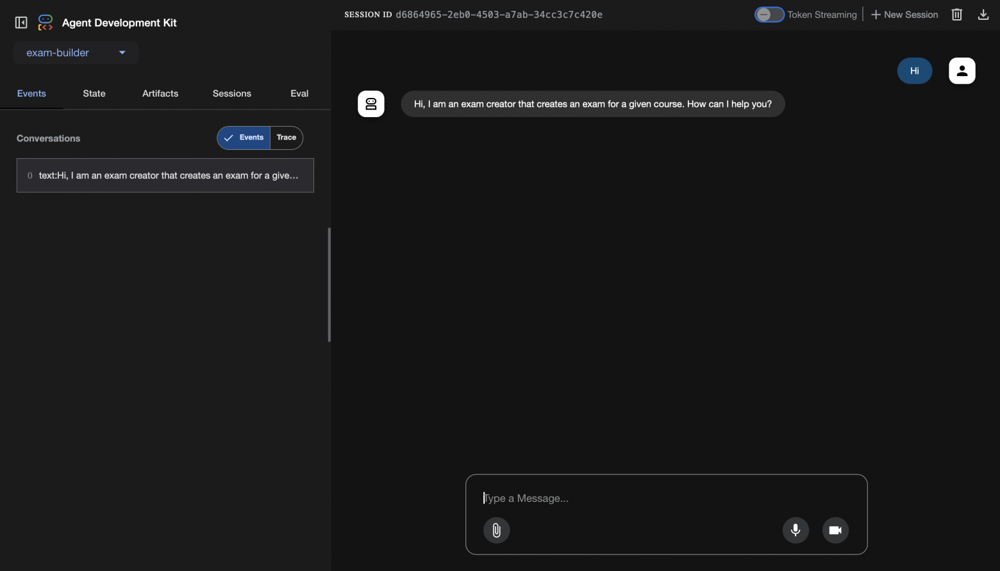
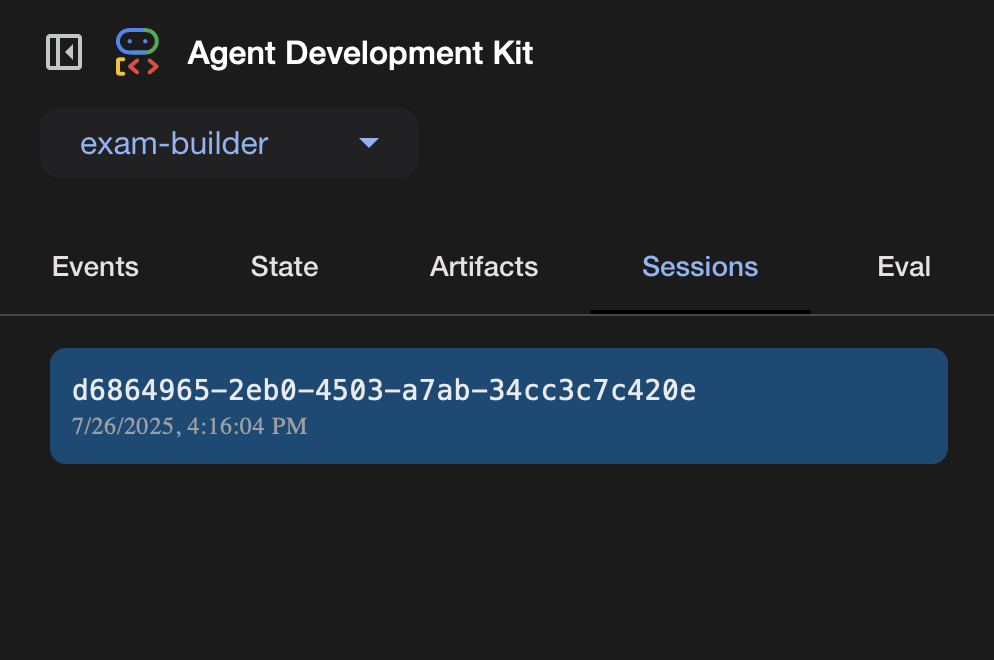
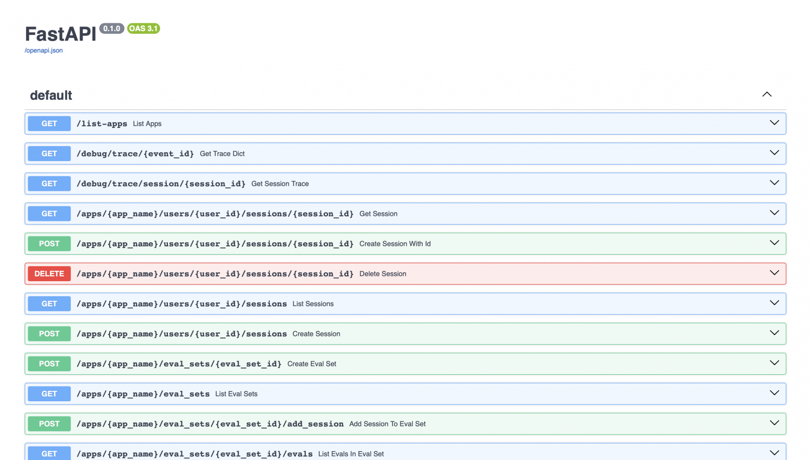
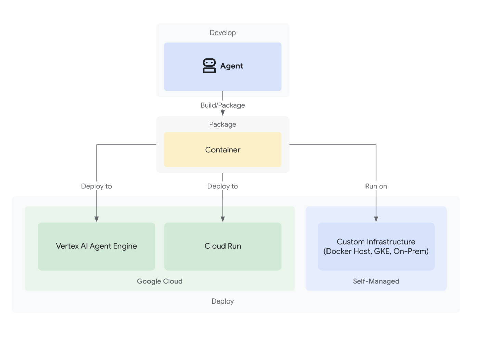
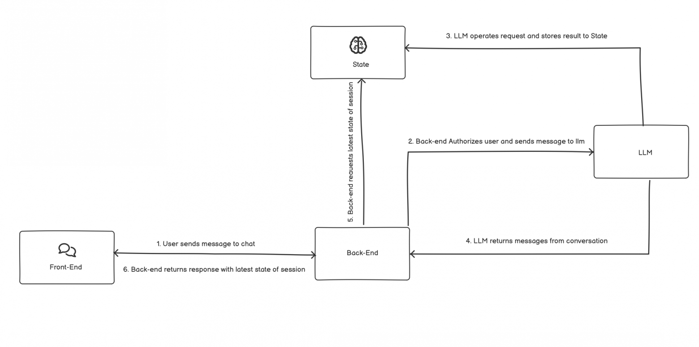

# Як інтегрувати Google ADK з custom interface: покрокове керівництво з прикладами

**Автор:** Mykhailo Kapustin (@kapustinomm)  
**Опубліковано на Habr:** 4 серпня 2025  
**Складність:** середня | **Час читання:** 9 хв | **Охоплення:** 7.8K

**Теги:** Google ADK, AI Agent, AI Agent Tutorial, Google Agent Engine, Python  
**Хаби:** Cloud Services, Google API, Google Cloud Platform, Artificial Intelligence, Python


Усім привіт!

Мене звати Mykhailo Kapustin, я розробник із 10-річним досвідом, co-founder і CTO дослідницького проєкту Advanced Scientific Research Projects.

Нещодавно я зіткнувся із завданням: потрібно було побудувати custom interactive agent із власним UI, який можна вбудувати в наявну інфраструктуру проєкту. Я почав досліджувати тему, провів зустрічі з іншими інженерами, зокрема з Grigory Nosyrev (Senior Software Engineer, Workato), і зрозумів: матеріалів про інтеграцію Google Agent Development Kit (ADK) у реальні інтерфейси майже немає.

## Що таке Google ADK: короткий огляд

Google Agent Development Kit (ADK) — open-source toolkit від Google, випущений 9 квітня 2025 року. Він призначений для створення LLM-агентів, здатних вести діалог, викликати зовнішні функції, працювати з внутрішнім станом, підключати документи й будувати reasoning-процеси. ADK дозволяє розробляти агентів локально або в cloud із мінімальною кількістю коду та досить прозорою архітектурою.

ADK активно розвивається. Команда Google постійно вносить покращення, і за кожною зміною видно прагнення зробити агентну архітектуру більш передбачуваною, прозорою та керованою.

## Створення простого агента з Google ADK

Google ADK — напрочуд чиста технологія. Інтерфейси прості, документація лаконічна, і для більшості базових use cases потрібно зовсім небагато коду. Ось приклад мінімального агента на офіційному пакеті `adk-python`:

```python
from google.adk.agents import Agent
from google.adk.tools import google_search

root_agent = Agent(
    name="search_assistant",
    model="gemini-2.0-flash",
    instruction="You are a helpful assistant. Answer user questions using Google Search when needed.",
    description="An assistant that can search the web.",
    tools=[google_search]
)
```

Ви описуєте instruction, підключаєте tool (`google_search`) — і все. Агент готовий спілкуватися та шукати інформацію через Google Search.

Щоб запустити агента, виконайте: `adk web` — це стартує готовий web interface, де можна одразу спілкуватися з агентом.


*Рисунок 1: демонстрація агента у web interface Agent Development Kit. Видно ініціалізацію сесії та перше повідомлення від агента.*

## Архітектура агента Google ADK: sessions, reasoning, state

Коли ви надсилаєте перше повідомлення через поле "Type a message..." в інтерфейсі `adk web`, Google ADK автоматично створює унікальну session для поточного діалогу. З цього моменту все, що відбувається між вами та LLM, зберігається в контексті цієї session.


*Рисунок 2: вкладка Sessions у Vertex AI Agent Development Kit з активною session агента `exam-builder`. Sessions дозволяють відстежувати прогрес взаємодії, зберігати state і відновлювати діалог за session_id.*

Усередині кожної session агент підтримує власне внутрішнє state, яке включає:

- історію повідомлень;
- thoughts і проміжні reasoning steps;
- список викликаних функцій та events;
- artifacts, якщо їх створив агент.

Якщо ви використовуєте `adk web`, вам не потрібно дбати про створення sessions або ручну передачу state — усе відбувається автоматично.

## Підключення custom UI до Google ADK через FastAPI

Після перших експериментів з `adk web` у мене виникло природне запитання: якщо web interface уже вміє спілкуватися з агентом, отже під капотом має бути API — чи можу я використати цей API для власного інтерфейсу?

Відповідь — так. Google ADK розгортає повноцінний FastAPI server, а `adk web` напряму його використовує. Щоб запустити ADK API, достатньо виконати:

```bash
adk api_server
```

Це запускає FastAPI interface на порту 8000:

```
INFO:     Started server process [18018]
INFO:     Uvicorn running on http://127.0.0.1:8000 (Press CTRL+C to quit)
```

Документацію Google ADK API можна відкрити за адресою `http://127.0.0.1:8000/docs`.


*Рисунок 3: OpenAPI-документація з повним списком доступних endpoints FastAPI server, включно з sessions, tracing, evaluations і artifacts.*

Серед доступних routes:

- `POST /run` — для одиночних викликів агента;
- `GET /run_sse` — для streaming responses (SSE);
- `POST /sessions` — для керування user sessions;
- `POST /evals` — для запуску вбудованих evaluation procedures;
- `GET /artifacts` — для роботи з artifacts, створеними агентом.

Фактично ви можете повторити функціональність `adk web`, але всередині власного застосунку.

## Deployment агента: Vertex AI, Cloud Run або Docker

Google пропонує три офіційні способи deployment, і кожен передбачає containerizing агента:

1. **Vertex AI Agent Engine** — повністю кероване рішення від Google Cloud.
2. **Cloud Run** — простий спосіб запустити container у cloud.
3. **Custom Infrastructure** — самостійне керування через Docker, GKE або on-premise.


*Рисунок 4: схема deployment агента Google ADK: збірка container і запуск на Vertex AI Agent Engine, Cloud Run або custom infrastructure через Docker/GKE.*

Я обрав Vertex AI Agent Engine — повністю керовану платформу, спеціально призначену для production deployment LLM-агентів. Процес deployment дуже лаконічний:

```python
app = reasoning_engines.AdkApp(
    agent=root_agent,
    enable_tracing=True,
)

remote_app = agent_engines.create(
    agent_engine=app,
    requirements=["google-cloud-aiplatform[adk,agent_engines]"],
    extra_packages=["./path_to_folder_with_agent"],
)
```

## Після deployment: Agent Engine API

Після deployment агента через Vertex AI Agent Engine ви більше не взаємодієте напряму з Google ADK API. Натомість ви працюєте з окремим **Agent Engine API**, який Google розробив поверх ADK.

Ключові методи керування sessions:

- `create_session` — створити нову session;
- `get_session` / `async_get_session` — отримати інформацію про session;
- `list_sessions` — отримати список усіх user sessions;
- `delete_session` — видалити session.

Ключові методи взаємодії з агентом:

- `stream_query` — основний метод інтерактивної комунікації (через SSE);
- `async_stream_query` — async-варіант;
- `streaming_agent_run_with_events` — розширений метод для покрокових events (reasoning, function calls, artifacts).

## Production-інтеграція: підключення моделі до продукту

Після вивчення кількох архітектурних варіантів я обрав підхід **proxy backend**, який:

- авторизує користувачів;
- фільтрує й збагачує responses;
- логує дані;
- запитує session state у моделі.

Workflow:

1. Frontend надсилає повідомлення на backend.
2. Backend делегує запит LLM (`query` або `stream_query`).
3. LLM обробляє запит і оновлює session `state`.
4. LLM повертає responses.
5. Backend запитує `state` за `session_id`.
6. Фінальний результат іде на frontend.


*Рисунок 5: схема архітектури взаємодії для custom interface на базі Google ADK.*

Єдиний нюанс — streaming: потрібно проксувати `stream_query` через WebSocket (або SSE), щоб отримувати responses у real time.

## Керування session state: оновлення state під час діалогів

ADK надає механізм **callback** — функції, які автоматично викликаються після генерації відповіді або виконання tool.

Ось базовий приклад: функція `memorize_list`, яка додає значення до списку за певним ключем у `state`:

```python
def memorize_list(key: str, value: str, tool_context: ToolContext) -> dict:
    mem_dict = tool_context.state
    if key not in mem_dict:
        mem_dict[key] = []
    if value not in mem_dict[key]:
        mem_dict[key].append(value)
    return {"status": f'Stored "{key}": "{value}"'}
```

Її можна підключити до агента через `after_model_callback`:

```python
def save_to_state(callback_context: CallbackContext, llm_response: LlmResponse) -> Optional[LlmResponse]:
    memorize_list("progress", llm_response.content.parts[0].text, callback_context)
```

Цей callback автоматично запускатиметься після генерації відповіді, дозволяючи агенту оновлювати своє state без участі frontend або backend.

## Висновок

Інтеграція Google ADK і Vertex AI Agent Engine — це не просто спосіб підключити LLM до продукту. Це можливість побудувати гнучку й масштабовану архітектуру, де модель стає повноцінним учасником діалогу, а не просто API-wrapper поверх тексту.

За допомогою state, callbacks і продуманої архітектури ви можете:

- керувати пам'яттю і поведінкою агента;
- спостерігати й аналізувати sessions;
- адаптувати комунікаційний досвід під потреби вашого продукту.

Найважливіше — ви не обмежені. LLM interface — це не кінцева точка, а початок нової гілки в архітектурі продукту.

---

[← Назад до статей](../README.md)
