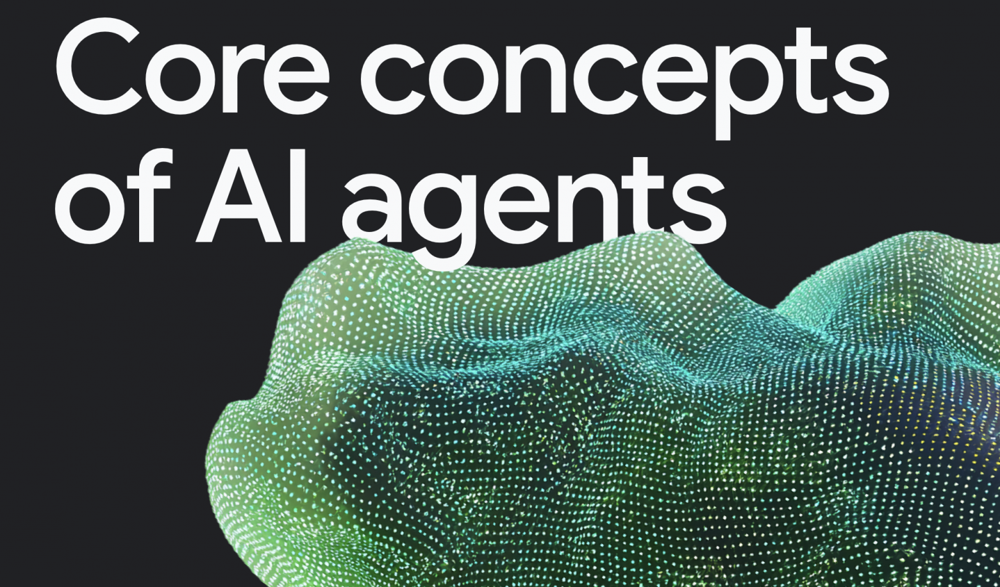
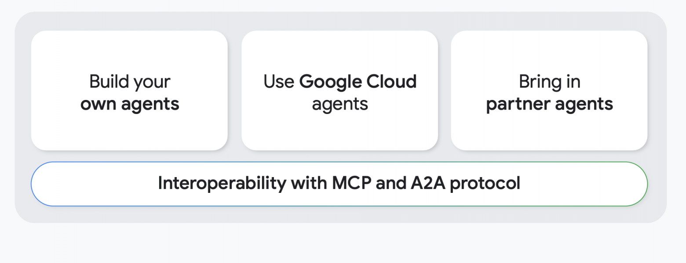
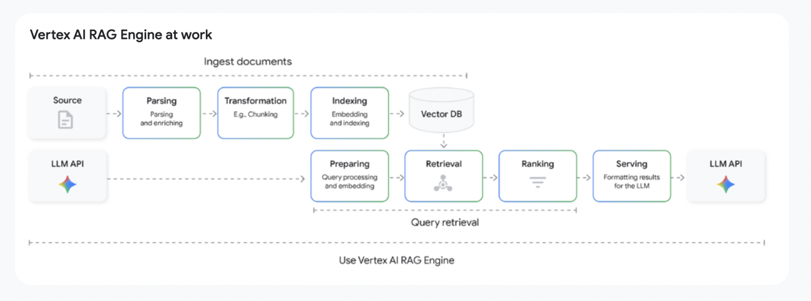
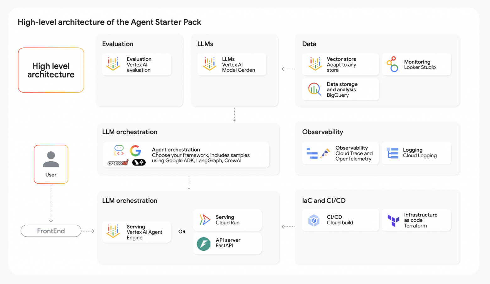
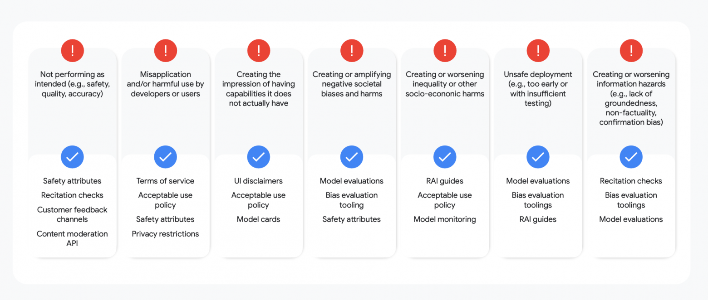

# Google ADK und "Startup Technical Guide: AI Agents": Wie Google die Erstellung von KI-Agenten neu definiert

**Autor:** Mykhailo Kapustin (@kapustinomm)  
**Veröffentlicht auf Habr:** 5. Oktober 2025  
**Schwierigkeit:** Einfach | **Lesezeit:** 9 Min. | **Reichweite:** 5.3K

**Tags:** Google ADK, KI, Vertex AI, Google Cloud, Google App Engine  
**Hub:** Künstliche Intelligenz

Wenn Google Cloud den "Startup Technical Guide: AI Agents" veröffentlicht, ist das nicht einfach nur eine weitere Dokumentation, sondern ein Meilenstein. Warum? Weil es rund um KI-Agenten derzeit sehr viel Hype gibt, es bisher aber keinen umfassenden technischen Referenzpunkt gab.

In diesem Sommer bin ich bereits tief in das Thema eingestiegen und habe sogar [einen Artikel über Google ADK und die Integration eines KI-Agenten in eine eigene UI](../google-adk-custom-interface/) geschrieben. Der neue Leitfaden von Google liegt jedoch auf einem ganz anderen Niveau: 64 Seiten, die den gesamten Weg von der Idee bis zur Produktion abdecken.

Was macht ihn besonders? Erstens Umfang und Tiefe: Google hat die Expertise seiner Teams investiert, um alles von Architektur bis AgentOps zu beschreiben. Zweitens der Fokus auf praktische Zuverlässigkeit: Schritt für Schritt wird erklärt, wie man aus einem Agentenprototyp ein robustes System mit Monitoring, Tests und Sicherheit macht. Drittens der Fokus auf das Google-Cloud-Ökosystem: Der Leitfaden zeigt, wie man Vertex AI, Gemini, das Agent Development Kit (ADK) und andere Tools nutzt. Die Prinzipien sind aber auch breiter anwendbar: Sie sind für jeden Entwickler von LLM-Agenten nützlich, selbst auf alternativen Plattformen.

Nachdem ich das gesamte Dokument gelesen hatte, habe ich fünf zentrale Erkenntnisse herausgearbeitet.

## Erkenntnis 1: KI-Agenten sind keine Chatbots, sondern ein neues Paradigma für die Arbeit mit KI

Die wichtigste Botschaft, die der Leitfaden von Anfang an vermittelt: Der Ansatz "fragen und eine Antwort erhalten" gehört zunehmend der Vergangenheit an. KI-Agenten sind der nächste Schritt, bei dem wir dem Modell ein komplexes Ziel geben, keine konkrete Frage. Der Agent plant und führt mehrstufige Aufgaben aus, indem er Tools und externe Daten nutzt.

Thomas Kurian (CEO von Google Cloud) nannte agentische Workflows treffend die "new frontier", in der KI zum Beispiel "eine Produkteinführung planen oder ein Problem in der Lieferkette lösen" kann, indem sie alle notwendigen Schritte ausführt. Das ist eine grundlegende Abkehr von herkömmlichen engen Bots: Ein Agent ist wie ein autonomer Assistent, der denken, Entscheidungen treffen und handeln kann.

Für Entwickler ist diese Betonung wichtig. Wir nennen oft jedes Skript mit GPT und ein paar angebundenen APIs einen "KI-Agenten". Google legt die Messlatte jedoch höher: Ein Agent muss Ziele adaptiv erreichen, statt nur nach Vorlage zu antworten.

## Erkenntnis 2: Ein einzelnes LLM reicht nicht aus: Man braucht den vollständigen Stack aus Infrastruktur und Tools

Google betont: Man kann keinen ernsthaften KI-Agenten bauen, indem man einfach ein großes Sprachmodell auswählt. Man braucht skalierbare Infrastruktur, Datenintegration und eine durchdachte Architektur. Einen produktionsreifen Agenten zu erstellen, erfordert weit mehr als die Auswahl eines LLM.

Zu den Kernkomponenten eines Agenten gehören: das Modell, Tools für Aktionen, Orchestrierungslogik (z. B. das ReAct-Muster), Speicher für Kontext, Mechanismen zur Sitzungsspeicherung und mehr.

Der Leitfaden betont: "Automate workflows, not just conversations." Für ein kleines Startup reicht es nicht, einen "sprechenden Kopf" zu bauen: Es müssen echte Geschäftsprozesse automatisiert werden. Der Agent muss in die eigene Infrastruktur integriert werden: auf APIs zugreifen und mit den eigenen Daten arbeiten.

## Erkenntnis 3: Grounding: Den Agenten lehren, sich auf Wissen statt auf Halluzinationen zu stützen

Eines der Lieblingsthemen unter LLM-Entwicklern ist die Frage, wie man Modellhalluzinationen und begrenztem Weltwissen begegnet. Googles Antwort lautet: **Grounding**. Der Leitfaden unterscheidet klar: Fine-Tuning ist nicht Grounding. Fine-Tuning garantiert weder Genauigkeit noch Faktizität von Antworten. Grounding verbindet das Modell mit aktuellen, zuverlässigen Datenquellen.

In der Praxis bedeutet das Retrieval-Augmented Generation (RAG): Bevor eine Antwort generiert wird, stellt der Agent eine Suchanfrage oder greift auf die Wissensbasis zu, um relevante Fakten abzurufen. Der Leitfaden beschreibt die Entwicklung von einfachem RAG zu GraphRAG (Nutzung von Datenbeziehungen über einen Knowledge Graph) und sogar Agentic RAG, bei dem der Agent aktiv Informationen sammelt.

Google bewegt sich im Kern darauf zu, den Agenten zu einem proaktiven Forscher zu machen: zu einem System, das seiner internen Welt nicht blind vertraut, sondern Hypothesen prüft und Daten verfeinert.

## Erkenntnis 4: AgentOps: Testen und Monitoring statt "wird schon gutgehen"

Den stärksten Eindruck hinterließ der Abschnitt über AgentOps, im Grunde MLOps für Agenten. Google sagt offen: Die meisten Agenten scheitern in der Produktion nicht wegen schlechter Modelle, sondern weil niemand die "mühsame" operative Arbeit erledigt.

Der Leitfaden schlägt einen vierstufigen Ansatz zur Agentenbewertung vor:

1. **Komponententests**: Jedes Tool und jede Funktion wird einzeln getestet
2. **Trajektorienprüfungen**: Was der Agent in jedem Schritt tut
3. **Ergebnisprüfungen**: Wie korrekt die finalen Antworten sind
4. **Systemmonitoring**: Beobachtbarkeit in der Produktion

Google stellt ausdrücklich fest, dass der Wechsel von improvisiertem "vibe-testing" zu einem systematischen, automatisierten und reproduzierbaren Verfahren ein Wettbewerbsvorteil ist.

Das Agent Starter Pack von Google enthält bereits Terraform-Templates, CI/CD-Konfigurationen und Skripte, die Monitoring, Tests und Deployment nach Best Practices bündeln.

## Erkenntnis 5: Sicherheit und Ethik: Jetzt Pflichtanforderungen, keine Option

Der Leitfaden macht unmissverständlich klar: Wer einen mächtigen KI-Agenten erstellt, übernimmt automatisch Verantwortung für seine Sicherheit, den Datenschutz und sein ethisches Verhalten. Er beschreibt die Risiken (toxische Inhalte, Datenlecks, Prompt-Injection-Angriffe) und die notwendigen Gegenmaßnahmen detailliert.

Google schlägt einen "defense-in-depth"-Ansatz vor:

- **Design mit Guardrails**: Kontextfilter und Tool-Beschränkungen nach dem Prinzip der geringsten Rechte von Anfang an
- **Infrastrukturschutz**: isolierte Agentenausführung, IAM-Rollen
- **Monitoring und Auditing**: jede Aktion protokollieren, Logs in BigQuery speichern, Alerts konfigurieren
- **Guardrails**: automatische Prüfungen eingehender Prompts und ausgehender Antworten

Der Leitfaden verweist auf Googles Secure AI Framework (SAIF), ein internes Regelwerk für sichere KI-Entwicklung.

## Fazit

Nach der gründlichen Lektüre des Leitfadens hatte ich das Gefühl, einen Versuch in den Händen zu halten, einen neuen Branchenstandard zu kodifizieren. Google hat erhebliche Arbeit geleistet, um die Erfahrungen der letzten Jahre zu strukturieren: von frühen Agentenprototypen bis zu ausgereiften, beherrschbaren Systemen.

Die Botschaft lautet: "The path from prototype to production is disciplined engineering." Spontane Experimente sind für Demos in Ordnung, aber die Zukunft gehört einem methodischen Ansatz: durchdachte Architektur, kontinuierliches Grounding mit Daten, automatisierte Tests jedes "Denkschritts" und sorgfältige Aufmerksamkeit für Sicherheit.

Warum ist dieser Leitfaden mehr als Dokumentation? Weil er eine gemeinsame Sprache und ein gemeinsames Framework für alle schafft, die KI-Agenten bauen. So wie DevOps einst als Bündel von Praktiken entstand, erleben wir jetzt die Geburt eines analogen Konzepts für KI-Agenten: nennen wir es AgentOps.

## Quellen

- [Startup Technical Guide: Building AI Agents with Google Cloud](https://services.google.com/fh/files/misc/startup_technical_guide_ai_agents_final.pdf)
- [How to Integrate Google ADK with a Custom Interface](../google-adk-custom-interface/)

---

[← Back to articles](../README.md)
