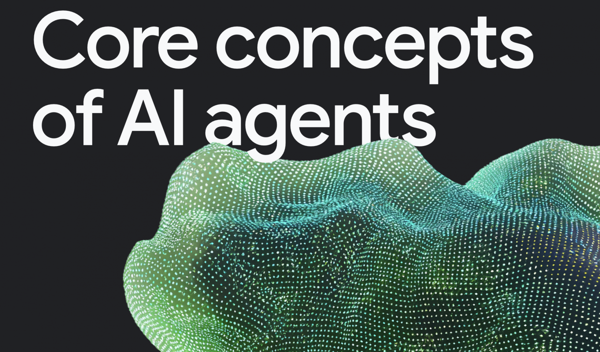
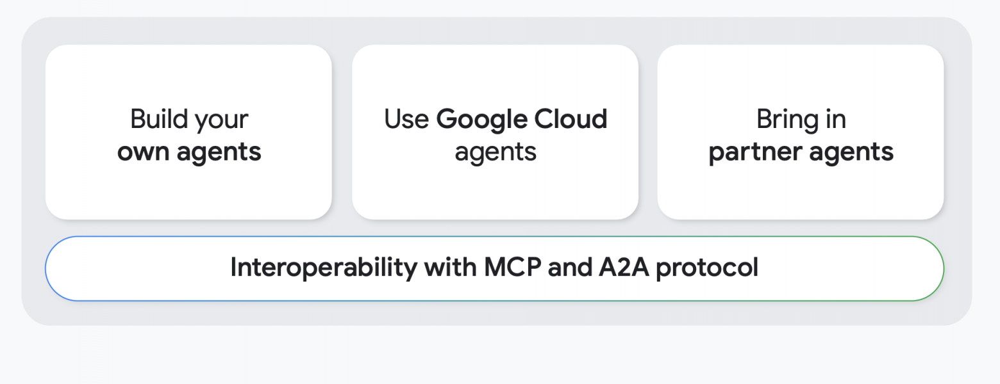
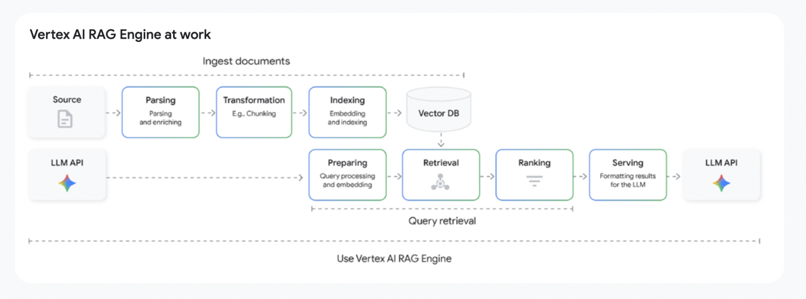
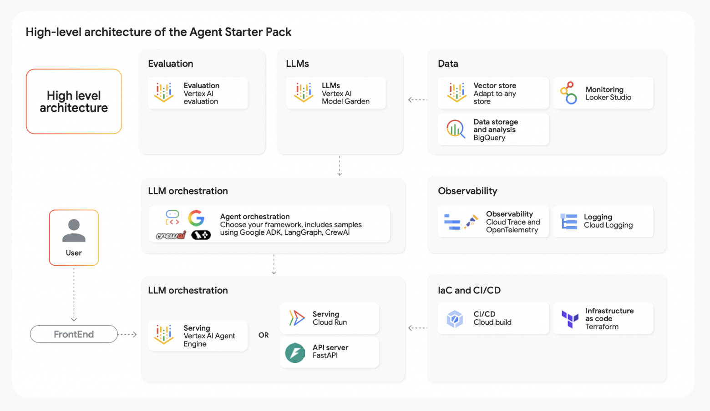
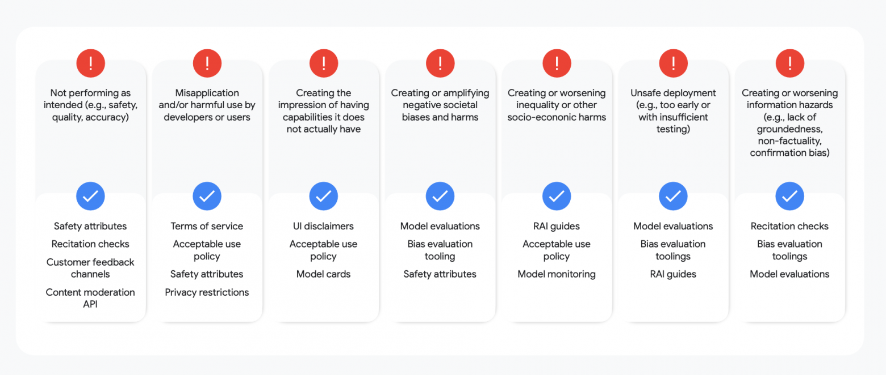

# Google ADK and "Startup Technical Guide: AI Agents": How Google is Redefining AI Agent Creation

**Author:** Mykhailo Kapustin (@kapustinomm)  
**Published on Habr:** October 5, 2025  
**Difficulty:** Easy | **Reading time:** 9 min | **Reach:** 5.3K

**Tags:** Google ADK, AI, Vertex AI, Google Cloud, Google App Engine  
**Hub:** Artificial Intelligence

When Google Cloud releases the "Startup Technical Guide: AI Agents" — this is not just another documentation drop, but a landmark event. Why? Because there is a lot of hype around AI agents right now, but until now there has been no comprehensive technical reference point.

This summer I already dove into the topic and even wrote [an article about Google ADK and integrating an AI agent into a custom UI](../google-adk-custom-interface/). But the new guide from Google is on a completely different level: 64 pages covering the entire journey from idea to production.

What makes it stand out? First, scale and depth — Google has invested the expertise of its teams to describe everything from architecture to AgentOps. Second, a focus on practical reliability — step by step, it describes how to turn an agent prototype into a robust system with monitoring, testing, and security. Third, a focus on the Google Cloud ecosystem — the guide shows how to use Vertex AI, Gemini, the Agent Development Kit (ADK), and other tools. The principles are also applicable more broadly — they will be useful to any LLM agent developer, even on alternative platforms.

After reading the entire document, I distilled five key insights.

## Insight 1: AI Agents Are Not Chatbots — A New Paradigm for Working with AI

The main point the guide drives home from the start: the "ask and receive an answer" approach is becoming a thing of the past. AI agents are the next step, where we give the model a complex goal, not a specific question. The agent plans and executes multi-step tasks, leveraging tools and external data.

Thomas Kurian (CEO of Google Cloud) aptly called agentic workflows the "new frontier," where AI could, for example, "plan a product launch or solve a supply chain problem" by executing all the necessary steps. This is a fundamental departure from conventional narrow bots: an agent is like your autonomous assistant, capable of reasoning, making decisions, and taking action.

As a developer, this emphasis is important. We often call any script with GPT wired to a couple of APIs an "AI agent." But Google sets a higher bar: an agent must adaptively achieve goals, not just respond by template.

## Insight 2: One LLM Is Not Enough — You Need the Full Stack of Infrastructure and Tools

Google emphasizes: you cannot build a serious AI agent by simply choosing a large language model. You need scalable infrastructure, data integration, and a well-thought-out architecture. Creating a production-grade agent requires far more than selecting an LLM.

Key agent components include: the model, tools for actions, orchestration logic (e.g., the ReAct pattern), memory for context, session storage mechanisms, and more.

The guide emphasizes "Automate workflows, not just conversations." For a small startup, building a "talking head" is not enough — you need to automate real business processes. The agent must integrate into your infrastructure: access your APIs, work with your data.

## Insight 3: Grounding — Teaching the Agent to Rely on Knowledge, Not Hallucinations

One of the favorite topics among LLM developers is how to combat model hallucinations and limited world knowledge. Google's answer: **Grounding**. The guide clearly distinguishes: fine-tuning is not grounding. Fine-tuning does not guarantee the accuracy and factuality of responses. Grounding connects the model to up-to-date, reliable data sources.

In practice, this means Retrieval-Augmented Generation (RAG) — before generating a response, the agent makes a search query or accesses your knowledge base to pull relevant facts. The guide describes the evolution from basic RAG to GraphRAG (leveraging data relationships through a knowledge graph) and even Agentic RAG, where the agent actively gathers information.

Google is essentially moving toward making the agent a proactive researcher — one that doesn't blindly trust its internal world but verifies hypotheses and refines data.

## Insight 4: AgentOps — Testing and Monitoring Instead of "Hope for the Best"

The strongest impression was made by the section on AgentOps — essentially MLOps for agents. Google honestly states: most agents fail in production not because of bad models, but because nobody does the "tedious" operational work.

The guide proposes a four-layer approach to agent evaluation:

1. **Component tests** — each tool and function is tested individually
2. **Trajectory checks** — what the agent does at each step
3. **Outcome checks** — how correct the final answers are
4. **System monitoring** — production observability

Google explicitly states that moving from improvised "vibe-testing" to a systematic, automated, and reproducible procedure is a competitive advantage.

The Agent Starter Pack from Google already includes Terraform templates, CI/CD configs, and scripts that bundle monitoring, testing, and deployment following best practices.

## Insight 5: Security and Ethics — Now Mandatory Requirements, Not an Option

The guide makes it unequivocally clear: when creating a powerful AI agent, you automatically take responsibility for its safety, data protection, and ethical behavior. It details the risks (toxic content, data leaks, prompt injection attacks) and the necessary countermeasures.

Google proposes a "defense-in-depth" approach:

- **Design with guardrails** — context filters, least-privilege tool restrictions from the start
- **Infrastructure protection** — isolated agent execution, IAM roles
- **Monitoring and auditing** — log every action, store logs in BigQuery, configure alerts
- **Guardrails** — automatic checks on incoming prompts and outgoing responses

The guide references Google's Secure AI Framework (SAIF) — an internal set of rules for secure AI development.

## Conclusion

After thoughtfully reading the guide, I felt like I was holding an attempt to codify a new industry standard. Google has done significant work structuring the experience of recent years: from early agent prototypes to mature, manageable systems.

Their message: "The path from prototype to production is disciplined engineering." Spontaneous experiments are fine for demos, but the future belongs to a methodical approach: well-considered architecture, continuous grounding to data, automated testing of every "thought step," and meticulous attention to security.

Why is this guide more than documentation? Because it establishes a common language and framework for all of us building AI agents. Just as DevOps once emerged as a set of practices, we are witnessing the birth of an analogous concept for AI agents — call it AgentOps.

## Sources

- [Startup Technical Guide: Building AI Agents with Google Cloud](https://services.google.com/fh/files/misc/startup_technical_guide_ai_agents_final.pdf)
- [How to Integrate Google ADK with a Custom Interface](../google-adk-custom-interface/)

---

[← Back to articles](../README.md)
