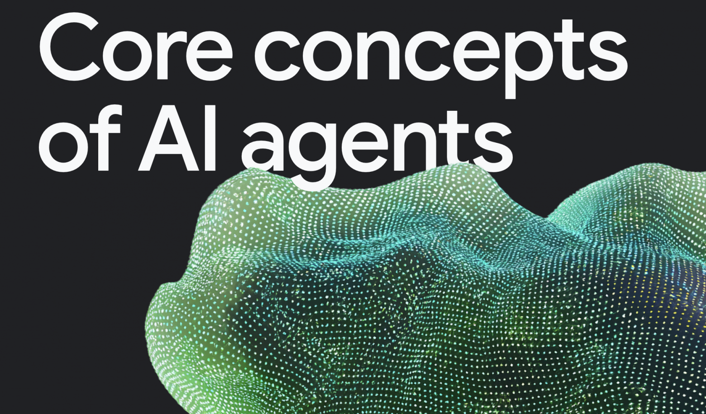
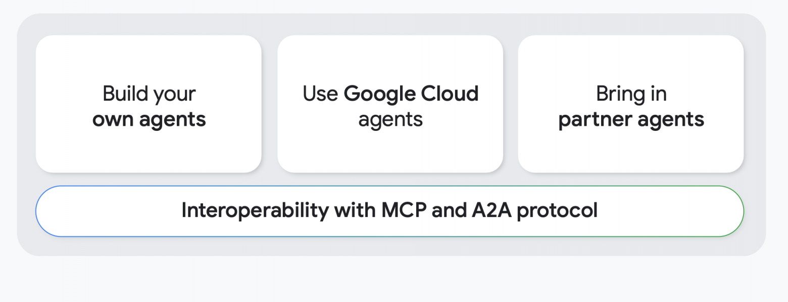
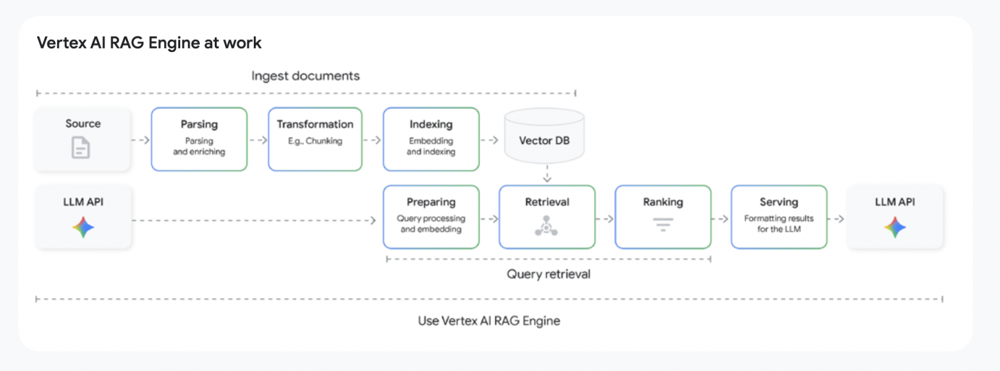
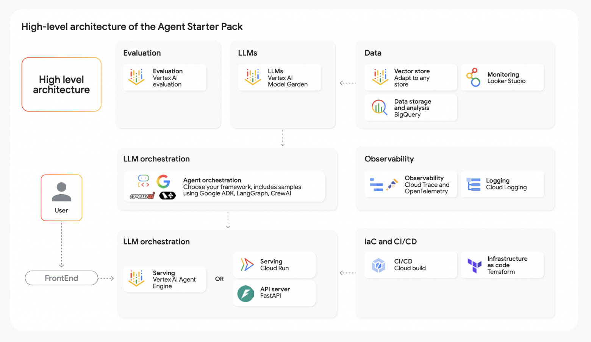
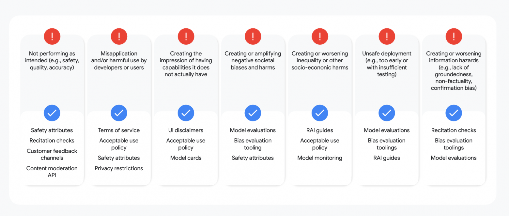

# Google ADK y "Startup Technical Guide: AI Agents": cómo Google está redefiniendo la creación de agentes de IA

**Autor:** Mykhailo Kapustin (@kapustinomm)  
**Publicado en Habr:** 5 de octubre de 2025  
**Dificultad:** Fácil | **Tiempo de lectura:** 9 min | **Alcance:** 5.3K

**Etiquetas:** Google ADK, IA, Vertex AI, Google Cloud, Google App Engine  
**Hub:** Inteligencia artificial

Cuando Google Cloud publica el "Startup Technical Guide: AI Agents", no se trata de otro lanzamiento de documentación más, sino de un acontecimiento importante. ¿Por qué? Porque ahora hay mucho hype alrededor de los agentes de IA, pero hasta ahora no existía un punto de referencia técnico completo.

Este verano ya profundicé en el tema e incluso escribí [un artículo sobre Google ADK y la integración de un agente de IA en una interfaz personalizada](../google-adk-custom-interface/). Pero la nueva guía de Google está a otro nivel: 64 páginas que cubren todo el recorrido, desde la idea hasta producción.

¿Qué la hace destacar? Primero, la escala y la profundidad: Google ha invertido la experiencia de sus equipos para describirlo todo, desde la arquitectura hasta AgentOps. Segundo, el foco en la fiabilidad práctica: paso a paso, explica cómo convertir un prototipo de agente en un sistema robusto con monitorización, pruebas y seguridad. Tercero, el foco en el ecosistema de Google Cloud: la guía muestra cómo usar Vertex AI, Gemini, Agent Development Kit (ADK) y otras herramientas. Los principios también se aplican de forma más amplia: serán útiles para cualquier desarrollador de agentes LLM, incluso en plataformas alternativas.

Después de leer todo el documento, extraje cinco ideas clave.

## Idea 1: Los agentes de IA no son chatbots: son un nuevo paradigma para trabajar con IA

El punto principal que la guía deja claro desde el principio es que el enfoque de "preguntar y recibir una respuesta" se está quedando atrás. Los agentes de IA son el siguiente paso, donde damos al modelo un objetivo complejo, no una pregunta específica. El agente planifica y ejecuta tareas de varios pasos, aprovechando herramientas y datos externos.

Thomas Kurian (CEO de Google Cloud) llamó acertadamente a los flujos de trabajo agentivos la "new frontier", donde la IA podría, por ejemplo, "planificar el lanzamiento de un producto o resolver un problema de cadena de suministro" ejecutando todos los pasos necesarios. Es una ruptura fundamental con los bots estrechos convencionales: un agente es como un asistente autónomo, capaz de razonar, tomar decisiones y actuar.

Como desarrollador, este énfasis es importante. A menudo llamamos "agente de IA" a cualquier script con GPT conectado a un par de APIs. Pero Google establece un listón más alto: un agente debe alcanzar objetivos de forma adaptativa, no solo responder con una plantilla.

## Idea 2: Un solo LLM no basta: necesitas todo el stack de infraestructura y herramientas

Google insiste: no se puede construir un agente de IA serio simplemente eligiendo un gran modelo de lenguaje. Se necesita infraestructura escalable, integración de datos y una arquitectura bien pensada. Crear un agente apto para producción requiere mucho más que seleccionar un LLM.

Los componentes clave de un agente incluyen: el modelo, herramientas para acciones, lógica de orquestación (por ejemplo, el patrón ReAct), memoria para el contexto, mecanismos de almacenamiento de sesiones y más.

La guía subraya: "Automate workflows, not just conversations." Para una startup pequeña, construir una "cabeza parlante" no es suficiente: hay que automatizar procesos de negocio reales. El agente debe integrarse en tu infraestructura: acceder a tus APIs y trabajar con tus datos.

## Idea 3: Grounding: enseñar al agente a apoyarse en conocimiento, no en alucinaciones

Uno de los temas favoritos entre los desarrolladores de LLM es cómo combatir las alucinaciones del modelo y su conocimiento limitado del mundo. La respuesta de Google: **Grounding**. La guía distingue claramente: el fine-tuning no es grounding. El fine-tuning no garantiza la precisión ni la factualidad de las respuestas. El grounding conecta el modelo con fuentes de datos actualizadas y fiables.

En la práctica, esto significa Retrieval-Augmented Generation (RAG): antes de generar una respuesta, el agente realiza una búsqueda o accede a tu base de conocimiento para extraer hechos relevantes. La guía describe la evolución desde RAG básico hasta GraphRAG (aprovechando relaciones de datos mediante un grafo de conocimiento) e incluso Agentic RAG, donde el agente recopila información activamente.

En esencia, Google avanza hacia convertir al agente en un investigador proactivo: uno que no confía ciegamente en su mundo interno, sino que verifica hipótesis y refina datos.

## Idea 4: AgentOps: pruebas y monitorización en lugar de "esperar que salga bien"

La sección sobre AgentOps causó la impresión más fuerte: en esencia, MLOps para agentes. Google lo dice con honestidad: la mayoría de los agentes fallan en producción no por malos modelos, sino porque nadie hace el trabajo operativo "tedioso".

La guía propone un enfoque de cuatro capas para evaluar agentes:

1. **Pruebas de componentes**: cada herramienta y función se prueba individualmente
2. **Comprobaciones de trayectoria**: qué hace el agente en cada paso
3. **Comprobaciones de resultado**: qué tan correctas son las respuestas finales
4. **Monitorización del sistema**: observabilidad en producción

Google afirma explícitamente que pasar de un "vibe-testing" improvisado a un procedimiento sistemático, automatizado y reproducible es una ventaja competitiva.

El Agent Starter Pack de Google ya incluye plantillas de Terraform, configuraciones CI/CD y scripts que agrupan monitorización, pruebas y despliegue siguiendo buenas prácticas.

## Idea 5: Seguridad y ética: ahora son requisitos obligatorios, no una opción

La guía deja algo inequívocamente claro: al crear un agente de IA potente, automáticamente asumes responsabilidad por su seguridad, la protección de datos y su comportamiento ético. Detalla los riesgos (contenido tóxico, fugas de datos, ataques de prompt injection) y las contramedidas necesarias.

Google propone un enfoque de "defense-in-depth":

- **Diseño con guardrails**: filtros de contexto y restricciones de herramientas con privilegios mínimos desde el inicio
- **Protección de infraestructura**: ejecución aislada del agente, roles IAM
- **Monitorización y auditoría**: registrar cada acción, almacenar logs en BigQuery, configurar alertas
- **Guardrails**: comprobaciones automáticas de prompts entrantes y respuestas salientes

La guía hace referencia al Secure AI Framework (SAIF) de Google, un conjunto interno de reglas para el desarrollo seguro de IA.

## Conclusión

Después de leer la guía con atención, sentí que tenía en mis manos un intento de codificar un nuevo estándar de la industria. Google ha hecho un trabajo importante estructurando la experiencia de los últimos años: desde los primeros prototipos de agentes hasta sistemas maduros y gestionables.

Su mensaje: "The path from prototype to production is disciplined engineering." Los experimentos espontáneos sirven para demos, pero el futuro pertenece a un enfoque metódico: arquitectura bien pensada, grounding continuo con datos, pruebas automatizadas de cada "paso de pensamiento" y una atención meticulosa a la seguridad.

¿Por qué esta guía es más que documentación? Porque establece un lenguaje común y un marco para todos los que construimos agentes de IA. Así como DevOps surgió una vez como un conjunto de prácticas, estamos presenciando el nacimiento de un concepto análogo para los agentes de IA: llamémoslo AgentOps.

## Fuentes

- [Startup Technical Guide: Building AI Agents with Google Cloud](https://services.google.com/fh/files/misc/startup_technical_guide_ai_agents_final.pdf)
- [How to Integrate Google ADK with a Custom Interface](../google-adk-custom-interface/)

---

[← Back to articles](../README.md)
