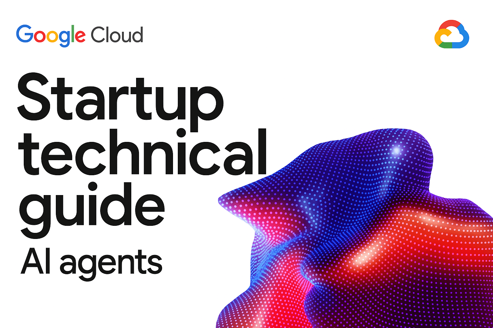
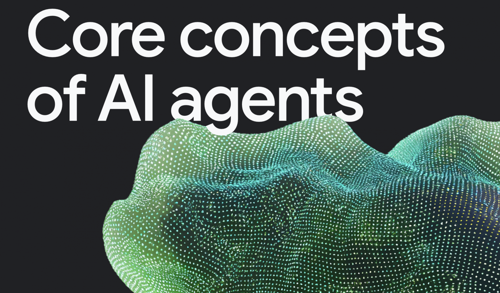
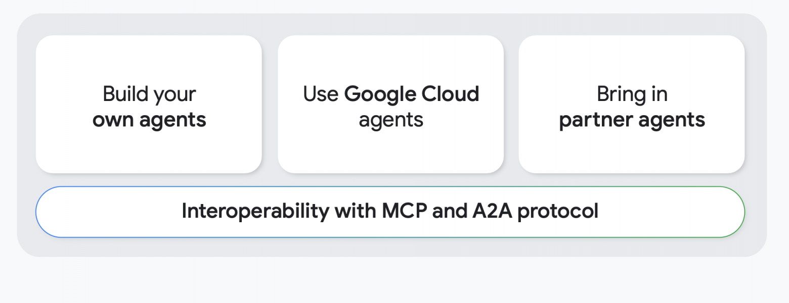
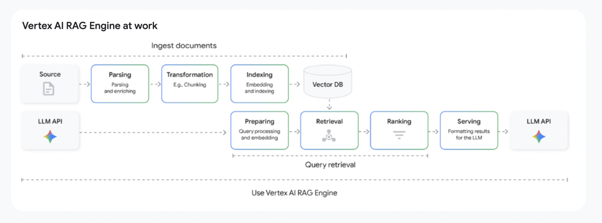
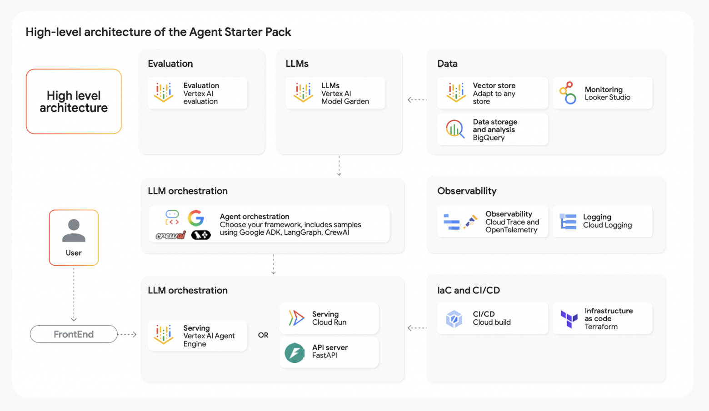
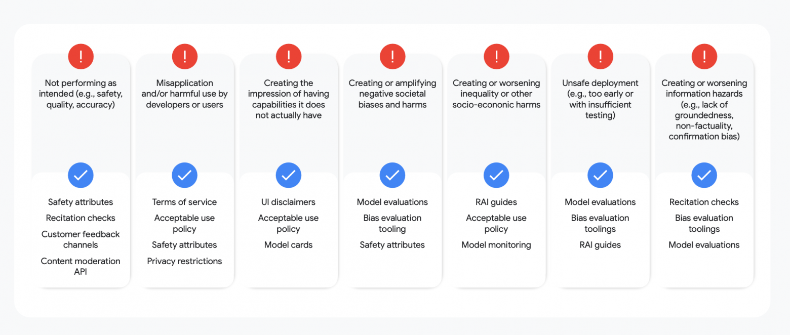

# Google ADK и "Startup Technical Guide: AI Agents": как Google переопределяет создание AI-агентов

**Автор:** Mykhailo Kapustin (@kapustinomm)  
**Опубликовано на Habr:** 5 октября 2025  
**Сложность:** лёгкая | **Время чтения:** 9 мин | **Охват:** 5.3K

**Теги:** Google ADK, AI, Vertex AI, Google Cloud, Google App Engine  
**Хаб:** Artificial Intelligence

Когда Google Cloud выпускает "Startup Technical Guide: AI Agents", это не просто очередной документ, а заметное событие. Почему? Потому что вокруг AI-агентов сейчас много хайпа, но до последнего времени не было цельной технической точки опоры.

Этим летом я уже глубоко погружался в тему и даже написал [статью о Google ADK и интеграции AI-агента в custom UI](../google-adk-custom-interface/). Но новый guide от Google — это совершенно другой уровень: 64 страницы, которые закрывают весь путь от идеи до production.

Чем он выделяется? Во-первых, масштабом и глубиной: Google вложил экспертизу своих команд, чтобы описать всё — от архитектуры до AgentOps. Во-вторых, фокусом на практической надёжности: шаг за шагом показано, как превратить прототип агента в устойчивую систему с мониторингом, тестированием и безопасностью. В-третьих, вниманием к экосистеме Google Cloud: guide показывает, как использовать Vertex AI, Gemini, Agent Development Kit (ADK) и другие инструменты. При этом принципы применимы шире — они будут полезны любому разработчику LLM-агентов, даже на альтернативных платформах.

После прочтения всего документа я выделил пять ключевых идей.

## Идея 1: AI-агенты — это не чатботы, а новая парадигма работы с AI

Главная мысль, которую guide проводит с самого начала: подход "задать вопрос и получить ответ" уходит в прошлое. AI-агенты — следующий шаг, где мы даём модели сложную цель, а не конкретный вопрос. Агент планирует и выполняет многошаговые задачи, используя инструменты и внешние данные.

Thomas Kurian (CEO Google Cloud) точно назвал agentic workflows "new frontier", где AI может, например, "спланировать запуск продукта или решить проблему цепочки поставок", выполнив все необходимые шаги. Это принципиальный отход от привычных узких ботов: агент похож на автономного помощника, способного рассуждать, принимать решения и действовать.

Для разработчика этот акцент важен. Мы часто называем "AI-агентом" любой скрипт, где GPT подключён к паре API. Но Google задаёт более высокую планку: агент должен адаптивно достигать целей, а не просто отвечать по шаблону.

## Идея 2: одного LLM недостаточно — нужен полный стек инфраструктуры и инструментов

Google подчёркивает: серьёзного AI-агента нельзя построить, просто выбрав большую языковую модель. Нужны масштабируемая инфраструктура, интеграция данных и продуманная архитектура. Создание production-grade агента требует гораздо большего, чем выбор LLM.

Ключевые компоненты агента включают модель, инструменты для действий, логику оркестрации (например, паттерн ReAct), память для контекста, механизмы хранения сессий и многое другое.

Guide подчёркивает: "Automate workflows, not just conversations." Для небольшого стартапа недостаточно построить "говорящую голову" — нужно автоматизировать реальные бизнес-процессы. Агент должен интегрироваться в вашу инфраструктуру: получать доступ к вашим API и работать с вашими данными.

## Идея 3: Grounding — учим агента опираться на знания, а не на галлюцинации

Одна из любимых тем среди LLM-разработчиков — как бороться с галлюцинациями модели и ограниченностью её знаний о мире. Ответ Google: **Grounding**. Guide ясно разделяет: fine-tuning — это не grounding. Fine-tuning не гарантирует точность и фактичность ответов. Grounding подключает модель к актуальным и надёжным источникам данных.

На практике это означает Retrieval-Augmented Generation (RAG): перед генерацией ответа агент делает поисковый запрос или обращается к вашей базе знаний, чтобы извлечь релевантные факты. Guide описывает эволюцию от базового RAG к GraphRAG (использованию связей данных через knowledge graph) и даже к Agentic RAG, где агент активно собирает информацию.

Фактически Google движется к тому, чтобы агент становился проактивным исследователем: он не слепо доверяет своему внутреннему миру, а проверяет гипотезы и уточняет данные.

## Идея 4: AgentOps — тестирование и мониторинг вместо "надеемся на лучшее"

Самое сильное впечатление произвёл раздел об AgentOps — по сути MLOps для агентов. Google честно говорит: большинство агентов ломаются в production не из-за плохих моделей, а потому что никто не делает "скучную" операционную работу.

Guide предлагает четырёхуровневый подход к оценке агентов:

1. **Component tests** — каждый инструмент и функция тестируются отдельно.
2. **Trajectory checks** — проверяется, что агент делает на каждом шаге.
3. **Outcome checks** — оценивается корректность финальных ответов.
4. **System monitoring** — production observability.

Google прямо говорит, что переход от импровизированного "vibe-testing" к систематической, автоматизированной и воспроизводимой процедуре — это конкурентное преимущество.

Agent Starter Pack от Google уже включает Terraform templates, CI/CD configs и scripts, которые объединяют мониторинг, тестирование и deployment по best practices.

## Идея 5: безопасность и этика — теперь обязательные требования, а не опция

Guide однозначно показывает: создавая мощного AI-агента, вы автоматически берёте ответственность за его безопасность, защиту данных и этичное поведение. В документе подробно разобраны риски (токсичный контент, утечки данных, prompt injection attacks) и необходимые контрмеры.

Google предлагает подход "defense-in-depth":

- **Design with guardrails** — контекстные фильтры и ограничения инструментов по принципу least privilege с самого начала.
- **Infrastructure protection** — изолированное выполнение агентов, IAM roles.
- **Monitoring and auditing** — логирование каждого действия, хранение логов в BigQuery, настройка alerts.
- **Guardrails** — автоматические проверки входящих prompts и исходящих responses.

Guide ссылается на Google's Secure AI Framework (SAIF) — внутренний набор правил для безопасной разработки AI.

## Заключение

После вдумчивого прочтения guide у меня возникло ощущение, что я держу в руках попытку кодифицировать новый индустриальный стандарт. Google проделал большую работу по структурированию опыта последних лет: от ранних прототипов агентов до зрелых управляемых систем.

Их message: "Путь от прототипа к production — это дисциплинированная инженерия." Спонтанные эксперименты хороши для demo, но будущее принадлежит методичному подходу: продуманной архитектуре, постоянному grounding на данные, автоматическому тестированию каждого "шага мысли" и внимательному отношению к безопасности.

Почему этот guide — больше, чем документация? Потому что он задаёт общий язык и framework для всех, кто строит AI-агентов. Так же, как когда-то DevOps появился как набор практик, сейчас мы наблюдаем рождение аналогичной концепции для AI-агентов — назовём её AgentOps.

## Источники

- [Startup Technical Guide: Building AI Agents with Google Cloud](https://services.google.com/fh/files/misc/startup_technical_guide_ai_agents_final.pdf)
- [How to Integrate Google ADK with a Custom Interface](../google-adk-custom-interface/)

---

[← Назад к статьям](../README.md)
