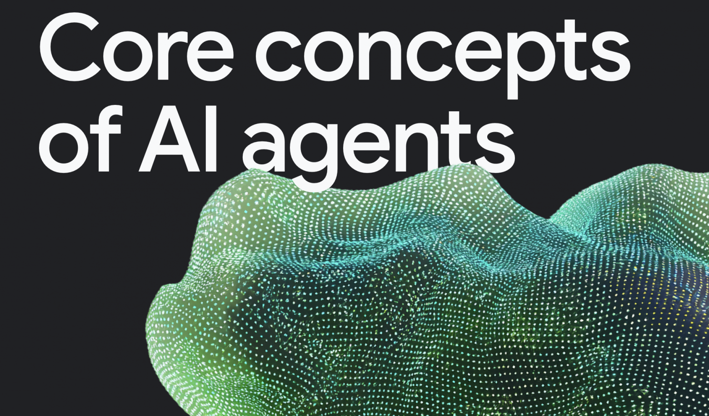
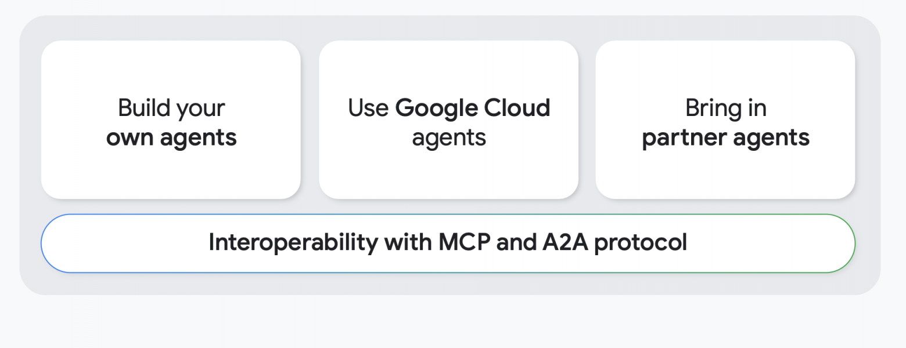
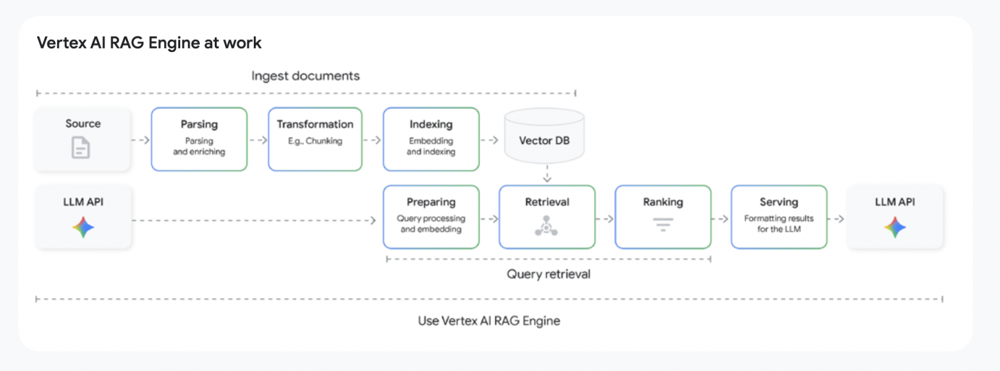
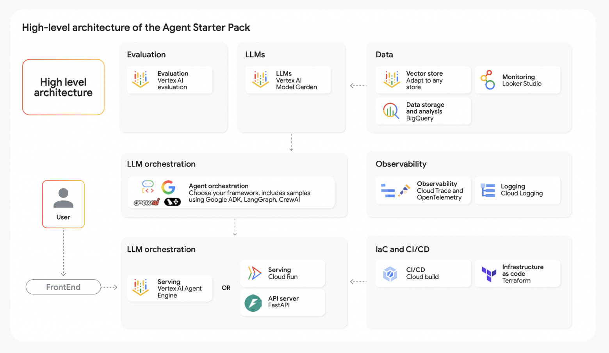
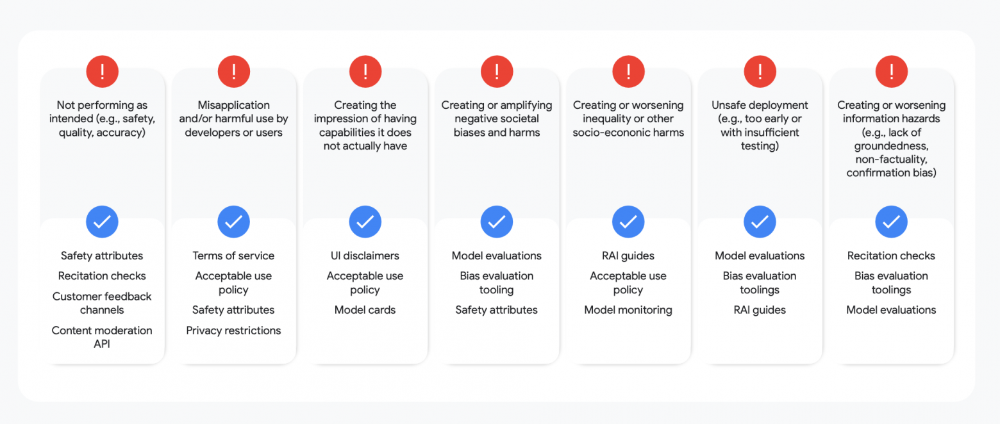

# Google ADK і "Startup Technical Guide: AI Agents": як Google переосмислює створення AI-агентів

**Автор:** Mykhailo Kapustin (@kapustinomm)  
**Опубліковано на Habr:** 5 жовтня 2025  
**Складність:** легка | **Час читання:** 9 хв | **Охоплення:** 5.3K

**Теги:** Google ADK, AI, Vertex AI, Google Cloud, Google App Engine  
**Хаб:** Artificial Intelligence

Коли Google Cloud випускає "Startup Technical Guide: AI Agents", це не просто черговий документ, а помітна подія. Чому? Тому що навколо AI-агентів зараз багато хайпу, але до останнього часу не було цілісної технічної точки опори.

Цього літа я вже глибоко занурювався в тему й навіть написав [статтю про Google ADK та інтеграцію AI-агента в custom UI](../google-adk-custom-interface/). Але новий guide від Google — це зовсім інший рівень: 64 сторінки, які закривають увесь шлях від ідеї до production.

Чим він вирізняється? По-перше, масштабом і глибиною: Google вклав експертизу своїх команд, щоб описати все — від архітектури до AgentOps. По-друге, фокусом на практичній надійності: крок за кроком показано, як перетворити прототип агента на стійку систему з моніторингом, тестуванням і безпекою. По-третє, увагою до екосистеми Google Cloud: guide показує, як використовувати Vertex AI, Gemini, Agent Development Kit (ADK) та інші інструменти. Водночас принципи застосовні ширше — вони будуть корисні будь-якому розробнику LLM-агентів, навіть на альтернативних платформах.

Після прочитання всього документа я виділив п'ять ключових ідей.

## Ідея 1: AI-агенти — це не чатботи, а нова парадигма роботи з AI

Головна думка, яку guide проводить із самого початку: підхід "поставити запитання й отримати відповідь" відходить у минуле. AI-агенти — наступний крок, де ми даємо моделі складну ціль, а не конкретне запитання. Агент планує і виконує багатокрокові задачі, використовуючи інструменти та зовнішні дані.

Thomas Kurian (CEO Google Cloud) влучно назвав agentic workflows "new frontier", де AI може, наприклад, "спланувати запуск продукту або розв'язати проблему ланцюга постачання", виконавши всі необхідні кроки. Це принциповий відхід від звичних вузьких ботів: агент схожий на автономного помічника, здатного міркувати, ухвалювати рішення й діяти.

Для розробника цей акцент важливий. Ми часто називаємо "AI-агентом" будь-який скрипт, де GPT підключений до кількох API. Але Google задає вищу планку: агент має адаптивно досягати цілей, а не просто відповідати за шаблоном.

## Ідея 2: одного LLM недостатньо — потрібен повний стек інфраструктури та інструментів

Google підкреслює: серйозного AI-агента не можна побудувати, просто обравши велику мовну модель. Потрібні масштабована інфраструктура, інтеграція даних і продумана архітектура. Створення production-grade агента вимагає значно більшого, ніж вибір LLM.

Ключові компоненти агента включають модель, інструменти для дій, логіку оркестрації (наприклад, патерн ReAct), пам'ять для контексту, механізми зберігання сесій та багато іншого.

Guide підкреслює: "Automate workflows, not just conversations." Для невеликого стартапу недостатньо побудувати "говорячу голову" — потрібно автоматизувати реальні бізнес-процеси. Агент має інтегруватися у вашу інфраструктуру: отримувати доступ до ваших API і працювати з вашими даними.

## Ідея 3: Grounding — навчаємо агента спиратися на знання, а не на галюцинації

Одна з улюблених тем серед LLM-розробників — як боротися з галюцинаціями моделі та обмеженістю її знань про світ. Відповідь Google: **Grounding**. Guide чітко розділяє: fine-tuning — це не grounding. Fine-tuning не гарантує точність і фактичність відповідей. Grounding підключає модель до актуальних і надійних джерел даних.

На практиці це означає Retrieval-Augmented Generation (RAG): перед генерацією відповіді агент робить пошуковий запит або звертається до вашої бази знань, щоб витягти релевантні факти. Guide описує еволюцію від базового RAG до GraphRAG (використання зв'язків даних через knowledge graph) і навіть до Agentic RAG, де агент активно збирає інформацію.

Фактично Google рухається до того, щоб агент ставав проактивним дослідником: він не сліпо довіряє своєму внутрішньому світу, а перевіряє гіпотези й уточнює дані.

## Ідея 4: AgentOps — тестування і моніторинг замість "сподіваємося на краще"

Найсильніше враження справив розділ про AgentOps — по суті MLOps для агентів. Google чесно говорить: більшість агентів ламаються в production не через погані моделі, а тому що ніхто не робить "нудну" операційну роботу.

Guide пропонує чотирирівневий підхід до оцінювання агентів:

1. **Component tests** — кожен інструмент і функція тестуються окремо.
2. **Trajectory checks** — перевіряється, що агент робить на кожному кроці.
3. **Outcome checks** — оцінюється коректність фінальних відповідей.
4. **System monitoring** — production observability.

Google прямо говорить, що перехід від імпровізованого "vibe-testing" до систематичної, автоматизованої та відтворюваної процедури — це конкурентна перевага.

Agent Starter Pack від Google уже включає Terraform templates, CI/CD configs і scripts, які об'єднують моніторинг, тестування та deployment за best practices.

## Ідея 5: безпека й етика — тепер обов'язкові вимоги, а не опція

Guide однозначно показує: створюючи потужного AI-агента, ви автоматично берете відповідальність за його безпеку, захист даних та етичну поведінку. У документі докладно розібрані ризики (токсичний контент, витоки даних, prompt injection attacks) і необхідні контрзаходи.

Google пропонує підхід "defense-in-depth":

- **Design with guardrails** — контекстні фільтри й обмеження інструментів за принципом least privilege із самого початку.
- **Infrastructure protection** — ізольоване виконання агентів, IAM roles.
- **Monitoring and auditing** — логування кожної дії, зберігання логів у BigQuery, налаштування alerts.
- **Guardrails** — автоматичні перевірки вхідних prompts і вихідних responses.

Guide посилається на Google's Secure AI Framework (SAIF) — внутрішній набір правил для безпечної розробки AI.

## Висновок

Після вдумливого прочитання guide в мене виникло відчуття, що я тримаю в руках спробу кодифікувати новий індустріальний стандарт. Google виконав велику роботу зі структурування досвіду останніх років: від ранніх прототипів агентів до зрілих керованих систем.

Їхній message: "Шлях від прототипу до production — це дисциплінована інженерія." Спонтанні експерименти хороші для demo, але майбутнє належить методичному підходу: продуманій архітектурі, постійному grounding на дані, автоматичному тестуванню кожного "кроку думки" й уважному ставленню до безпеки.

Чому цей guide — більше, ніж документація? Тому що він задає спільну мову і framework для всіх, хто будує AI-агентів. Так само, як колись DevOps з'явився як набір практик, зараз ми спостерігаємо народження аналогічної концепції для AI-агентів — назвімо її AgentOps.

## Джерела

- [Startup Technical Guide: Building AI Agents with Google Cloud](https://services.google.com/fh/files/misc/startup_technical_guide_ai_agents_final.pdf)
- [How to Integrate Google ADK with a Custom Interface](../google-adk-custom-interface/)

---

[← Назад до статей](../README.md)
