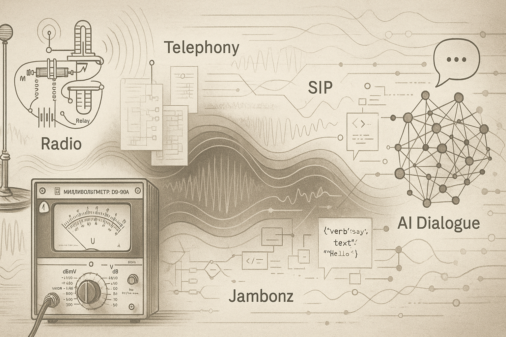

[← Technical Articles](../README.md)

# Voice AI Systems Powered by Jambonz: From Telephony to Human–Machine Dialogue

*October 2025*

An exploration of how telephony evolves into programmable Voice AI. This article explains the technical flow from PSTN to SIP, Jambonz, and backend logic — showing how developers can build intelligent voice agents that connect human speech with artificial intelligence.

**Links:** [Habr](https://habr.com/en/articles/958670/) | [Original on Arcanum12th](https://arcanum12th.education/ru/documents/b84ee790-effe-42f8-8ae8-dba899b3650e)

**Full text:** [article.md](article.md)

**Tags:** llm, communication, agents, ai, jambonz

---

[← Technical Articles](../README.md)

Meta: [meta.yaml](meta.yaml)
