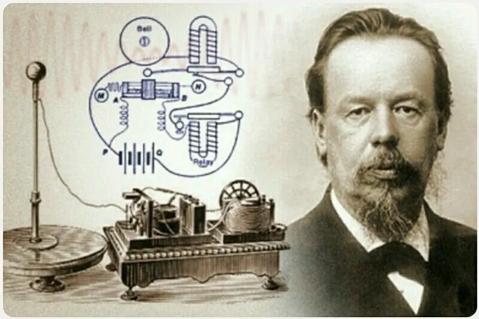
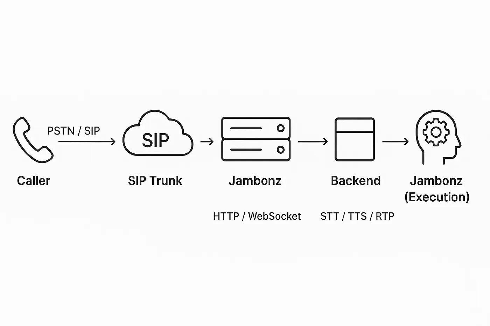

# Voice-AI-Systeme mit Jambonz: Von der Telefonie zum Mensch-Maschine-Dialog

*Von Popovs Radioexperimenten zu KI-Anrufen: Wie Telefonie zur Grundlage intelligenter Kommunikation wurde*

*21. Oktober 2025*

---

Telefonie ist längst nicht mehr nur Sprachkommunikation.
Heute ist sie zu einer digitalen Infrastruktur geworden, in der Anrufe analysiert, programmatisch gesteuert und mit künstlicher Intelligenz erweitert werden können.
So wird aus einem gewöhnlichen Gespräch ein Dialog zwischen Mensch und System: live, personalisiert und datengetrieben.

Ich habe meinen Abschluss an der Odesa National Academy of Telecommunications namens A. S. Popov gemacht, wo ich Signalphysik, Frequenzen und Vermittlungsprinzipien studierte.
Damals wirkte das wie reine Ingenieurarbeit: Berechnungen, Schaltpläne und Laborinstrumente.
Doch heute bilden dieselben Prinzipien die Grundlage von Voice-AI-Systemen, in denen Stimme zu einem Datenstrom wird und Kommunikationslogik zu Code.


*Auf dem Foto: das Gebäude der Odesa National Academy of Telecommunications.*

Mein Name ist Mykhailo Kapustin, und ich bin CTO und Mitgründer der transatlantischen Forschungsholding Advanced Scientific Research Projects.
Wir betreiben angewandte Forschung in künstlicher Intelligenz, Brain-Computer Interfaces (BCI) und kognitiven Technologien, darunter Traumanalyse und Modellierung menschlicher Wahrnehmung.

Heute nähern wir uns der Ära der Neurointerfaces (BCI), in der Kommunikation direkt stattfinden könnte: von Geist zu Geist.
Ich glaube, dass in Zukunft Systeme digitaler Telepathie entstehen könnten, die Gedanken direkt in das Gedächtnis des Empfängers übertragen, oder dass sich die Menschheit selbst in Richtung dieser Fähigkeit entwickelt.

Doch das Wesen der Kommunikation wird gleich bleiben: Sie beruht weiterhin auf dem Austausch von Bedeutung und dem Routing von Signalen zwischen Bewusstseinen.
Telefonie erfüllt diese Rolle bereits heute, nur arbeitet sie statt mit neuronalen Impulsen mit Stimme, Protokollen und Code.


*Alexander Stepanovich Popov, der Erfinder des Radios und einer der Begründer moderner Kommunikation.*
*Im Hintergrund: der Schaltplan und der erste Funkempfänger, demonstriert am 7. Mai 1895.*

Bevor wir zum praktischen Teil übergehen und zeigen, wie man einen Voice-AI-Agenten baut, zerlegen wir zuerst, woraus Telefonie besteht: was PSTN, SIP und SIP-Trunks sind und warum Jambonz zur zentralen Brücke zwischen klassischer Telekommunikation und künstlicher Intelligenz geworden ist.

### Anrufer (PSTN / SIP): Wo die Stimme beginnt

Jeder Sprachanruf beginnt mit dem Anrufer, also der Partei, die den Anruf initiiert.
Das kann ein Mobiltelefon, ein Festnetztelefon oder ein VoIP-Client sein: eine Softwareanwendung, die Sprache über das Internet überträgt (zum Beispiel Zoom, Microsoft Teams, Telegram oder Enterprise-Kommunikationstools).

Von dort hängt alles davon ab, welches Netzwerk das Signal transportiert:

- **PSTN (Public Switched Telephone Network)**: das traditionelle Telefonnetz für Standardanrufe. Es bietet stabile Verbindungen, ist aber nicht für direkte Integration mit digitalen Systemen ausgelegt.
- **SIP (Session Initiation Protocol)**: ein Protokoll, das Sprache in ein digitales Format umwandelt und die Übertragung über das Internet ermöglicht (Voice over IP). Es verwaltet Verbindungsaufbau, Routing und Beendigung von Anrufen.

Um diese beiden Welten, analog (PSTN) und digital (SIP), zu verbinden, wird ein SIP-Trunk verwendet.
Er wirkt wie ein virtueller Kanal, über den Anrufe aus dem traditionellen Telefonnetz in ein internetbasiertes System wie Jambonz gelangen.
Der SIP-Trunk dient als Schnittstelle zwischen dem Telekommunikationsanbieter und deiner Anwendung: Er empfängt den Anruf, wandelt ihn in eine SIP-Session um und übergibt dann die Kontrolle an Jambonz, wo die Anruflogik programmatisch verarbeitet wird.

## Überblick über den Call Flow

### 1. Anrufer

Der Nutzer initiiert einen Anruf von einem Telefon oder VoIP-Client.

**Protokoll:** PSTN oder SIP

**Ergebnis:** Das Sprachsignal wird ins Netzwerk gesendet.

### 2. SIP-Trunk

Der Anruf gelangt über einen virtuellen Kanal des Telekommunikationsanbieters in die digitale Umgebung.

**Protokoll:** SIP

**Ergebnis:** Der Anruf wird in eine SIP-Session umgewandelt.

### 3. Jambonz

Jambonz empfängt den Anruf, erstellt eine Session und sendet einen Webhook an deine Anwendung.

**Protokolle:** SIP / HTTP

**Ergebnis:** Das Anrufereignis wird an den Backend-Service geliefert.

### 4. Backend

Das Backend verarbeitet das Ereignis und gibt eine JSON-Antwort mit Anrufanweisungen (Verbs) zurück.

**Protokolle:** HTTP / WebSocket

**Ergebnis:** Die Gesprächslogik wird definiert.

### 5. Jambonz (Ausführung)

Führt die Verbs aus: Sprachsynthese, Audioerfassung und Routing.

**Protokolle:** STT / TTS / RTP

**Ergebnis:** Der Nutzer hört die KI-generierte Antwort.

Diese Sequenz zeigt den vollständigen Weg eines Sprachanrufs: vom Anrufer bis zur KI-gestützten Verarbeitung und Antwort.
Das folgende Diagramm zeigt, wie diese Komponenten auf Protokoll- und Datenflussebene interagieren:


*Abbildung 1. Voice Call Flow: vom Anrufer zur KI-Antwort über SIP, Jambonz und das Backend-System.*

### Was ist Jambonz und warum ist es wichtig?

Nachdem ein Anruf PSTN, SIP und den SIP-Trunk durchlaufen hat, wird die Kontrolle an Jambonz übergeben: eine Plattform, die Telefonanrufe programmierbar macht.
Jambonz wird verwendet, um Voice-AI-Anwendungen zu bauen, bei denen Anrufe auf Code-Ebene behandelt werden: empfangen, geroutet, in Text umgewandelt, per TTS gesprochen und mit externen KI-Modellen verbunden.

Die Plattform ist offen und flexibel: Sie unterstützt beliebige SIP-Trunks, STT/TTS-Dienste und LLM-Anbieter, sodass Entwickler eigene Voice-Pipelines bauen können.
Die Interaktion zwischen Jambonz und der Anwendung erfolgt über Webhooks oder WebSocket-Verbindungen: Das System sendet Anrufereignisse, und das Backend antwortet mit JSON-Anweisungen, die das Verhalten des Anrufs definieren.

Als ich Telefonie zum ersten Mal studierte, fühlte es sich ähnlich an wie die Arbeit mit analogen Messinstrumenten.
In unseren Laboren zeichneten wir Signale mit Millivoltmetern auf, analysierten verzerrte Wellenformen und zeichneten Vermittlungsschaltungen auf große Papierbögen.
Damals gab es keine Cloud-APIs, aber die Prinzipien waren dieselben: messen, übertragen, verarbeiten, interpretieren.

Heute leben dieselben Prinzipien in digitaler Form weiter: Nur nutzen wir statt Kabeln und Oszilloskopen SIP-Streams, Webhooks und LLM-Modelle.


*Foto: Labor-Millivoltmeter V3-38A, Odesa National Academy of Telecommunications*


*Foto: Schaltpläne, eine traditionelle Praxis der technischen Signalanalyse*

Die Prinzipien bleiben jedoch dieselben: Nur verwalten wir jetzt statt analoger Schaltungen Datenströme.
Jambonz ermöglicht es, diese Prozesse nicht über Verdrahtungspläne, sondern über deklarative Befehle namens Verbs zu beschreiben.
Diese Verbs definieren das Verhalten eines Sprachanrufs: wann abgehoben wird, was gesagt wird und wie KI in das Gespräch eingebunden wird.

### Wichtige Befehle (Verbs) in Jambonz

Jedes Verb steht für eine bestimmte Aktion: einen Anruf annehmen, Sprache abspielen, Spracheingaben erkennen, Teilnehmer verbinden oder das Gespräch beenden.
Durch die Kombination von Verbs in einem JSON-Skript können Entwickler das Anrufverhalten von Anfang bis Ende vollständig definieren.

## Wichtige Befehlskategorien in Jambonz

### 1. Anrufsteuerung

`answer`, `hangup`, `redirect`, `pause`

Einen Anruf behandeln, beenden oder umleiten.

### 2. Sprache & Audio

`say`, `play`, `gather`, `listen`, `transcribe`, `synthesizer`

Sprachsynthese durchführen, Audio abspielen, Sprache sammeln und erkennen.

### 3. KI- & NLP-Integration

`LLM`, `Dialogflow`, `Rasa`

Externe KI- oder Conversational-Plattformen anbinden.

### 4. Verbindungsmanagement

`dial`, `conference`, `enqueue`, `dequeue`, `leave`

Teilnehmer verbinden, Konferenzen und Warteschlangen organisieren.

### 5. SIP-Steuerung

`sip-decline`, `sip-refer`, `sip-request`

Low-Level-SIP-Sessions verwalten.

### 6. Service-Befehle

`tag`, `config`, `alert`

Metadaten hinzufügen, Parameter konfigurieren oder Alerts senden.

### Eine KI-gestützte Voice-Anwendung bauen

Nachdem wir untersucht haben, wie Telefoniearchitektur funktioniert und welche Rolle Jambonz darin spielt, können wir zum interessantesten Teil übergehen: der praktischen KI-Integration in einen Sprachanruf.
Unten steht ein Basisszenario, das die Grundlage für die meisten Voice-AI-Anwendungen bildet.

### 1. Eingehender Anruf und Ereignisbehandlung

Wenn ein Nutzer anruft, empfängt Jambonz den Anruf über SIP und triggert dein Backend, indem es einen Webhook mit Anrufdetails sendet: Nummer, Zeitstempel, Session-ID (`call_sid`) und Richtung.
Das Backend antwortet mit einem JSON-Szenario, das angibt, was als Nächstes passieren soll.

Ein einfaches Beispiel ist, den Nutzer zu begrüßen und mit dem Zuhören zu beginnen:

```javascript
app.post('/webhooks/call', (req, res) => {
  res.json([
    { verb: 'say', text: 'Hello. Please describe your dream.' },
    { verb: 'gather', input: ['speech'], actionHook: '/webhooks/gather' }
  ]);
});
```

- `say`: erzeugt Sprache mit TTS
- `gather`: aktiviert Spracherkennung (STT) und wartet auf die Antwort des Nutzers

### 2. Sprachverarbeitung und KI-Integration

Wenn der Nutzer spricht, sendet Jambonz den erkannten Text über den `actionHook` an dein Backend.
Dann kannst du ein beliebiges LLM-Modell (z. B. GPT oder Gemini) aufrufen, um eine Antwort zu generieren:

```javascript
app.post('/webhooks/gather', async (req, res) => {
  const userInput = req.body.speech.transcript;
  const reply = await ai.generate(userInput); // LLM API call
  res.json([
    { verb: 'say', text: reply },
    { verb: 'gather', input: ['speech'], actionHook: '/webhooks/gather' }
  ]);
});
```

So entsteht eine Dialogschleife: Jambonz spricht zum Nutzer zurück, während die KI den Inhalt des Gesprächs steuert.

### 3. Den Anruf beenden

Wenn das Gespräch vorbei ist, kann das Backend finale Befehle zurückgeben:

```javascript
res.json([
  { verb: 'say', text: 'Thank you for the conversation. Goodbye.' },
  { verb: 'hangup' }
]);
```

### 4. Kernkomponenten und Protokolle

- **SIP / RTP**: Signal und Audio übertragen
- **HTTP / WebSocket**: Kommunikation zwischen Jambonz und deiner App verwalten
- **STT / TTS**: Sprache in Text und zurück umwandeln
- **LLM API**: erzeugt semantische Antworten

Diese Architektur erlaubt es, das gesamte Anrufverhalten im Code zu beschreiben und die Logik an konkrete Anwendungsfälle anzupassen: Support, Beratung, Forschungssitzungen oder interaktive Interviews.

### Fazit

Heute verwalten wir Anrufe so, wie frühe Ingenieure Radiowellen verwalteten: Nur lebt der Schaltplan jetzt in einer JSON-Datei, und die Antenne ist zu einem LLM geworden.

Darin liegt etwas Poetisches: Jede Kommunikationstechnologie, vom Radio bis zu Brain-Computer Interfaces, verfolgt dasselbe Ziel: hören und verstanden werden.

Jambonz zeigt, wie zeitlose Kommunikationsprinzipien sich weiterentwickeln können: Dort wird Stimme zu Code, und Code wird Teil eines lebendigen Gesprächs.

---

### Quellen

- [Medium article](https://medium.com/@kapustinomm/voice-ai-systems-powered-by-jambonz-from-telephony-to-human-machine-dialogue-37f31796fae2)
- [Original article on Arcanum12th](https://arcanum12th.education/ru/documents/b84ee790-effe-42f8-8ae8-dba899b3650e)
- [Jambonz Official Site](https://www.jambonz.org/)
