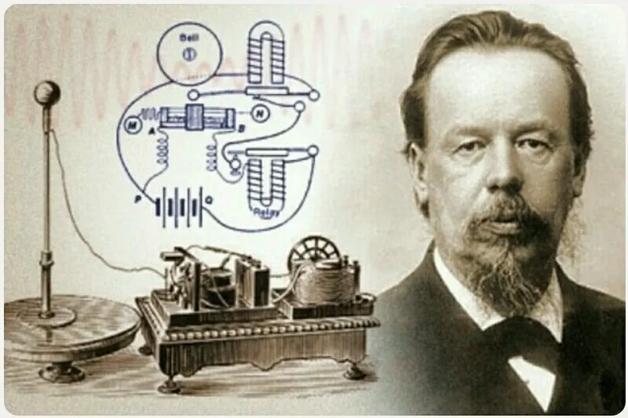
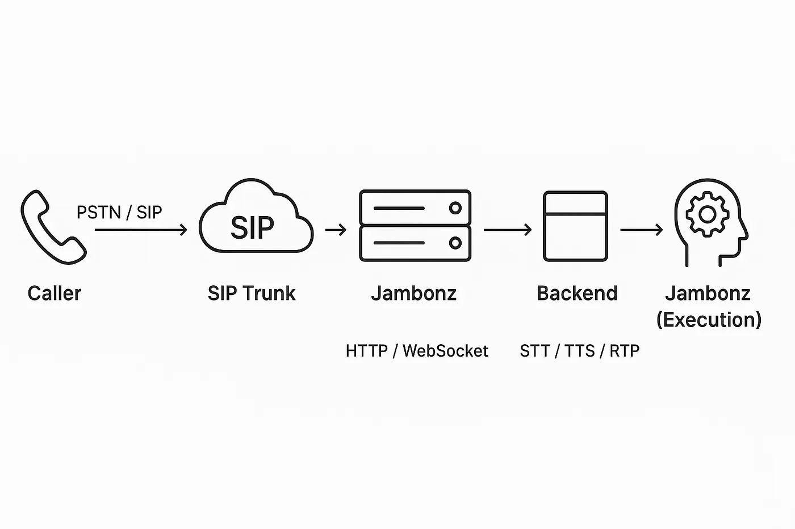

# Voice AI Systems Powered by Jambonz: From Telephony to Human–Machine Dialogue

*From Popov’s Radio Experiments to AI Calls — How Telephony Became the Foundation of Intelligent Communication*

*October 21, 2025*

---

Telephony has long ceased to be just voice communication.
Today, it has become a digital infrastructure where calls can be analyzed, managed programmatically, and enhanced with artificial intelligence.
This transforms an ordinary conversation into a dialogue between human and system — live, personalized, and data-driven.

I graduated from the Odesa National Academy of Telecommunications named after A. S. Popov, where I studied signal physics, frequencies, and switching principles.
At the time, it seemed like pure engineering — calculations, circuit diagrams, and lab instruments.
But today, those same principles form the foundation of Voice AI systems, where voice becomes a stream of data and communication logic turns into code.


*In the photo: the building of the Odesa National Academy of Telecommunications.*

My name is Mykhailo Kapustin, and I am the CTO and co-founder of the transatlantic research holding Advanced Scientific Research Projects.
We conduct applied research in artificial intelligence, brain–computer interfaces (BCI), and cognitive technologies, including dream analysis and modeling of human perception.

Today, we are approaching the era of neurointerfaces (BCI), where communication may occur directly — from mind to mind.
I believe that in the future, digital telepathy systems may emerge, transmitting thoughts straight into the recipient’s memory — or humanity itself may evolve toward this ability.

Yet, the essence of communication will remain the same: it will still be based on the exchange of meaning and the routing of signals between minds.
Telephony already performs this role today — only instead of neural impulses, it operates through voice, protocols, and code.


*Alexander Stepanovich Popov — the inventor of radio and one of the founders of modern communication.*
*In the background — the schematic and the first radio receiver demonstrated on May 7, 1895.*

Before moving on to the practical part and showing how to build a voice AI agent, let’s first break down what telephony consists of — what PSTN, SIP, and SIP trunks are, and why Jambonz has become the key bridge between classical telecommunication and artificial intelligence.

### Caller (PSTN / SIP): Where the Voice Begins

Every voice call begins with the caller — the party initiating the call.
This could be a mobile phone, a landline, or a VoIP client — a software application that transmits voice over the internet (for example, Zoom, Microsoft Teams, Telegram, or enterprise communication tools).

From there, everything depends on the network carrying the signal:

- **PSTN (Public Switched Telephone Network)** — the traditional phone network that handles standard calls. It provides stable connections but is not designed for direct integration with digital systems.
- **SIP (Session Initiation Protocol)** — a protocol that converts voice into a digital format and enables transmission over the internet (Voice over IP). It manages call setup, routing, and termination.

To bridge these two worlds — analog (PSTN) and digital (SIP) — a SIP trunk is used.
It acts as a virtual channel through which calls from the traditional phone network enter the internet-based system, such as Jambonz.
The SIP trunk serves as the interface between the telecom operator and your application: it receives the call, converts it into a SIP session, and then passes control to Jambonz, where call logic is handled programmatically.

## Call Flow Overview

### 1. Caller

The user initiates a call from a phone or VoIP client.

**Protocol:** PSTN or SIP

**Result:** The voice signal is sent into the network.

### 2. SIP Trunk

The call enters the digital environment through a virtual channel from the telecom operator.

**Protocol:** SIP

**Result:** The call is converted into a SIP session.

### 3. Jambonz

Jambonz receives the call, creates a session, and sends a webhook to your application.

**Protocols:** SIP / HTTP

**Result:** The call event is delivered to the backend service.

### 4. Backend

The backend processes the event and returns a JSON response with call instructions (verbs).

**Protocols:** HTTP / WebSocket

**Result:** The conversation logic is defined.

### 5. Jambonz (Execution)

Executes the verbs — speech synthesis, audio collection, and routing.

**Protocols:** STT / TTS / RTP

**Result:** The user hears the AI-generated response.

This sequence illustrates the complete path of a voice call — from the caller to AI-driven processing and response.
The diagram below shows how these components interact at the protocol and data flow level:


*Figure 1. Voice call flow — from the caller to the AI response through SIP, Jambonz, and the backend system.*

### What is Jambonz and Why It Matters

After a call passes through PSTN, SIP, and the SIP trunk, control is handed over to Jambonz — a platform that makes phone calls programmable.
Jambonz is used to build Voice AI applications, where calls are handled at the code level: received, routed, converted to text, spoken through TTS, and connected to external AI models.

The platform is open and flexible: it supports any SIP trunks, STT/TTS services, and LLM providers, allowing developers to build custom voice pipelines.
Interaction between Jambonz and the application occurs through webhooks or WebSocket connections — the system sends call events, and the backend responds with JSON instructions that define the call’s behavior.

When I first studied telephony, it felt similar to working with analog measurement instruments.
In our labs, we recorded signals with millivoltmeters, analyzed distorted waveforms, and drew switching circuits on large paper sheets.
There were no cloud APIs back then, but the principles were the same: measure, transmit, process, interpret.

Today, these same principles live in digital form — only now, instead of cables and oscilloscopes, we use SIP streams, webhooks, and LLM models.


*Photo: Laboratory millivoltmeter V3–38A, Odesa National Academy of Telecommunications*


*Photo: Circuit schematics — a traditional practice of engineering signal analysis*

The principles, however, remain the same — only now, instead of analog circuits, we manage streams of data.
Jambonz allows these processes to be described not through wiring diagrams, but through declarative commands called verbs.
These verbs define the behavior of a voice call — when to answer, what to say, and how to connect AI into the conversation.

### Key Commands (Verbs) in Jambonz

Each verb represents a specific action: answering a call, playing speech, recognizing voice input, connecting participants, or ending the conversation.
By combining verbs into a JSON script, developers can fully define the call behavior from start to finish.

## Key Command Categories in Jambonz

### 1. Call Control

`answer`, `hangup`, `redirect`, `pause`

Handle, end, or redirect a call.

### 2. Speech & Audio

`say`, `play`, `gather`, `listen`, `transcribe`, `synthesizer`

Perform speech synthesis, play audio, collect and recognize speech.

### 3. AI & NLP Integration

`LLM`, `Dialogflow`, `Rasa`

Connect external AI or conversational platforms.

### 4. Connection Management

`dial`, `conference`, `enqueue`, `dequeue`, `leave`

Connect participants, organize conferences and queues.

### 5. SIP Control

`sip-decline`, `sip-refer`, `sip-request`

Manage low-level SIP sessions.

### 6. Service Commands

`tag`, `config`, `alert`

Add metadata, configure parameters, or send alerts.

### Building an AI-Powered Voice Application

Now that we’ve explored how telephony architecture works and the role Jambonz plays within it, we can move on to the most interesting part — practical AI integration into a voice call.
Below is a basic scenario that forms the foundation for most Voice AI applications.

### 1. Incoming Call and Event Handling

When a user makes a call, Jambonz receives it via SIP and triggers your backend by sending a webhook containing call details — number, timestamp, session ID (`call_sid`), and direction.
The backend responds with a JSON scenario specifying what to do next.

A simple example is to greet the user and start listening for speech:

```javascript
app.post('/webhooks/call', (req, res) => {
  res.json([
    { verb: 'say', text: 'Hello. Please describe your dream.' },
    { verb: 'gather', input: ['speech'], actionHook: '/webhooks/gather' }
  ]);
});
```

- `say` — generates speech using TTS
- `gather` — enables speech recognition (STT) and waits for the user’s response

### 2. Speech Processing and AI Integration

When the user speaks, Jambonz sends the recognized text to your backend through the `actionHook`.
You can then call any LLM model (e.g., GPT or Gemini) to generate a response:

```javascript
app.post('/webhooks/gather', async (req, res) => {
  const userInput = req.body.speech.transcript;
  const reply = await ai.generate(userInput); // LLM API call
  res.json([
    { verb: 'say', text: reply },
    { verb: 'gather', input: ['speech'], actionHook: '/webhooks/gather' }
  ]);
});
```

This creates a dialogue loop — Jambonz speaks back to the user, while the AI controls the conversation’s content.

### 3. Ending the Call

When the conversation is over, the backend can return final commands:

```javascript
res.json([
  { verb: 'say', text: 'Thank you for the conversation. Goodbye.' },
  { verb: 'hangup' }
]);
```

### 4. Core Components and Protocols

- **SIP / RTP** — transmit signal and audio
- **HTTP / WebSocket** — manage communication between Jambonz and your app
- **STT / TTS** — convert speech to text and back
- **LLM API** — generates semantic responses

This architecture lets you describe the entire call behavior in code, adapting logic for specific use cases: support, consultation, research sessions, or interactive interviews.

### Conclusion

Today we manage calls the same way early engineers managed radio waves — only now the schematic lives in a JSON file, and the antenna has become an LLM.

There’s something poetic about that: every communication technology — from radio to brain–computer interfaces — aims for the same goal: to hear and to be understood.

Jambonz demonstrates how timeless principles of communication can evolve — where voice becomes code, and code becomes part of a living conversation.

---

### Sources

- [Medium article](https://medium.com/@kapustinomm/voice-ai-systems-powered-by-jambonz-from-telephony-to-human-machine-dialogue-37f31796fae2)
- [Original article on Arcanum12th](https://arcanum12th.education/ru/documents/b84ee790-effe-42f8-8ae8-dba899b3650e)
- [Jambonz Official Site](https://www.jambonz.org/)
