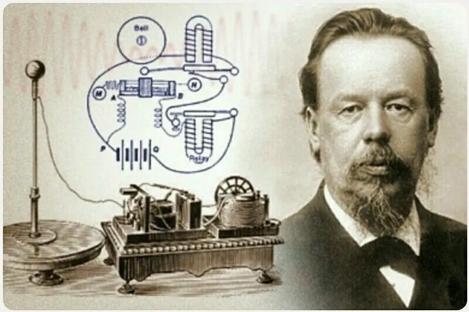
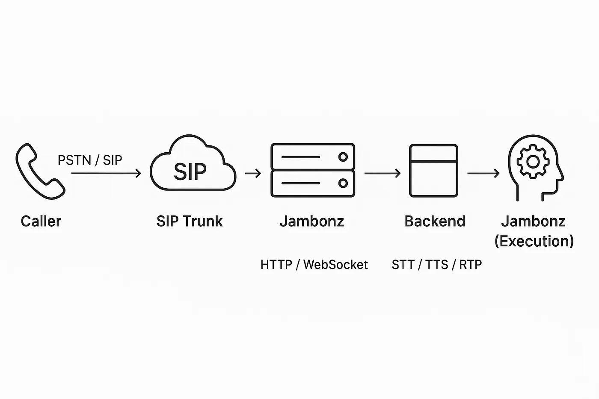
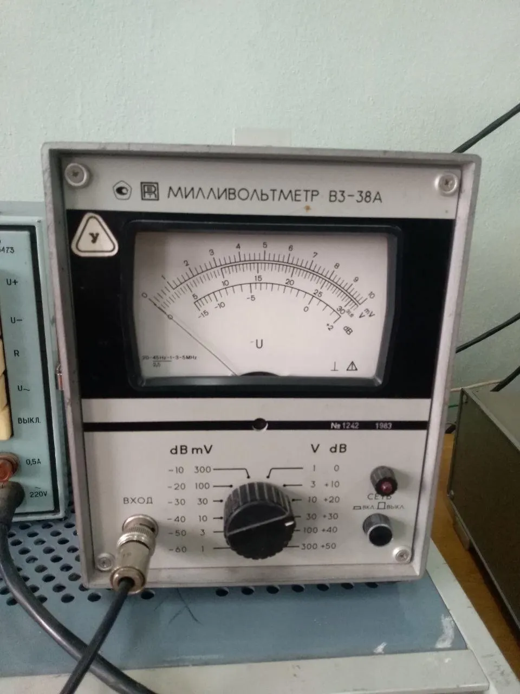

# Sistemas de Voice AI con Jambonz: de la telefonía al diálogo humano-máquina

*De los experimentos de radio de Popov a las llamadas con IA: cómo la telefonía se convirtió en la base de la comunicación inteligente*

*21 de octubre de 2025*

---

La telefonía hace tiempo que dejó de ser solo comunicación de voz.
Hoy se ha convertido en una infraestructura digital donde las llamadas pueden analizarse, gestionarse de forma programática y potenciarse con inteligencia artificial.
Esto transforma una conversación ordinaria en un diálogo entre una persona y un sistema: en vivo, personalizado y basado en datos.

Me gradué en la Odesa National Academy of Telecommunications, nombrada en honor a A. S. Popov, donde estudié física de señales, frecuencias y principios de conmutación.
En aquel momento parecía ingeniería pura: cálculos, diagramas de circuitos e instrumentos de laboratorio.
Pero hoy esos mismos principios forman la base de los sistemas de Voice AI, donde la voz se convierte en un flujo de datos y la lógica de comunicación se transforma en código.


*En la foto: el edificio de la Odesa National Academy of Telecommunications.*

Mi nombre es Mykhailo Kapustin, y soy CTO y cofundador del holding transatlántico de investigación Advanced Scientific Research Projects.
Realizamos investigación aplicada en inteligencia artificial, interfaces cerebro-computadora (BCI) y tecnologías cognitivas, incluido el análisis de sueños y el modelado de la percepción humana.

Hoy nos acercamos a la era de las neurointerfaces (BCI), donde la comunicación puede ocurrir directamente: de mente a mente.
Creo que en el futuro podrían surgir sistemas de telepatía digital que transmitan pensamientos directamente a la memoria del receptor, o que la humanidad misma evolucione hacia esa capacidad.

Sin embargo, la esencia de la comunicación seguirá siendo la misma: seguirá basándose en el intercambio de significado y en el enrutamiento de señales entre mentes.
La telefonía ya cumple ese papel hoy: solo que, en lugar de impulsos neuronales, opera mediante voz, protocolos y código.


*Alexander Stepanovich Popov, inventor de la radio y uno de los fundadores de la comunicación moderna.*
*Al fondo: el esquema y el primer receptor de radio demostrado el 7 de mayo de 1895.*

Antes de pasar a la parte práctica y mostrar cómo construir un agente de voz con IA, primero descompongamos de qué está hecha la telefonía: qué son PSTN, SIP y los SIP trunks, y por qué Jambonz se ha convertido en el puente clave entre la telecomunicación clásica y la inteligencia artificial.

### Llamante (PSTN / SIP): donde comienza la voz

Toda llamada de voz comienza con el llamante, la parte que inicia la llamada.
Puede ser un teléfono móvil, una línea fija o un cliente VoIP: una aplicación de software que transmite voz por internet (por ejemplo, Zoom, Microsoft Teams, Telegram o herramientas de comunicación empresarial).

A partir de ahí, todo depende de la red que transporta la señal:

- **PSTN (Public Switched Telephone Network)**: la red telefónica tradicional que gestiona llamadas estándar. Proporciona conexiones estables, pero no está diseñada para integrarse directamente con sistemas digitales.
- **SIP (Session Initiation Protocol)**: un protocolo que convierte la voz a formato digital y permite transmitirla por internet (Voice over IP). Gestiona el establecimiento, enrutamiento y finalización de llamadas.

Para conectar estos dos mundos, analógico (PSTN) y digital (SIP), se utiliza un SIP trunk.
Actúa como un canal virtual por el que las llamadas de la red telefónica tradicional entran en un sistema basado en internet, como Jambonz.
El SIP trunk sirve como interfaz entre el operador de telecomunicaciones y tu aplicación: recibe la llamada, la convierte en una sesión SIP y luego pasa el control a Jambonz, donde la lógica de la llamada se maneja programáticamente.

## Resumen del flujo de llamada

### 1. Llamante

El usuario inicia una llamada desde un teléfono o cliente VoIP.

**Protocolo:** PSTN o SIP

**Resultado:** La señal de voz se envía a la red.

### 2. SIP Trunk

La llamada entra en el entorno digital a través de un canal virtual del operador de telecomunicaciones.

**Protocolo:** SIP

**Resultado:** La llamada se convierte en una sesión SIP.

### 3. Jambonz

Jambonz recibe la llamada, crea una sesión y envía un webhook a tu aplicación.

**Protocolos:** SIP / HTTP

**Resultado:** El evento de llamada se entrega al servicio backend.

### 4. Backend

El backend procesa el evento y devuelve una respuesta JSON con instrucciones de llamada (verbs).

**Protocolos:** HTTP / WebSocket

**Resultado:** Se define la lógica de conversación.

### 5. Jambonz (ejecución)

Ejecuta los verbs: síntesis de voz, recolección de audio y enrutamiento.

**Protocolos:** STT / TTS / RTP

**Resultado:** El usuario escucha la respuesta generada por IA.

Esta secuencia ilustra el recorrido completo de una llamada de voz: desde el llamante hasta el procesamiento y la respuesta impulsados por IA.
El diagrama siguiente muestra cómo interactúan estos componentes a nivel de protocolo y flujo de datos:


*Figura 1. Flujo de llamada de voz: del llamante a la respuesta de IA mediante SIP, Jambonz y el sistema backend.*

### Qué es Jambonz y por qué importa

Después de que una llamada pasa por PSTN, SIP y el SIP trunk, el control se entrega a Jambonz: una plataforma que hace programables las llamadas telefónicas.
Jambonz se utiliza para construir aplicaciones de Voice AI, donde las llamadas se manejan a nivel de código: se reciben, se enrutan, se convierten a texto, se reproducen mediante TTS y se conectan con modelos de IA externos.

La plataforma es abierta y flexible: admite cualquier SIP trunk, servicios STT/TTS y proveedores de LLM, lo que permite a los desarrolladores construir pipelines de voz personalizados.
La interacción entre Jambonz y la aplicación ocurre mediante webhooks o conexiones WebSocket: el sistema envía eventos de llamada y el backend responde con instrucciones JSON que definen el comportamiento de la llamada.

Cuando estudié telefonía por primera vez, se parecía a trabajar con instrumentos analógicos de medición.
En nuestros laboratorios registrábamos señales con milivoltímetros, analizábamos formas de onda distorsionadas y dibujábamos circuitos de conmutación en grandes hojas de papel.
Entonces no había APIs en la nube, pero los principios eran los mismos: medir, transmitir, procesar, interpretar.

Hoy esos mismos principios viven en forma digital: solo que ahora, en lugar de cables y osciloscopios, usamos flujos SIP, webhooks y modelos LLM.


*Foto: milivoltímetro de laboratorio V3-38A, Odesa National Academy of Telecommunications*


*Foto: esquemas de circuitos, una práctica tradicional del análisis técnico de señales*

Sin embargo, los principios siguen siendo los mismos: solo que ahora, en lugar de circuitos analógicos, gestionamos flujos de datos.
Jambonz permite describir estos procesos no mediante diagramas de cableado, sino mediante comandos declarativos llamados verbs.
Estos verbs definen el comportamiento de una llamada de voz: cuándo responder, qué decir y cómo conectar la IA a la conversación.

### Comandos clave (verbs) en Jambonz

Cada verb representa una acción específica: responder una llamada, reproducir voz, reconocer entrada de voz, conectar participantes o terminar la conversación.
Combinando verbs en un script JSON, los desarrolladores pueden definir completamente el comportamiento de la llamada de principio a fin.

## Categorías clave de comandos en Jambonz

### 1. Control de llamadas

`answer`, `hangup`, `redirect`, `pause`

Manejan, terminan o redirigen una llamada.

### 2. Voz y audio

`say`, `play`, `gather`, `listen`, `transcribe`, `synthesizer`

Realizan síntesis de voz, reproducen audio, recolectan y reconocen voz.

### 3. Integración de IA y NLP

`LLM`, `Dialogflow`, `Rasa`

Conectan IA externa o plataformas conversacionales.

### 4. Gestión de conexiones

`dial`, `conference`, `enqueue`, `dequeue`, `leave`

Conectan participantes, organizan conferencias y colas.

### 5. Control SIP

`sip-decline`, `sip-refer`, `sip-request`

Gestionan sesiones SIP de bajo nivel.

### 6. Comandos de servicio

`tag`, `config`, `alert`

Añaden metadatos, configuran parámetros o envían alertas.

### Construir una aplicación de voz impulsada por IA

Ahora que hemos explorado cómo funciona la arquitectura de telefonía y el papel que Jambonz desempeña en ella, podemos pasar a la parte más interesante: la integración práctica de IA en una llamada de voz.
Abajo hay un escenario básico que sirve de base para la mayoría de aplicaciones de Voice AI.

### 1. Llamada entrante y manejo de eventos

Cuando un usuario realiza una llamada, Jambonz la recibe mediante SIP y activa tu backend enviando un webhook con detalles de la llamada: número, timestamp, ID de sesión (`call_sid`) y dirección.
El backend responde con un escenario JSON que especifica qué hacer después.

Un ejemplo simple es saludar al usuario y empezar a escuchar voz:

```javascript
app.post('/webhooks/call', (req, res) => {
  res.json([
    { verb: 'say', text: 'Hello. Please describe your dream.' },
    { verb: 'gather', input: ['speech'], actionHook: '/webhooks/gather' }
  ]);
});
```

- `say`: genera voz usando TTS
- `gather`: habilita reconocimiento de voz (STT) y espera la respuesta del usuario

### 2. Procesamiento de voz e integración de IA

Cuando el usuario habla, Jambonz envía el texto reconocido a tu backend mediante el `actionHook`.
Después puedes llamar a cualquier modelo LLM (por ejemplo, GPT o Gemini) para generar una respuesta:

```javascript
app.post('/webhooks/gather', async (req, res) => {
  const userInput = req.body.speech.transcript;
  const reply = await ai.generate(userInput); // LLM API call
  res.json([
    { verb: 'say', text: reply },
    { verb: 'gather', input: ['speech'], actionHook: '/webhooks/gather' }
  ]);
});
```

Esto crea un bucle de diálogo: Jambonz responde al usuario con voz, mientras la IA controla el contenido de la conversación.

### 3. Finalizar la llamada

Cuando la conversación termina, el backend puede devolver comandos finales:

```javascript
res.json([
  { verb: 'say', text: 'Thank you for the conversation. Goodbye.' },
  { verb: 'hangup' }
]);
```

### 4. Componentes y protocolos centrales

- **SIP / RTP**: transmiten señal y audio
- **HTTP / WebSocket**: gestionan la comunicación entre Jambonz y tu app
- **STT / TTS**: convierten voz a texto y viceversa
- **LLM API**: genera respuestas semánticas

Esta arquitectura permite describir todo el comportamiento de la llamada en código, adaptando la lógica a casos de uso concretos: soporte, consultoría, sesiones de investigación o entrevistas interactivas.

### Conclusión

Hoy gestionamos llamadas del mismo modo en que los primeros ingenieros gestionaban ondas de radio: solo que ahora el esquema vive en un archivo JSON, y la antena se ha convertido en un LLM.

Hay algo poético en eso: toda tecnología de comunicación, desde la radio hasta las interfaces cerebro-computadora, busca el mismo objetivo: escuchar y ser entendido.

Jambonz demuestra cómo pueden evolucionar principios atemporales de comunicación: donde la voz se convierte en código, y el código se vuelve parte de una conversación viva.

---

### Fuentes

- [Medium article](https://medium.com/@kapustinomm/voice-ai-systems-powered-by-jambonz-from-telephony-to-human-machine-dialogue-37f31796fae2)
- [Original article on Arcanum12th](https://arcanum12th.education/ru/documents/b84ee790-effe-42f8-8ae8-dba899b3650e)
- [Jambonz Official Site](https://www.jambonz.org/)
