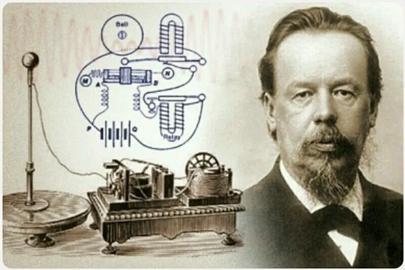
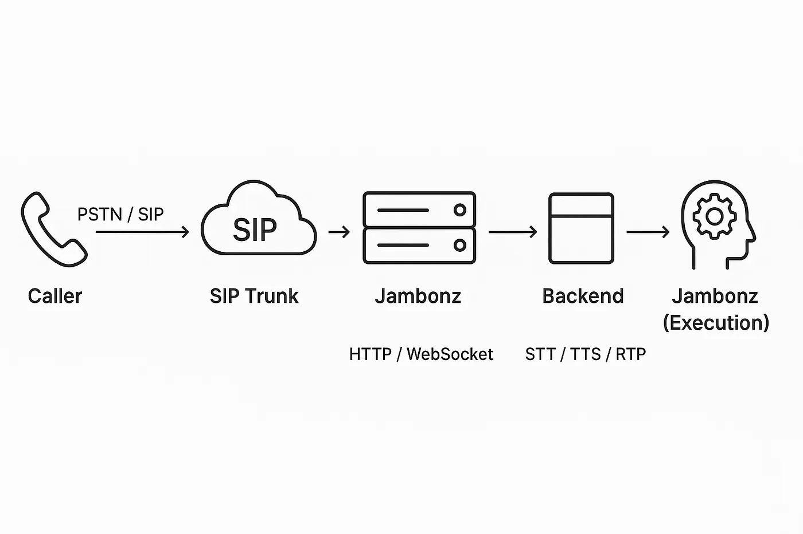
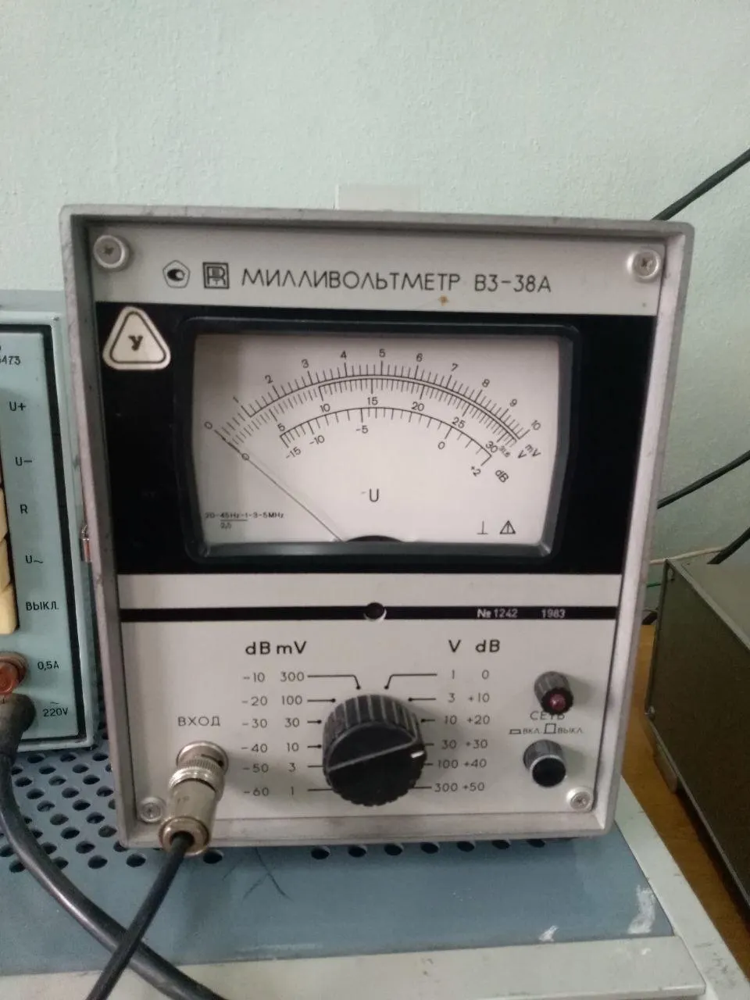

# Voice AI Systems Powered by Jambonz: от телефонии к диалогу человека и машины

*От радиоопытов Попова к AI-звонкам — как телефония стала основой интеллектуальной коммуникации*

*21 октября 2025*

---

Телефония давно перестала быть просто голосовой связью.
Сегодня она стала цифровой инфраструктурой, где звонки можно анализировать, программно управлять ими и усиливать их искусственным интеллектом.
Это превращает обычный разговор в диалог между человеком и системой — живой, персонализированный и основанный на данных.

Я окончил Одесскую национальную академию связи имени А. С. Попова, где изучал физику сигналов, частоты и принципы коммутации.
Тогда это казалось чистой инженерией — расчёты, схемы и лабораторные приборы.
Но сегодня те же принципы лежат в основе Voice AI systems, где голос становится потоком данных, а логика коммуникации превращается в код.


*На фото: здание Одесской национальной академии связи.*

Меня зовут Mykhailo Kapustin, я CTO и co-founder трансатлантического исследовательского холдинга Advanced Scientific Research Projects.
Мы проводим прикладные исследования в области искусственного интеллекта, brain-computer interfaces (BCI) и когнитивных технологий, включая анализ сновидений и моделирование человеческого восприятия.

Сегодня мы приближаемся к эпохе нейроинтерфейсов (BCI), где коммуникация может происходить напрямую — от сознания к сознанию.
Я считаю, что в будущем могут появиться системы цифровой телепатии, передающие мысли прямо в память получателя, или само человечество может эволюционировать к такой способности.

Но суть коммуникации останется прежней: она всё равно будет основана на обмене смыслом и маршрутизации сигналов между сознаниями.
Телефония уже выполняет эту роль сегодня — только вместо нейронных импульсов она работает через голос, протоколы и код.


*Александр Степанович Попов — изобретатель радио и один из основателей современной связи.*
*На фоне — схема и первый радиоприёмник, продемонстрированный 7 мая 1895 года.*

Прежде чем перейти к практической части и показать, как построить voice AI agent, разберём, из чего состоит телефония: что такое PSTN, SIP и SIP trunks, и почему Jambonz стал ключевым мостом между классической телекоммуникацией и искусственным интеллектом.

### Caller (PSTN / SIP): где начинается голос

Каждый голосовой звонок начинается с caller — стороны, которая инициирует call.
Это может быть мобильный телефон, стационарный телефон или VoIP client — программное приложение, передающее голос через интернет (например, Zoom, Microsoft Teams, Telegram или корпоративные коммуникационные инструменты).

Дальше всё зависит от сети, которая несёт сигнал:

- **PSTN (Public Switched Telephone Network)** — традиционная телефонная сеть, которая обрабатывает обычные звонки. Она обеспечивает стабильное соединение, но не рассчитана на прямую интеграцию с цифровыми системами.
- **SIP (Session Initiation Protocol)** — протокол, который преобразует голос в цифровой формат и обеспечивает передачу через интернет (Voice over IP). Он управляет установлением, маршрутизацией и завершением звонка.

Чтобы соединить эти два мира — аналоговый (PSTN) и цифровой (SIP), — используется SIP trunk.
Он работает как виртуальный канал, через который звонки из традиционной телефонной сети попадают в internet-based system, например Jambonz.
SIP trunk служит интерфейсом между telecom operator и вашим приложением: принимает call, преобразует его в SIP session, а затем передаёт управление Jambonz, где логика звонка обрабатывается программно.

## Call Flow Overview

### 1. Caller

Пользователь инициирует звонок с телефона или VoIP client.

**Protocol:** PSTN или SIP

**Result:** голосовой сигнал отправляется в сеть.

### 2. SIP Trunk

Звонок попадает в цифровую среду через виртуальный канал от telecom operator.

**Protocol:** SIP

**Result:** call преобразуется в SIP session.

### 3. Jambonz

Jambonz принимает звонок, создаёт session и отправляет webhook вашему приложению.

**Protocols:** SIP / HTTP

**Result:** call event доставляется в backend service.

### 4. Backend

Backend обрабатывает event и возвращает JSON response с call instructions (verbs).

**Protocols:** HTTP / WebSocket

**Result:** определяется логика разговора.

### 5. Jambonz (Execution)

Выполняет verbs — speech synthesis, audio collection и routing.

**Protocols:** STT / TTS / RTP

**Result:** пользователь слышит AI-generated response.

Эта последовательность показывает полный путь voice call — от caller до AI-driven processing и response.
Диаграмма ниже показывает, как эти компоненты взаимодействуют на уровне protocol и data flow:


*Рисунок 1. Voice call flow — от caller к AI response через SIP, Jambonz и backend system.*

### Что такое Jambonz и почему он важен

После того как звонок проходит через PSTN, SIP и SIP trunk, управление передаётся Jambonz — платформе, которая делает телефонные звонки программируемыми.
Jambonz используется для построения Voice AI applications, где calls обрабатываются на уровне кода: принимаются, маршрутизируются, преобразуются в текст, озвучиваются через TTS и подключаются к внешним AI models.

Платформа открыта и гибка: она поддерживает любые SIP trunks, STT/TTS services и LLM providers, позволяя разработчикам строить custom voice pipelines.
Взаимодействие между Jambonz и приложением происходит через webhooks или WebSocket connections: система отправляет call events, а backend отвечает JSON instructions, определяющими поведение звонка.

Когда я впервые изучал телефонию, это напоминало работу с аналоговыми измерительными приборами.
В лабораториях мы записывали сигналы милливольтметрами, анализировали искажённые формы волн и рисовали коммутационные схемы на больших листах бумаги.
Тогда не было cloud APIs, но принципы были теми же: измерить, передать, обработать, интерпретировать.

Сегодня эти же принципы живут в цифровой форме — только теперь вместо кабелей и осциллографов мы используем SIP streams, webhooks и LLM models.


*Фото: лабораторный милливольтметр В3-38А, Одесская национальная академия связи*


*Фото: электрические схемы — традиционная практика инженерного анализа сигналов*

Принципы, однако, остаются прежними — только теперь вместо аналоговых схем мы управляем потоками данных.
Jambonz позволяет описывать эти процессы не через wiring diagrams, а через declarative commands, которые называются verbs.
Эти verbs определяют поведение voice call: когда ответить, что сказать и как подключить AI к разговору.

### Key Commands (Verbs) in Jambonz

Каждый verb представляет конкретное действие: ответить на звонок, проиграть речь, распознать voice input, соединить участников или завершить разговор.
Комбинируя verbs в JSON script, разработчики могут полностью определить call behavior от начала до конца.

## Key Command Categories in Jambonz

### 1. Call Control

`answer`, `hangup`, `redirect`, `pause`

Обработать, завершить или перенаправить call.

### 2. Speech & Audio

`say`, `play`, `gather`, `listen`, `transcribe`, `synthesizer`

Выполнить speech synthesis, проиграть audio, собрать и распознать speech.

### 3. AI & NLP Integration

`LLM`, `Dialogflow`, `Rasa`

Подключить external AI или conversational platforms.

### 4. Connection Management

`dial`, `conference`, `enqueue`, `dequeue`, `leave`

Соединить участников, организовать conferences и queues.

### 5. SIP Control

`sip-decline`, `sip-refer`, `sip-request`

Управлять low-level SIP sessions.

### 6. Service Commands

`tag`, `config`, `alert`

Добавить metadata, настроить parameters или отправить alerts.

### Building an AI-Powered Voice Application

Теперь, когда мы разобрали, как работает telephony architecture и какую роль в ней играет Jambonz, можно перейти к самому интересному — практической интеграции AI в голосовой звонок.
Ниже базовый сценарий, который лежит в основе большинства Voice AI applications.

### 1. Incoming Call and Event Handling

Когда пользователь совершает звонок, Jambonz принимает его через SIP и вызывает backend, отправляя webhook с деталями call: номер, timestamp, session ID (`call_sid`) и direction.
Backend отвечает JSON scenario, указывающим, что делать дальше.

Простой пример — поприветствовать пользователя и начать слушать речь:

```javascript
app.post('/webhooks/call', (req, res) => {
  res.json([
    { verb: 'say', text: 'Hello. Please describe your dream.' },
    { verb: 'gather', input: ['speech'], actionHook: '/webhooks/gather' }
  ]);
});
```

- `say` — генерирует speech через TTS.
- `gather` — включает speech recognition (STT) и ждёт ответ пользователя.

### 2. Speech Processing and AI Integration

Когда пользователь говорит, Jambonz отправляет распознанный текст в backend через `actionHook`.
Затем можно вызвать любую LLM model (например, GPT или Gemini), чтобы сгенерировать ответ:

```javascript
app.post('/webhooks/gather', async (req, res) => {
  const userInput = req.body.speech.transcript;
  const reply = await ai.generate(userInput); // LLM API call
  res.json([
    { verb: 'say', text: reply },
    { verb: 'gather', input: ['speech'], actionHook: '/webhooks/gather' }
  ]);
});
```

Так создаётся dialogue loop: Jambonz отвечает пользователю голосом, а AI управляет содержанием разговора.

### 3. Ending the Call

Когда разговор завершён, backend может вернуть финальные команды:

```javascript
res.json([
  { verb: 'say', text: 'Thank you for the conversation. Goodbye.' },
  { verb: 'hangup' }
]);
```

### 4. Core Components and Protocols

- **SIP / RTP** — передают signal и audio.
- **HTTP / WebSocket** — управляют коммуникацией между Jambonz и вашим приложением.
- **STT / TTS** — преобразуют speech в text и обратно.
- **LLM API** — генерирует semantic responses.

Эта архитектура позволяет описать всё поведение call в коде, адаптируя логику под конкретные use cases: support, consultation, research sessions или interactive interviews.

### Conclusion

Сегодня мы управляем звонками так же, как ранние инженеры управляли радиоволнами, — только теперь схема живёт в JSON file, а антенна стала LLM.

В этом есть что-то поэтичное: каждая коммуникационная технология — от радио до brain-computer interfaces — стремится к одной цели: быть услышанным и понятым.

Jambonz показывает, как вечные принципы коммуникации могут эволюционировать: голос становится кодом, а код — частью живого разговора.

---

### Источники

- [Medium article](https://medium.com/@kapustinomm/voice-ai-systems-powered-by-jambonz-from-telephony-to-human-machine-dialogue-37f31796fae2)
- [Original article on Arcanum12th](https://arcanum12th.education/ru/documents/b84ee790-effe-42f8-8ae8-dba899b3650e)
- [Jambonz Official Site](https://www.jambonz.org/)
