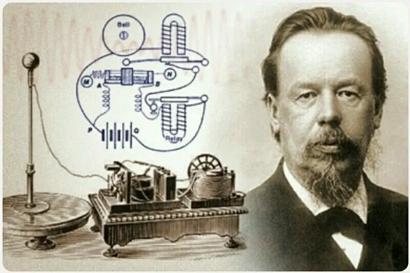
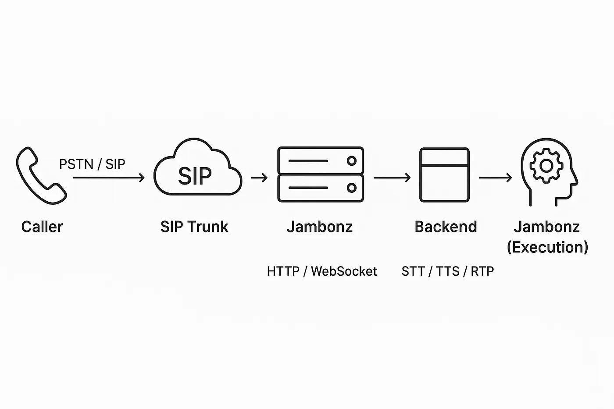
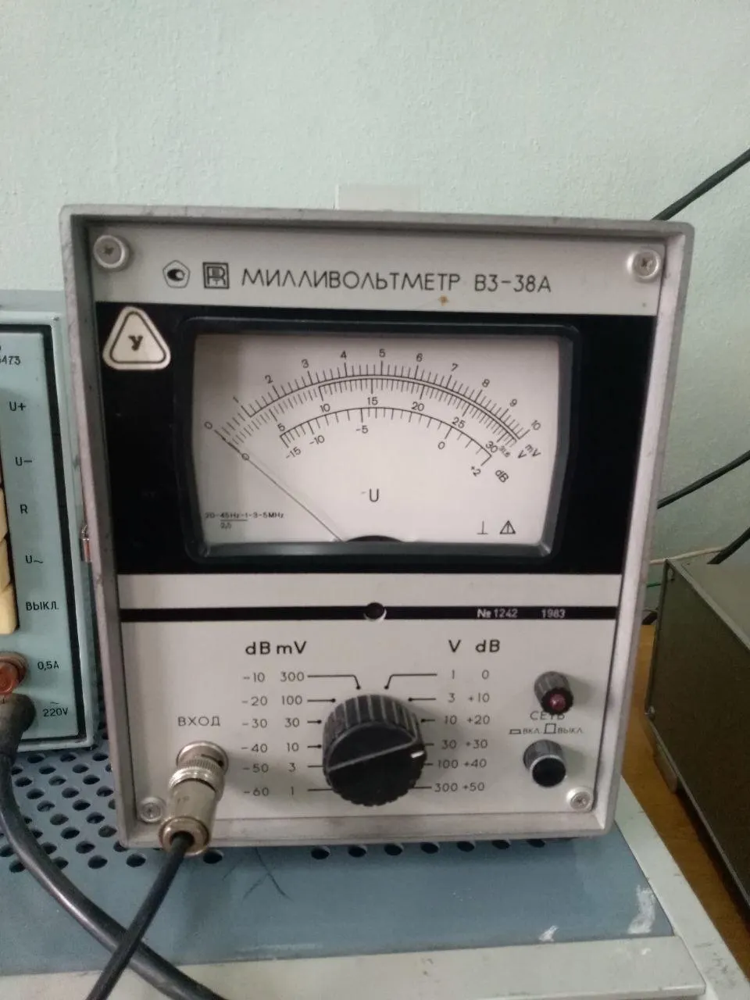

# Voice AI Systems Powered by Jambonz: від телефонії до діалогу людини й машини

*Від радіоекспериментів Попова до AI-дзвінків — як телефонія стала основою інтелектуальної комунікації*

*21 жовтня 2025*

---

Телефонія давно перестала бути просто голосовим зв'язком.
Сьогодні вона стала цифровою інфраструктурою, де дзвінки можна аналізувати, програмно керувати ними й посилювати їх штучним інтелектом.
Це перетворює звичайну розмову на діалог між людиною і системою — живий, персоналізований і заснований на даних.

Я закінчив Одеську національну академію зв'язку імені О. С. Попова, де вивчав фізику сигналів, частоти та принципи комутації.
Тоді це здавалося чистою інженерією — розрахунки, схеми й лабораторні прилади.
Але сьогодні ті самі принципи лежать в основі Voice AI systems, де голос стає потоком даних, а логіка комунікації перетворюється на код.


*На фото: будівля Одеської національної академії зв'язку.*

Мене звати Mykhailo Kapustin, я CTO і co-founder трансатлантичного дослідницького холдингу Advanced Scientific Research Projects.
Ми проводимо прикладні дослідження в галузі штучного інтелекту, brain-computer interfaces (BCI) і когнітивних технологій, включно з аналізом сновидінь і моделюванням людського сприйняття.

Сьогодні ми наближаємося до епохи нейроінтерфейсів (BCI), де комунікація може відбуватися напряму — від свідомості до свідомості.
Я вважаю, що в майбутньому можуть з'явитися системи цифрової телепатії, які передаватимуть думки прямо в пам'ять отримувача, або саме людство може еволюціонувати до такої здатності.

Але суть комунікації залишиться тією самою: вона все одно буде заснована на обміні смислом і маршрутизації сигналів між свідомостями.
Телефонія вже виконує цю роль сьогодні — лише замість нейронних імпульсів вона працює через голос, протоколи й код.


*Олександр Степанович Попов — винахідник радіо й один із засновників сучасного зв'язку.*
*На тлі — схема й перший радіоприймач, продемонстрований 7 травня 1895 року.*

Перш ніж перейти до практичної частини й показати, як побудувати voice AI agent, розберімо, з чого складається телефонія: що таке PSTN, SIP і SIP trunks, і чому Jambonz став ключовим мостом між класичною телекомунікацією та штучним інтелектом.

### Caller (PSTN / SIP): де починається голос

Кожен голосовий дзвінок починається з caller — сторони, яка ініціює call.
Це може бути мобільний телефон, стаціонарний телефон або VoIP client — програмний застосунок, що передає голос через інтернет (наприклад, Zoom, Microsoft Teams, Telegram або корпоративні комунікаційні інструменти).

Далі все залежить від мережі, яка несе сигнал:

- **PSTN (Public Switched Telephone Network)** — традиційна телефонна мережа, яка обробляє звичайні дзвінки. Вона забезпечує стабільне з'єднання, але не розрахована на пряму інтеграцію з цифровими системами.
- **SIP (Session Initiation Protocol)** — протокол, який перетворює голос у цифровий формат і забезпечує передавання через інтернет (Voice over IP). Він керує встановленням, маршрутизацією та завершенням дзвінка.

Щоб поєднати ці два світи — аналоговий (PSTN) і цифровий (SIP), — використовується SIP trunk.
Він працює як віртуальний канал, через який дзвінки з традиційної телефонної мережі потрапляють в internet-based system, наприклад Jambonz.
SIP trunk слугує інтерфейсом між telecom operator і вашим застосунком: приймає call, перетворює його на SIP session, а потім передає керування Jambonz, де логіка дзвінка обробляється програмно.

## Call Flow Overview

### 1. Caller

Користувач ініціює дзвінок із телефону або VoIP client.

**Protocol:** PSTN або SIP

**Result:** голосовий сигнал надсилається в мережу.

### 2. SIP Trunk

Дзвінок потрапляє в цифрове середовище через віртуальний канал від telecom operator.

**Protocol:** SIP

**Result:** call перетворюється на SIP session.

### 3. Jambonz

Jambonz приймає дзвінок, створює session і надсилає webhook вашому застосунку.

**Protocols:** SIP / HTTP

**Result:** call event доставляється в backend service.

### 4. Backend

Backend обробляє event і повертає JSON response з call instructions (verbs).

**Protocols:** HTTP / WebSocket

**Result:** визначається логіка розмови.

### 5. Jambonz (Execution)

Виконує verbs — speech synthesis, audio collection і routing.

**Protocols:** STT / TTS / RTP

**Result:** користувач чує AI-generated response.

Ця послідовність показує повний шлях voice call — від caller до AI-driven processing і response.
Діаграма нижче показує, як ці компоненти взаємодіють на рівні protocol і data flow:


*Рисунок 1. Voice call flow — від caller до AI response через SIP, Jambonz і backend system.*

### Що таке Jambonz і чому він важливий

Після того як дзвінок проходить через PSTN, SIP і SIP trunk, керування передається Jambonz — платформі, яка робить телефонні дзвінки програмованими.
Jambonz використовується для побудови Voice AI applications, де calls обробляються на рівні коду: приймаються, маршрутизуються, перетворюються на текст, озвучуються через TTS і підключаються до зовнішніх AI models.

Платформа відкрита й гнучка: вона підтримує будь-які SIP trunks, STT/TTS services і LLM providers, дозволяючи розробникам будувати custom voice pipelines.
Взаємодія між Jambonz і застосунком відбувається через webhooks або WebSocket connections: система надсилає call events, а backend відповідає JSON instructions, що визначають поведінку дзвінка.

Коли я вперше вивчав телефонію, це нагадувало роботу з аналоговими вимірювальними приладами.
У лабораторіях ми записували сигнали мілівольтметрами, аналізували спотворені форми хвиль і малювали комутаційні схеми на великих аркушах паперу.
Тоді не було cloud APIs, але принципи були тими самими: виміряти, передати, обробити, інтерпретувати.

Сьогодні ці самі принципи живуть у цифровій формі — тільки тепер замість кабелів і осцилографів ми використовуємо SIP streams, webhooks і LLM models.


*Фото: лабораторний мілівольтметр В3-38А, Одеська національна академія зв'язку*


*Фото: електричні схеми — традиційна практика інженерного аналізу сигналів*

Принципи, однак, залишаються тими самими — тільки тепер замість аналогових схем ми керуємо потоками даних.
Jambonz дозволяє описувати ці процеси не через wiring diagrams, а через declarative commands, які називаються verbs.
Ці verbs визначають поведінку voice call: коли відповісти, що сказати і як підключити AI до розмови.

### Key Commands (Verbs) in Jambonz

Кожен verb представляє конкретну дію: відповісти на дзвінок, програти мовлення, розпізнати voice input, з'єднати учасників або завершити розмову.
Комбінуючи verbs у JSON script, розробники можуть повністю визначити call behavior від початку до кінця.

## Key Command Categories in Jambonz

### 1. Call Control

`answer`, `hangup`, `redirect`, `pause`

Обробити, завершити або перенаправити call.

### 2. Speech & Audio

`say`, `play`, `gather`, `listen`, `transcribe`, `synthesizer`

Виконати speech synthesis, програти audio, зібрати й розпізнати speech.

### 3. AI & NLP Integration

`LLM`, `Dialogflow`, `Rasa`

Підключити external AI або conversational platforms.

### 4. Connection Management

`dial`, `conference`, `enqueue`, `dequeue`, `leave`

З'єднати учасників, організувати conferences і queues.

### 5. SIP Control

`sip-decline`, `sip-refer`, `sip-request`

Керувати low-level SIP sessions.

### 6. Service Commands

`tag`, `config`, `alert`

Додати metadata, налаштувати parameters або надіслати alerts.

### Building an AI-Powered Voice Application

Тепер, коли ми розібрали, як працює telephony architecture і яку роль у ній відіграє Jambonz, можна перейти до найцікавішого — практичної інтеграції AI в голосовий дзвінок.
Нижче базовий сценарій, який лежить в основі більшості Voice AI applications.

### 1. Incoming Call and Event Handling

Коли користувач здійснює дзвінок, Jambonz приймає його через SIP і викликає backend, надсилаючи webhook з деталями call: номер, timestamp, session ID (`call_sid`) і direction.
Backend відповідає JSON scenario, який вказує, що робити далі.

Простий приклад — привітати користувача й почати слухати мовлення:

```javascript
app.post('/webhooks/call', (req, res) => {
  res.json([
    { verb: 'say', text: 'Hello. Please describe your dream.' },
    { verb: 'gather', input: ['speech'], actionHook: '/webhooks/gather' }
  ]);
});
```

- `say` — генерує speech через TTS.
- `gather` — вмикає speech recognition (STT) і чекає відповідь користувача.

### 2. Speech Processing and AI Integration

Коли користувач говорить, Jambonz надсилає розпізнаний текст у backend через `actionHook`.
Потім можна викликати будь-яку LLM model (наприклад, GPT або Gemini), щоб згенерувати відповідь:

```javascript
app.post('/webhooks/gather', async (req, res) => {
  const userInput = req.body.speech.transcript;
  const reply = await ai.generate(userInput); // LLM API call
  res.json([
    { verb: 'say', text: reply },
    { verb: 'gather', input: ['speech'], actionHook: '/webhooks/gather' }
  ]);
});
```

Так створюється dialogue loop: Jambonz відповідає користувачу голосом, а AI керує змістом розмови.

### 3. Ending the Call

Коли розмову завершено, backend може повернути фінальні команди:

```javascript
res.json([
  { verb: 'say', text: 'Thank you for the conversation. Goodbye.' },
  { verb: 'hangup' }
]);
```

### 4. Core Components and Protocols

- **SIP / RTP** — передають signal і audio.
- **HTTP / WebSocket** — керують комунікацією між Jambonz і вашим застосунком.
- **STT / TTS** — перетворюють speech на text і назад.
- **LLM API** — генерує semantic responses.

Ця архітектура дозволяє описати всю поведінку call у коді, адаптуючи логіку під конкретні use cases: support, consultation, research sessions або interactive interviews.

### Conclusion

Сьогодні ми керуємо дзвінками так само, як ранні інженери керували радіохвилями, — тільки тепер схема живе в JSON file, а антена стала LLM.

У цьому є щось поетичне: кожна комунікаційна технологія — від радіо до brain-computer interfaces — прагне однієї мети: бути почутою і зрозумілою.

Jambonz показує, як вічні принципи комунікації можуть еволюціонувати: голос стає кодом, а код — частиною живої розмови.

---

### Джерела

- [Medium article](https://medium.com/@kapustinomm/voice-ai-systems-powered-by-jambonz-from-telephony-to-human-machine-dialogue-37f31796fae2)
- [Original article on Arcanum12th](https://arcanum12th.education/ru/documents/b84ee790-effe-42f8-8ae8-dba899b3650e)
- [Jambonz Official Site](https://www.jambonz.org/)
