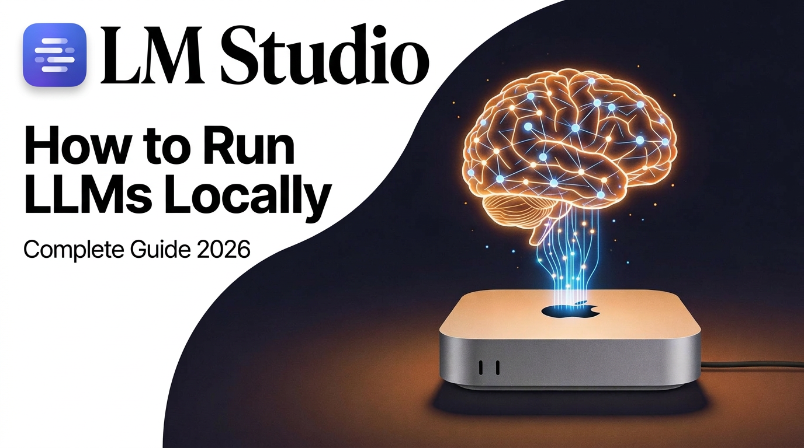

[← Technical Articles](../README.md)

# How to Run LLMs Locally with LM Studio: Complete Guide 2026

*February 2026*

**Developed at:** [ASRP](../../../experience/asrp/)

**Stats:** 38,612 views — Medium: 1K, Habr: 37.6K, Hashnode: 6

Run Large Language Models Offline on Your Computer — No API Keys, No Cloud Dependencies, Complete Privacy

**Links:** [Medium](https://medium.com/@kapustinomm/how-to-run-llms-locally-with-lm-studio-complete-guide-2026-c941843e000e) | [Habr](https://habr.com/en/articles/1005054/)

**Full text:** [article.md](article.md)

**Tags:** local ai, local llm, llm, lm studio, artificial intelligence

---

Meta: [meta.yaml](meta.yaml)

[← Technical Articles](../README.md)
