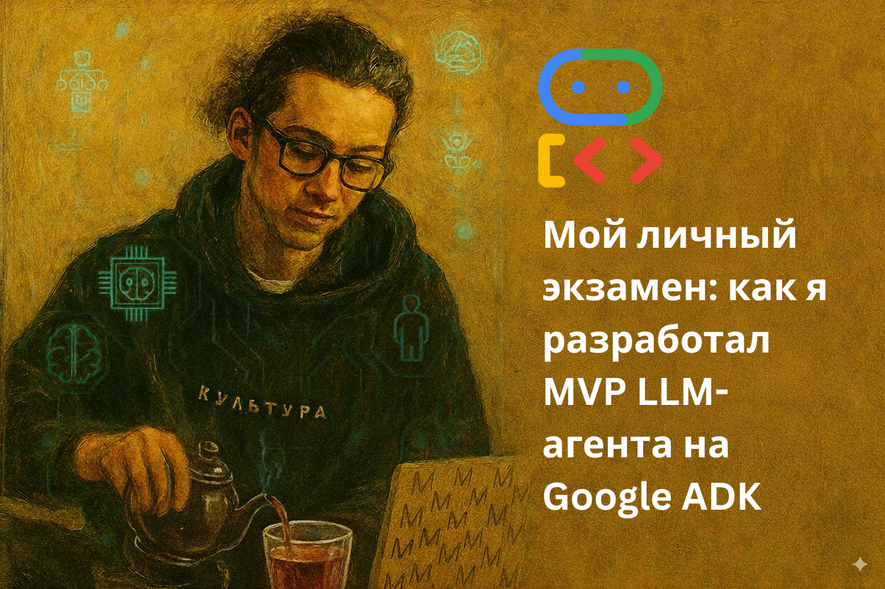

# Meine persönliche Prüfung: Wie ich einen MVP-LLM-Agenten mit Google ADK gebaut habe

**Autor:** Mykhailo Kapustin (@kapustinomm)  
**Veröffentlicht auf Habr:** 1. September 2025  
**Schwierigkeit:** Einfach | **Lesezeit:** 7 Min. | **Reichweite:** 7.8K

**Tags:** MVP, Künstliche Intelligenz, Google ADK, Python, LLM Agent  
**Hubs:** Künstliche Intelligenz, Google App Engine, Google API, Python, Google Cloud Platform

Ich arbeite als CTO von ASRP, einem Unternehmen, das Bildungsprojekte entwickelt und neue Ansätze im EdTech-Bereich erforscht. Einer unserer Schwerpunkte wurde das Testen der Möglichkeiten von Google ADK in Bildungsszenarien und der Aufbau eines Prototyps für ein intelligentes Wissensbewertungssystem.

## Was Google ADK besonders macht

Für die Erstellung des Agenten wählte ich Google ADK (Agent Development Kit), ein Framework, das speziell für den Aufbau von Systemen mit LLM-Agenten entwickelt wurde. Die ADK-Dokumentation betont, dass `LlmAgent` als der "denkende Teil" der Anwendung fungiert und LLM-Fähigkeiten für Schlussfolgern, natürliches Sprachverständnis und Entscheidungsfindung nutzt.

Neben `LlmAgent` enthält ADK Tools für eine strikte Ausführungsreihenfolge. `SequentialAgent` ist ein Workflow-Agent, der verschachtelte Sub-Agenten in einer definierten Reihenfolge ausführt und garantiert, dass Aufgaben streng nacheinander laufen.

## Architekturentscheidungen

In der ersten Version versuchte ich, die gesamte Geschäftslogik in einen einzigen `LlmAgent` zu packen: detaillierte Rollenbeschreibungen, Ziele und Erwartungen, mit der Annahme, dass das LLM alle Berechnungen ausführt und die Antworten der Lernenden bewertet. So bekam ich schnell einen funktionierenden Prototyp, aber bald zeigten sich Einschränkungen:

- Das Modell wurde durch die Menge an Anweisungen und Kontext überlastet
- Die Tokenkosten pro Anfrage stiegen
- Das Debugging dieser "monolithischen" Lösung war schwierig

Nach und nach wechselte ich zu einer modulareren Architektur und teilte das System in mehrere Agenten und Phasen auf. Ein `LlmAgent` übernimmt zum Beispiel die Generierung von Fragen, ein anderer prüft und analysiert Antworten, und ein dritter formuliert Kommentare und Hinweise. Zur Koordination der Phasen nutzte ich `SequentialAgent` und `ParallelAgent`: Ersterer garantiert die Ausführungsreihenfolge, Letzterer ermöglicht parallele unabhängige Aufgaben.

Dieser Multi-Agenten-Ansatz reduzierte die Last auf jeden einzelnen Agenten und machte die Prozesse zuverlässiger. Die Aufgabentrennung schuf robustere Ketten zur Antwortverarbeitung und vereinfachte das Testen jedes Moduls.

## Technische Herausforderungen und Engineering-Tricks

Das Modell lieferte manchmal unerwartete oder unvollständige Antworten, daher fügte ich zusätzliche Validierung hinzu. Zum Beispiel schrieb ich konkrete Formatprüfungen in die Anweisungen: Nachdem ich die Antwort eines Evaluator-Agenten erhalten hatte, prüfte ich, ob sie dem erwarteten Format entsprach (JSON oder eine klare Struktur). Wenn das Format kaputt war, fragte das Skript das Modell erneut mit präzisierenden Hinweisen.

Außerdem implementierte ich einen Feedback-Mechanismus: einen dedizierten Reviewer-Agenten, der die Antwortqualität prüft, bevor das finale Ergebnis ausgeliefert wird. So wurden Fehler abgefangen, bevor sie der Nutzer sah, und die Zuverlässigkeit des Systems stieg.

Eine weitere Engineering-Technik war die Nutzung der eingebauten ADK-Tools. Ich verwendete aktiv `AgentTool`, also die Umwandlung eines Agenten in ein Tool für einen anderen. Das brachte Flexibilität: Der Haupt-`LlmAgent` konnte je nach Anfrage dynamisch Sub-Agenten aufrufen. Dadurch ließen sich die Stärken verschiedener Modelle innerhalb eines einzigen Logikflusses kombinieren.

Zur Optimierung der Generierung nutzte ich, wo sinnvoll, Streaming und passte Modellparameter an (temperature, max_output_tokens). An kritischen Stellen setzte ich temperature=0 für deterministische Antworten. Außerdem speicherte ich zentrale Ergebnisse (`output_key`) in der Sitzung, um Daten zwischen Agenten weiterzugeben, ohne Text redundant zu duplizieren.

## 10 Lektionen aus der KI-Prüfung

1. **Delegiere Aufgaben über Agenten.** Versuche nicht, die gesamte Logik in einen "Super-Agenten" zu stopfen: Solche Systeme brechen oft unter ihrem eigenen Gewicht zusammen. Teile das Projekt in Phasen und kapsle Funktionalität in einzelne Agenten.

2. **Plane Architektur mit Blick auf Tokens.** Begrenze Anfrage- und Antwortgrößen, nutze Sitzungszustand und Memory Services, um nicht unnötig viel Kontext an das Modell zu senden.

3. **Nutze die Vorteile von ADK.** Beherrsche neben `LlmAgent` auch `SequentialAgent` und andere Workflow-Agenten. Verwandle Agenten für flexible Interaktion in `AgentTool`.

4. **Parallelisiere unabhängige Aufgaben.** Nutze `ParallelAgent` für Schritte, die nicht voneinander abhängen: Das spart Zeit, ohne Qualität zu verlieren.

5. **Verfolge Sitzung und Zustand.** Speichere benötigte Daten in `ctx.session.state`, um eine transparente Implementierung und reibungslose Agentenwechsel zu ermöglichen.

6. **Füge Feedback und Validierung hinzu.** Ein guter Agent prüft seine Arbeit immer: Baue einen Reviewer-Agenten, der die Antwortqualität kontrolliert, bevor das finale Ergebnis ausgeliefert wird.

7. **Logge und analysiere.** Implementiere Callbacks und Logging (AgentOps, Phoenix oder eigene Aufzeichnungen), um Kommunikationsmuster zwischen Agenten und Ressourcennutzung zu verstehen.

8. **Hab keine Angst vor Experimenten.** Die Arbeit mit KI ist ein kontinuierliches Experiment. Modelle können überraschen und erfordern Geduld und Anpassungsfähigkeit.

9. **Zusammenarbeit mit KI ist der neue Standard.** Lerne, LLMs als "Kollegen" zu verstehen: Gib klare Aufgaben, verifiziere Ergebnisse, kombiniere Ideen.

10. **Die Zukunft gehört dem Lernen.** Investiere in Wissen und Erfahrungsaustausch. Kontinuierliches Lernen und die Fähigkeit, andere zu unterrichten, halten dich technologisch auf Kurs.

## Entwicklung der CTO-Rolle

Während der Entwicklung erweiterte sich meine Rolle deutlich. Anfangs konzentrierte ich mich auf Engineering: Architektur entwerfen, Code schreiben, mit Modellen experimentieren. Doch das Projekt wuchs schnell, und ich musste ins Management wechseln: Entwickler einstellen, Aufgaben delegieren, Ausführung kontrollieren, mit Partnern planen, Budgets verwalten und Kollegen schulen.

Jede neue Projektphase wurde für mich zu einer Prüfung. Wenn neue APIs integriert oder Kubernetes-Skalierung umgesetzt wurden, reichte meine Verantwortung über "sauberen Code" hinaus: Ich musste das Team schulen, Rollen verteilen und mit Business-Stakeholdern arbeiten.

## Philosophische Überlegungen

Die Erstellung dieser "Prüfung" brachte mich dazu, über die umfassendere Bedeutung der Arbeit nachzudenken. Jedes IT-Projekt ist wie eine Prüfung: ein Test von Logik, Kreativität und der Bereitschaft, neu zu lernen. Mit LLM-Agenten wird Arbeit zu einer Art Partnerschaft: Sie führen nicht nur Befehle aus, sondern treten in Dialog, schlagen Ideen vor und stellen Fragen.

Ich bin optimistisch, was die Zukunft von EdTech angeht. Diese Systeme werden Bildung verändern: persönliche Tutoren, unmittelbares Feedback, adaptive Kurse. Bei ASRP übertragen wir die Erfahrungen aus Prototypen bereits in unsere Produkte, darunter die Plattform Arcanum12th.

Wichtig ist aber: Der Mensch bleibt im Zentrum des Prozesses. Eine Prüfung testet Wissen und Fähigkeiten; Agenten sind nur Helfer. Sie erweitern Möglichkeiten, aber die Verantwortung für Ergebnisse liegt weiterhin bei uns.

## Quellen

- Agent Development Kit — [LLM agents](https://google.github.io/adk-docs/)
- Agent Development Kit — [Sequential agents](https://google.github.io/adk-docs/)
- Agent Patterns with ADK (1 Agent, 5 Ways!)

---

[← Back to articles](../README.md)
