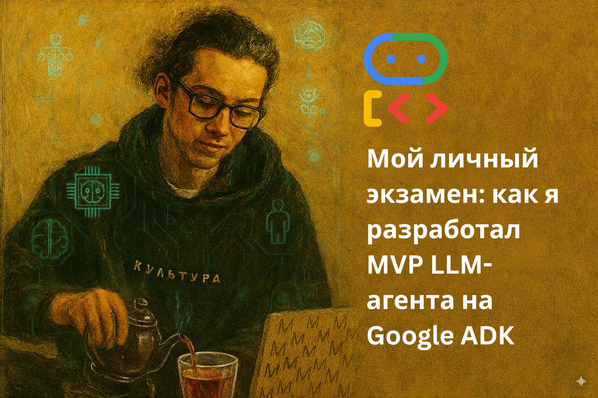

# Mi examen personal: cómo construí un agente LLM MVP con Google ADK

**Autor:** Mykhailo Kapustin (@kapustinomm)  
**Publicado en Habr:** 1 de septiembre de 2025  
**Dificultad:** Fácil | **Tiempo de lectura:** 7 min | **Alcance:** 7.8K

**Etiquetas:** MVP, Inteligencia artificial, Google ADK, Python, LLM Agent  
**Hubs:** Inteligencia artificial, Google App Engine, Google API, Python, Google Cloud Platform

He estado trabajando como CTO de ASRP, una empresa que desarrolla proyectos educativos y explora nuevos enfoques en EdTech. Una de nuestras áreas de enfoque pasó a ser probar las capacidades de Google ADK en escenarios educativos y construir un prototipo de sistema inteligente de evaluación del conocimiento.

## Qué hace especial a Google ADK

Para crear el agente, elegí Google ADK (Agent Development Kit), un framework diseñado específicamente para construir sistemas con agentes LLM. La documentación de ADK destaca que `LlmAgent` actúa como la "parte pensante" de la aplicación, aprovechando las capacidades del LLM para razonar, comprender lenguaje natural y tomar decisiones.

Además de `LlmAgent`, ADK incluye herramientas para una secuenciación estricta de la ejecución. `SequentialAgent` es un agente de workflow que ejecuta subagentes anidados en un orden definido, garantizando que las tareas se ejecuten estrictamente en secuencia.

## Decisiones de arquitectura

En la primera versión, intenté encajar toda la lógica de negocio dentro de un único `LlmAgent`: descripciones detalladas de roles, objetivos y expectativas, confiando en que el LLM realizara todos los cálculos y evaluara las respuestas de los estudiantes. Esto me dio rápidamente un prototipo funcional, pero pronto aparecieron limitaciones:

- El modelo se sobrecargó por el volumen de instrucciones y contexto
- Los costes de tokens por solicitud aumentaron
- Depurar esta solución "monolítica" era difícil

Poco a poco pasé a una arquitectura más modular, dividiendo el sistema en varios agentes y etapas. Por ejemplo, un `LlmAgent` gestiona la generación de preguntas, otro revisa y analiza respuestas, y un tercero forma comentarios y pistas. Usé `SequentialAgent` y `ParallelAgent` para coordinar las etapas: el primero garantiza el orden de ejecución, el segundo permite tareas independientes en paralelo.

Este enfoque multiagente redujo la carga sobre cada agente individual e hizo que los procesos fueran más fiables. La separación de tareas creó cadenas de procesamiento de respuestas más robustas y simplificó las pruebas de cada módulo.

## Desafíos técnicos y trucos de ingeniería

El modelo a veces producía respuestas inesperadas o incompletas, así que añadí validación adicional. Por ejemplo, escribí comprobaciones de formato específicas en las instrucciones: después de recibir la respuesta de un agente evaluador, verificaba que coincidiera con el formato esperado (JSON o una estructura clara). Si el formato estaba roto, el script volvía a preguntar al modelo con aclaraciones.

También implementé un mecanismo de feedback: un agente revisor dedicado que comprueba la calidad de la respuesta antes de entregar el resultado final. Esto detectaba errores antes de que el usuario los viera y mejoraba la fiabilidad del sistema.

Otra técnica de ingeniería fue usar las herramientas integradas de ADK. Utilicé activamente `AgentTool`, convirtiendo un agente en una herramienta para otro. Esto aportó flexibilidad: el `LlmAgent` principal podía llamar dinámicamente a subagentes según la solicitud. Así se podían combinar las fortalezas de distintos modelos dentro de un único flujo lógico.

Para optimizar la generación, usé streaming cuando era apropiado y ajusté parámetros del modelo (temperature, max_output_tokens). En lugares críticos, establecí temperature=0 para respuestas deterministas. También guardé resultados clave (`output_key`) en la sesión para pasar datos entre agentes sin duplicar texto innecesariamente.

## 10 lecciones del examen de IA

1. **Delega tareas mediante agentes.** No intentes meter toda la lógica en un "superagente": estos sistemas suelen colapsar bajo su propio peso. Divide el proyecto en etapas y encapsula la funcionalidad en agentes individuales.

2. **Planifica la arquitectura pensando en tokens.** Limita los tamaños de solicitudes y respuestas, usa estado de sesión y servicios de memoria para evitar enviar contexto excesivo al modelo.

3. **Aprovecha las ventajas de ADK.** Además de `LlmAgent`, domina `SequentialAgent` y otros agentes de workflow. Convierte agentes en `AgentTool` para una interacción flexible.

4. **Paraleliza tareas independientes.** Usa `ParallelAgent` para pasos que no dependen unos de otros: ahorra tiempo sin perder calidad.

5. **Rastrea sesión y estado.** Guarda los datos necesarios en `ctx.session.state` para una implementación transparente y cambios fluidos entre agentes.

6. **Añade feedback y validación.** Un buen agente siempre revisa su trabajo: construye un agente revisor que controle la calidad de la respuesta antes de entregar el resultado final.

7. **Registra y analiza.** Implementa callbacks y logging (AgentOps, Phoenix o registros propios) para comprender los patrones de comunicación entre agentes y el uso de recursos.

8. **No temas experimentar.** Trabajar con IA es un experimento continuo. Los modelos pueden sorprenderte y exigen paciencia y adaptabilidad.

9. **La colaboración con IA es el nuevo estándar.** Aprende a entender los LLM como "colegas": da tareas claras, verifica resultados, combina ideas.

10. **El futuro pertenece al aprendizaje.** Invierte en conocimiento e intercambio de experiencia. El aprendizaje continuo y la capacidad de enseñar a otros son lo que te mantiene al ritmo de la tecnología.

## Evolución del rol de CTO

Durante el desarrollo, mi rol se amplió significativamente. Al principio me centraba en ingeniería: diseñar arquitectura, escribir código, experimentar con modelos. Pero el proyecto creció rápido y tuve que pasar a la gestión: contratar desarrolladores, delegar tareas, controlar la ejecución, planificar con socios, gestionar presupuestos y formar a colegas.

Cada nueva fase del proyecto se convirtió en un examen para mí. Al integrar nuevas APIs o escalar en Kubernetes, mi responsabilidad iba más allá del "código limpio": necesitaba formar al equipo, distribuir roles y trabajar con stakeholders de negocio.

## Reflexiones filosóficas

Crear este "examen" me hizo pensar en el significado más amplio del trabajo. Cada proyecto de IT es como un examen: una prueba de lógica, creatividad y disposición a aprender de nuevo. Con agentes LLM, el trabajo se parece a una colaboración: no solo ejecutan comandos, también dialogan, sugieren ideas y hacen preguntas.

Soy optimista sobre el futuro de EdTech. Estos sistemas transformarán la educación: tutores personales, feedback instantáneo, cursos adaptativos. En ASRP ya estamos trasladando la experiencia de los prototipos a nuestros productos, incluida la plataforma Arcanum12th.

Pero es importante recordar que las personas siguen estando en el centro del proceso. Un examen evalúa conocimientos y habilidades; los agentes son solo ayudantes. Amplían posibilidades, pero la responsabilidad por los resultados sigue siendo nuestra.

## Fuentes

- Agent Development Kit — [LLM agents](https://google.github.io/adk-docs/)
- Agent Development Kit — [Sequential agents](https://google.github.io/adk-docs/)
- Agent Patterns with ADK (1 Agent, 5 Ways!)

---

[← Back to articles](../README.md)
