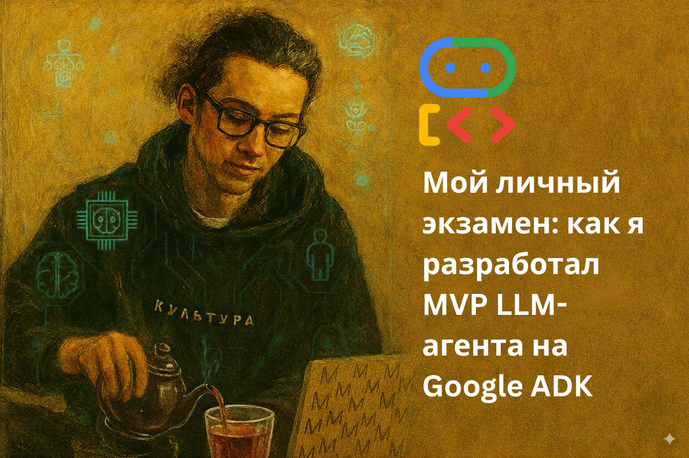

# My Personal Exam: How I Built an MVP LLM Agent on Google ADK

**Author:** Mykhailo Kapustin (@kapustinomm)  
**Published on Habr:** September 1, 2025  
**Difficulty:** Easy | **Reading time:** 7 min | **Reach:** 7.8K

**Tags:** MVP, Artificial Intelligence, Google ADK, Python, LLM Agent  
**Hubs:** Artificial Intelligence, Google App Engine, Google API, Python, Google Cloud Platform

I've been working as CTO of ASRP, a company developing educational projects and exploring new approaches in EdTech. One of our focus areas became testing Google ADK capabilities in educational scenarios and building a prototype intelligent knowledge assessment system.

## What Makes Google ADK Special

For creating the agent, I chose Google ADK (Agent Development Kit) — a framework specifically designed for building systems with LLM agents. The ADK documentation emphasizes that `LlmAgent` acts as the "thinking part" of the application, leveraging LLM capabilities for reasoning, natural language understanding, and decision-making.

Beyond `LlmAgent`, ADK includes tools for rigid execution sequencing. `SequentialAgent` is a workflow agent that executes nested sub-agents in a defined order, guaranteeing that tasks run strictly in sequence.

## Architectural Decisions

In the first version, I tried to fit all business logic inside a single `LlmAgent`: detailed role descriptions, goals, and expectations, relying on the LLM to perform all computations and evaluate student answers. This gave me a working prototype quickly, but limitations soon emerged:

- The model became overloaded by the volume of instructions and context
- Token costs per request grew
- Debugging this "monolithic" solution was difficult

I gradually moved to a more modular architecture, splitting the system into multiple agents and stages. For example, one `LlmAgent` handles question generation, another checks and analyzes answers, and a third forms comments and hints. I used `SequentialAgent` and `ParallelAgent` for stage coordination — the former guarantees execution order, the latter enables parallel independent tasks.

This multi-agent approach reduced the load on each individual agent and made processes more reliable. Task separation created more robust answer-processing chains and simplified testing of each module.

## Technical Challenges and Engineering Tricks

The model sometimes produced unexpected or incomplete answers, so I added extra validation. For instance, I wrote specific format checks in the instructions: after receiving an evaluator agent's response, I verified it matched the expected format (JSON or a clear structure). If the format was broken, the script re-prompted the model with clarifying hints.

I also implemented a feedback mechanism: a dedicated reviewer agent that checks response quality before delivering the final result. This caught errors before the user saw them and improved system reliability.

Another engineering technique was using ADK's built-in tools. I actively used `AgentTool` — turning one agent into a tool for another. This gave flexibility — the main `LlmAgent` could dynamically call sub-agents depending on the request. This allowed combining the strengths of different models within a single logic flow.

For generation optimization, I used streaming where appropriate and tuned model parameters (temperature, max_output_tokens). In critical places, I set temperature=0 for deterministic responses. I also stored key results (`output_key`) in the session to pass data between agents without redundant text duplication.

## 10 Lessons from the AI Exam

1. **Delegate tasks through agents.** Don't try to cram all logic into one "super-agent" — such systems often collapse under their own weight. Break the project into stages and wrap functionality in individual agents.

2. **Plan architecture with tokens in mind.** Limit request and response sizes, use session state and memory services to avoid sending excess context to the model.

3. **Leverage ADK's advantages.** Beyond `LlmAgent`, master `SequentialAgent` and other workflow agents. Turn agents into `AgentTool` for flexible interaction.

4. **Parallelize independent tasks.** Use `ParallelAgent` for steps that don't depend on each other — this saves time without losing quality.

5. **Track session and state.** Store needed data in `ctx.session.state` for transparent implementation and smooth agent switching.

6. **Add feedback and validation.** A good agent always checks its work — build a reviewer agent that controls answer quality before delivering the final result.

7. **Log and analyze.** Implement callbacks and logging (AgentOps, Phoenix, or custom records) to understand agent communication patterns and resource usage.

8. **Don't be afraid to experiment.** Working with AI is a continuous experiment. Models can surprise you, requiring patience and adaptability.

9. **Collaboration with AI is the new standard.** Learn to understand LLMs as "colleagues" — give clear tasks, verify results, combine ideas.

10. **The future belongs to learning.** Invest in knowledge and experience sharing. Continuous learning and the ability to teach others are what keep you in step with technology.

## Evolution of the CTO Role

During development, my role expanded significantly. Initially, I focused on engineering: designing architecture, writing code, experimenting with models. But the project grew quickly, and I had to shift to management — hiring developers, delegating tasks, controlling execution, planning with partners, managing budgets, and training colleagues.

Each new project phase became an exam for me. When integrating new APIs or scaling on Kubernetes, my responsibility extended beyond "clean code" — I needed to train the team, distribute roles, and work with business stakeholders.

## Philosophical Reflections

Creating this "exam" made me think about the broader meaning of the work. Every IT project is like an exam: a test of logic, creativity, and willingness to learn anew. With LLM agents, work becomes like a partnership — they don't just execute commands, they engage in dialogue, suggest ideas, and ask questions.

I'm optimistic about the future of EdTech. These systems will transform education: personal tutors, instant feedback, adaptive courses. At ASRP, we're already transferring prototype experience into our products, including the Arcanum12th platform.

But it's important to remember: humans remain at the center of the process. An exam tests knowledge and skills; agents are just helpers. They expand possibilities, but the responsibility for outcomes still lies with us.

## Sources

- Agent Development Kit — [LLM agents](https://google.github.io/adk-docs/)
- Agent Development Kit — [Sequential agents](https://google.github.io/adk-docs/)
- Agent Patterns with ADK (1 Agent, 5 Ways!)

---

*Originally published on [Habr](https://habr.com/en/articles/942696/).*
