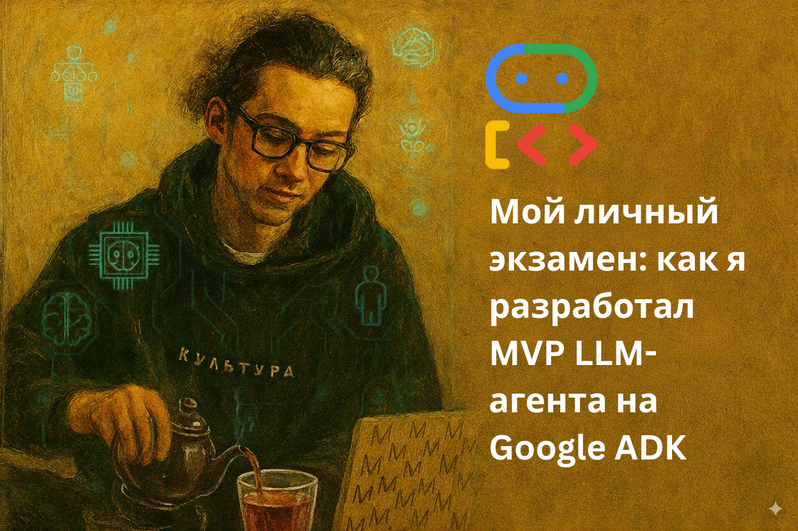

# Мой личный экзамен: как я построил MVP LLM-агента на Google ADK

**Автор:** Mykhailo Kapustin (@kapustinomm)  
**Опубликовано на Habr:** 1 сентября 2025  
**Сложность:** лёгкая | **Время чтения:** 7 мин | **Охват:** 7.8K

**Теги:** MVP, Artificial Intelligence, Google ADK, Python, LLM Agent  
**Хабы:** Artificial Intelligence, Google App Engine, Google API, Python, Google Cloud Platform

Я работал CTO в ASRP — компании, которая развивает образовательные проекты и исследует новые подходы в EdTech. Одним из наших направлений стало тестирование возможностей Google ADK в образовательных сценариях и создание прототипа интеллектуальной системы оценки знаний.

## Чем интересен Google ADK

Для создания агента я выбрал Google ADK (Agent Development Kit) — фреймворк, специально разработанный для построения систем с LLM-агентами. В документации ADK подчёркивается, что `LlmAgent` выступает как "мыслящая часть" приложения, используя возможности LLM для рассуждения, понимания естественного языка и принятия решений.

Помимо `LlmAgent`, в ADK есть инструменты для жёсткой последовательности выполнения. `SequentialAgent` — это workflow-агент, который запускает вложенных sub-agents в заданном порядке и гарантирует, что задачи выполняются строго последовательно.

## Архитектурные решения

В первой версии я попытался поместить всю бизнес-логику внутрь одного `LlmAgent`: подробные описания роли, целей и ожиданий, рассчитывая, что LLM сама выполнит все вычисления и оценит ответы студентов. Это быстро дало рабочий прототип, но вскоре проявились ограничения:

- модель перегружалась объёмом инструкций и контекста;
- стоимость токенов на запрос росла;
- отлаживать такое "монолитное" решение было сложно.

Постепенно я перешёл к более модульной архитектуре, разделив систему на несколько агентов и этапов. Например, один `LlmAgent` отвечает за генерацию вопросов, другой проверяет и анализирует ответы, третий формирует комментарии и подсказки. Для координации этапов я использовал `SequentialAgent` и `ParallelAgent`: первый гарантирует порядок выполнения, второй позволяет запускать независимые задачи параллельно.

Такой многоагентный подход снизил нагрузку на каждого отдельного агента и сделал процессы надёжнее. Разделение задач позволило построить более устойчивые цепочки обработки ответов и упростило тестирование каждого модуля.

## Технические вызовы и инженерные приёмы

Иногда модель выдавала неожиданные или неполные ответы, поэтому я добавил дополнительную валидацию. Например, в инструкциях появились конкретные проверки формата: после ответа агента-оценщика я проверял, соответствует ли он ожидаемому формату (JSON или понятной структуре). Если формат ломался, скрипт повторно обращался к модели с уточняющими подсказками.

Также я реализовал механизм обратной связи: отдельного reviewer-агента, который проверяет качество ответа перед выдачей финального результата. Это помогало ловить ошибки до того, как их увидит пользователь, и повышало надёжность системы.

Ещё один инженерный приём — использование встроенных инструментов ADK. Я активно применял `AgentTool`, превращая одного агента в инструмент для другого. Это давало гибкость: основной `LlmAgent` мог динамически вызывать sub-agents в зависимости от запроса. Такой подход позволял объединять сильные стороны разных моделей в одном логическом потоке.

Для оптимизации генерации я использовал streaming там, где это было уместно, и настраивал параметры модели (`temperature`, `max_output_tokens`). В критичных местах я ставил `temperature=0` для детерминированных ответов. Также я сохранял ключевые результаты (`output_key`) в сессии, чтобы передавать данные между агентами без лишнего дублирования текста.

## 10 уроков из AI-экзамена

1. **Делегируйте задачи через агентов.** Не пытайтесь вместить всю логику в одного "супер-агента" — такие системы часто рушатся под собственным весом. Разбивайте проект на этапы и оборачивайте функциональность в отдельных агентов.

2. **Планируйте архитектуру с учётом токенов.** Ограничивайте размеры запросов и ответов, используйте состояние сессии и memory services, чтобы не отправлять модели лишний контекст.

3. **Используйте преимущества ADK.** Помимо `LlmAgent`, освойте `SequentialAgent` и другие workflow agents. Превращайте агентов в `AgentTool` для гибкого взаимодействия.

4. **Параллелизуйте независимые задачи.** Используйте `ParallelAgent` для шагов, которые не зависят друг от друга: это экономит время без потери качества.

5. **Отслеживайте сессию и состояние.** Храните нужные данные в `ctx.session.state`, чтобы реализация была прозрачной, а переключение между агентами — плавным.

6. **Добавляйте обратную связь и валидацию.** Хороший агент всегда проверяет свою работу: создайте reviewer-агента, который контролирует качество ответа перед финальной выдачей.

7. **Логируйте и анализируйте.** Реализуйте callbacks и logging (AgentOps, Phoenix или собственные записи), чтобы понимать паттерны общения агентов и расход ресурсов.

8. **Не бойтесь экспериментировать.** Работа с AI — это постоянный эксперимент. Модели могут удивлять, поэтому нужны терпение и адаптивность.

9. **Сотрудничество с AI — новый стандарт.** Учитесь понимать LLM как "коллег": ставьте понятные задачи, проверяйте результаты, комбинируйте идеи.

10. **Будущее принадлежит обучению.** Инвестируйте в знания и обмен опытом. Непрерывное обучение и способность учить других помогают оставаться на одной скорости с технологиями.

## Эволюция роли CTO

Во время разработки моя роль заметно расширилась. Сначала я был сосредоточен на инженерии: проектировал архитектуру, писал код, экспериментировал с моделями. Но проект быстро рос, и мне пришлось перейти к управлению — нанимать разработчиков, делегировать задачи, контролировать выполнение, планировать вместе с партнёрами, управлять бюджетами и обучать коллег.

Каждый новый этап проекта становился для меня экзаменом. Когда нужно было интегрировать новые API или масштабироваться на Kubernetes, моя ответственность выходила за рамки "чистого кода": нужно было обучать команду, распределять роли и работать с business stakeholders.

## Философские размышления

Создание этого "экзамена" заставило меня задуматься о более широком смысле работы. Каждый IT-проект похож на экзамен: это проверка логики, креативности и готовности учиться заново. С LLM-агентами работа становится похожей на партнёрство: они не просто выполняют команды, а вступают в диалог, предлагают идеи и задают вопросы.

Я оптимистично смотрю на будущее EdTech. Такие системы изменят образование: персональные тьюторы, мгновенная обратная связь, адаптивные курсы. В ASRP мы уже переносим опыт прототипа в наши продукты, включая платформу Arcanum12th.

Но важно помнить: человек остаётся в центре процесса. Экзамен проверяет знания и навыки; агенты — всего лишь помощники. Они расширяют возможности, но ответственность за результат по-прежнему лежит на нас.

## Источники

- Agent Development Kit — [LLM agents](https://google.github.io/adk-docs/)
- Agent Development Kit — [Sequential agents](https://google.github.io/adk-docs/)
- Agent Patterns with ADK (1 Agent, 5 Ways!)

---

[← Назад к статьям](../README.md)
