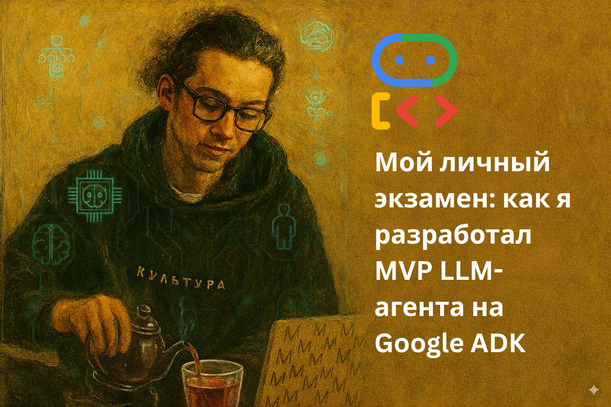

# Мій особистий іспит: як я побудував MVP LLM-агента на Google ADK

**Автор:** Mykhailo Kapustin (@kapustinomm)  
**Опубліковано на Habr:** 1 вересня 2025  
**Складність:** легка | **Час читання:** 7 хв | **Охоплення:** 7.8K

**Теги:** MVP, Artificial Intelligence, Google ADK, Python, LLM Agent  
**Хаби:** Artificial Intelligence, Google App Engine, Google API, Python, Google Cloud Platform

Я працював CTO в ASRP — компанії, яка розвиває освітні проєкти й досліджує нові підходи в EdTech. Одним із наших напрямів стало тестування можливостей Google ADK в освітніх сценаріях і створення прототипу інтелектуальної системи оцінювання знань.

## Чим цікавий Google ADK

Для створення агента я обрав Google ADK (Agent Development Kit) — фреймворк, спеціально розроблений для побудови систем із LLM-агентами. У документації ADK підкреслюється, що `LlmAgent` виступає як "мисляча частина" застосунку, використовуючи можливості LLM для міркування, розуміння природної мови й ухвалення рішень.

Окрім `LlmAgent`, в ADK є інструменти для жорсткої послідовності виконання. `SequentialAgent` — це workflow-агент, який запускає вкладених sub-agents у визначеному порядку й гарантує, що задачі виконуються строго послідовно.

## Архітектурні рішення

У першій версії я спробував помістити всю бізнес-логіку всередину одного `LlmAgent`: детальні описи ролі, цілей та очікувань, розраховуючи, що LLM сама виконає всі обчислення й оцінить відповіді студентів. Це швидко дало робочий прототип, але невдовзі проявилися обмеження:

- модель перевантажувалася обсягом інструкцій і контексту;
- вартість токенів на запит зростала;
- налагоджувати таке "монолітне" рішення було складно.

Поступово я перейшов до більш модульної архітектури, розділивши систему на кілька агентів та етапів. Наприклад, один `LlmAgent` відповідає за генерацію запитань, інший перевіряє й аналізує відповіді, третій формує коментарі та підказки. Для координації етапів я використовував `SequentialAgent` і `ParallelAgent`: перший гарантує порядок виконання, другий дає змогу запускати незалежні задачі паралельно.

Такий багатоагентний підхід зменшив навантаження на кожного окремого агента й зробив процеси надійнішими. Розділення задач дозволило побудувати стійкіші ланцюжки обробки відповідей і спростило тестування кожного модуля.

## Технічні виклики та інженерні прийоми

Іноді модель видавала неочікувані або неповні відповіді, тому я додав додаткову валідацію. Наприклад, в інструкціях з'явилися конкретні перевірки формату: після відповіді агента-оцінювача я перевіряв, чи відповідає вона очікуваному формату (JSON або зрозумілій структурі). Якщо формат ламався, скрипт повторно звертався до моделі з уточнювальними підказками.

Також я реалізував механізм зворотного зв'язку: окремого reviewer-агента, який перевіряє якість відповіді перед видачею фінального результату. Це допомагало ловити помилки до того, як їх побачить користувач, і підвищувало надійність системи.

Ще один інженерний прийом — використання вбудованих інструментів ADK. Я активно застосовував `AgentTool`, перетворюючи одного агента на інструмент для іншого. Це давало гнучкість: основний `LlmAgent` міг динамічно викликати sub-agents залежно від запиту. Такий підхід дозволяв об'єднувати сильні сторони різних моделей в одному логічному потоці.

Для оптимізації генерації я використовував streaming там, де це було доречно, і налаштовував параметри моделі (`temperature`, `max_output_tokens`). У критичних місцях я ставив `temperature=0` для детермінованих відповідей. Також я зберігав ключові результати (`output_key`) у сесії, щоб передавати дані між агентами без зайвого дублювання тексту.

## 10 уроків з AI-іспиту

1. **Делегуйте задачі через агентів.** Не намагайтеся вмістити всю логіку в одного "супер-агента" — такі системи часто руйнуються під власною вагою. Розбивайте проєкт на етапи й обгортайте функціональність в окремих агентів.

2. **Плануйте архітектуру з урахуванням токенів.** Обмежуйте розміри запитів і відповідей, використовуйте стан сесії та memory services, щоб не надсилати моделі зайвий контекст.

3. **Використовуйте переваги ADK.** Окрім `LlmAgent`, опануйте `SequentialAgent` та інших workflow agents. Перетворюйте агентів на `AgentTool` для гнучкої взаємодії.

4. **Паралелізуйте незалежні задачі.** Використовуйте `ParallelAgent` для кроків, які не залежать один від одного: це економить час без втрати якості.

5. **Відстежуйте сесію та стан.** Зберігайте потрібні дані в `ctx.session.state`, щоб реалізація була прозорою, а перемикання між агентами — плавним.

6. **Додавайте зворотний зв'язок і валідацію.** Хороший агент завжди перевіряє свою роботу: створіть reviewer-агента, який контролює якість відповіді перед фінальною видачею.

7. **Логуйте і аналізуйте.** Реалізуйте callbacks і logging (AgentOps, Phoenix або власні записи), щоб розуміти патерни спілкування агентів і витрати ресурсів.

8. **Не бійтеся експериментувати.** Робота з AI — це постійний експеримент. Моделі можуть дивувати, тому потрібні терпіння й адаптивність.

9. **Співпраця з AI — новий стандарт.** Вчіться розуміти LLM як "колег": ставте зрозумілі задачі, перевіряйте результати, комбінуйте ідеї.

10. **Майбутнє належить навчанню.** Інвестуйте в знання й обмін досвідом. Безперервне навчання та здатність навчати інших допомагають залишатися на одній швидкості з технологіями.

## Еволюція ролі CTO

Під час розробки моя роль помітно розширилася. Спочатку я був зосереджений на інженерії: проєктував архітектуру, писав код, експериментував із моделями. Але проєкт швидко зростав, і мені довелося перейти до управління — наймати розробників, делегувати задачі, контролювати виконання, планувати разом із партнерами, керувати бюджетами й навчати колег.

Кожен новий етап проєкту ставав для мене іспитом. Коли потрібно було інтегрувати нові API або масштабуватися на Kubernetes, моя відповідальність виходила за межі "чистого коду": потрібно було навчати команду, розподіляти ролі й працювати з business stakeholders.

## Філософські роздуми

Створення цього "іспиту" змусило мене замислитися про ширший сенс роботи. Кожен IT-проєкт схожий на іспит: це перевірка логіки, креативності та готовності вчитися заново. З LLM-агентами робота стає схожою на партнерство: вони не просто виконують команди, а вступають у діалог, пропонують ідеї та ставлять запитання.

Я оптимістично дивлюся на майбутнє EdTech. Такі системи змінять освіту: персональні тьютори, миттєвий зворотний зв'язок, адаптивні курси. В ASRP ми вже переносимо досвід прототипу в наші продукти, включно з платформою Arcanum12th.

Але важливо пам'ятати: людина залишається в центрі процесу. Іспит перевіряє знання й навички; агенти — лише помічники. Вони розширюють можливості, але відповідальність за результат і надалі лежить на нас.

## Джерела

- Agent Development Kit — [LLM agents](https://google.github.io/adk-docs/)
- Agent Development Kit — [Sequential agents](https://google.github.io/adk-docs/)
- Agent Patterns with ADK (1 Agent, 5 Ways!)

---

[← Назад до статей](../README.md)
