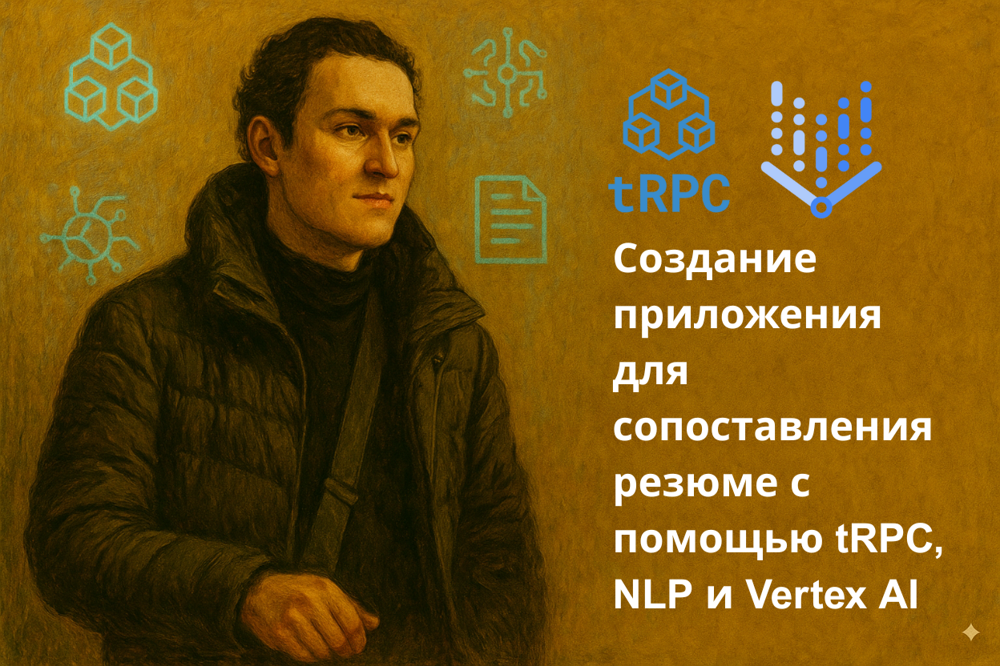

# Створення Resume Matcher з tRPC, NLP і Vertex AI

**Автор:** Mykhailo Kapustin (@kapustinomm)  
**Опубліковано на Habr:** 2 вересня 2025  
**Складність:** легка | **Час читання:** 6 хв | **Охоплення:** 7.5K

**Теги:** tRPC, Type-Safe API, Resume Matcher, PDF Text Extraction, NLP, Google Vertex AI, Gemini  
**Хаби:** Google API, Google Cloud Platform, Google App Engine, Node.js, JavaScript



Нещодавно я побудував невеликий TypeScript-застосунок, який порівнює PDF-резюме з описами вакансій. Мені потрібен був швидкий спосіб прототипувати API, тому для backend я обрав **tRPC**.

tRPC — це RPC-фреймворк, орієнтований на TypeScript, який обіцяє "end-to-end typesafe APIs": тобто я можу розділяти типи між клієнтом і сервером без написання OpenAPI або GraphQL SDL schemas. На практиці це означало, що я міг зосередитися на логіці, а не на boilerplate-коді.

## Чому tRPC?

На відміну від REST або GraphQL, tRPC не надає універсальну схему — він просто публікує процедури (по суті функції) на сервері, які клієнт може викликати, напряму розділяючи типи вхідних і вихідних даних. Я будував внутрішній інструмент (MVP) і вже використовував TypeScript з обох боків. Модель tRPC без build steps і з вбудованою типізацією ідеально підійшла.

Якщо я змінюю input або output серверної функції, TypeScript попередить мене на стороні клієнта ще до надсилання запиту. Це допомагає ловити помилки раніше. З REST або GraphQL мені довелося б вручну синхронізувати або генерувати схеми.

## Визначення tRPC Router

Після налаштування tRPC я написав простий router для основної операції: аналізу двох завантажених PDF-файлів (CV і опису вакансії). Використовуючи tRPC разом із Zod-form-data, я міг легко валідувати завантаження файлів:

```typescript
export const matchRouter = router({
  analyzePdfs: baseProcedure
    .input(zfd.formData({
      vacancyPdf: zfd.file().refine(file => file.type === "application/pdf", {
        message: "Only PDF files are allowed",
      }),
      cvPdf: zfd.file().refine(file => file.type === "application/pdf", {
        message: "Only PDF files are allowed",
      }),
    }))
    .mutation(async ({ input }) => {
      const [cvText, vacancyText] = await Promise.all([
        PDFService.extractText(input.cvPdf),
        PDFService.extractText(input.vacancyPdf),
      ]);
      const result = await MatcherService.match(cvText, vacancyText);
      return { matchRequestId, ...result };
    }),
});
```

Мутація `analyzePdfs` приймає multipart form із двома PDF-файлами. Після валідації я використовую `PDFService.extractText()`, щоб витягти raw text із кожного PDF, а потім викликаю `MatcherService.match()` для аналізу. Оскільки tRPC знає типи input/output, frontend отримує повністю типізовані результати без додаткових DTO.

## Витягування навичок за допомогою базового NLP

Коли в мене був чистий текст із CV та опису вакансії, потрібно було витягти значущі keywords або skills. Я залишив рішення простим: об'єднав `natural` для токенізації, `compromise` для part-of-speech tagging (nouns) і фільтр stop words:

```typescript
private static extractSkills(text: string): Set<string> {
  const doc = nlp(text);
  const nouns = doc.nouns().out("array");
  const capitalizedWords = text.match(/\b[A-Z][a-zA-Z0-9.-]+\b/g) || [];
  return new Set([...nouns, ...capitalizedWords].map(w => w.toLowerCase()));
}
```

Цей код приводить текст до нижнього регістру, пропускає його через NLP-бібліотеку для отримання nouns і використовує regex, щоб знайти всі слова з великої літери (часто це назви технологій). Об'єднання цих результатів дає набір кандидатів у "skills" із кожного документа. Це базове витягування keywords — не складний ML, — але воно працює швидко й непогано підсвічує збіжні навички.

## Інтеграція Vertex AI (Gemini 1.5 Flash) для matching

Для основної логіки зіставлення я звернувся до Google Vertex AI з новою моделлю **Gemini 1.5 Flash**. Головна мета була отримати структурований результат порівняння (scores і recommendations), не реалізовуючи складну NLP-логіку самостійно:

```typescript
const aiPrompt = `
Analyze the job description and candidate's CV to provide a structured evaluation.

Job Description:
${cleanedJD}

Candidate CV:
${cleanedCV}

Provide a structured analysis in JSON format with fields "score", "strengths", and "suggestions".
`;

const response = await fetch(process.env.AI_API_ENDPOINT!, {
  method: "POST",
  headers: {
    Authorization: process.env.AI_API_TOKEN,
    "Content-Type": "application/json",
  },
  body: JSON.stringify({
    contents: [{ role: "user", parts: [{ text: aiPrompt }] }]
  })
});

const data = await response.json();
const rawResponse = data.candidates[0].content.parts[0].text;
```

Цей підхід виявився дуже зручним: Gemini видавав результати без потреби писати ranking algorithm. Це відчувалося як використання моделі в ролі "black-box comparator". Довелося обробити помилки й rate limits, але загалом інтеграція дозволила мені зосередитися на UI та data flow, а не на fine-tuning LLM.

## Чому tRPC підійшов і де його обмеження

Використання tRPC помітно прискорило розробку. Без потреби писати API-схеми я міг підняти endpoint за хвилини. Full-stack TypeScript означає, що код router фактично є спільним кодом для клієнта й сервера, а перевірки виконуються на етапі компіляції.

З іншого боку, tRPC тісно пов'язує frontend із цією серверною реалізацією. Якби мені знадобився публічний REST API або mobile client, архітектуру довелося б переглянути. Також caching і rate limiting потрібно було реалізовувати самостійно: tRPC не дає вбудованих рішень рівня GraphQL.

Для цього проєкту — по суті внутрішнього demo — такі обмеження були прийнятними.

## Висновки

Будувати цей проєкт на сучасних TypeScript API було досить приємно. Я отримав end-to-end typing і не мав підтримувати окрему client library. Код відчувається майже як SDK: я просто викликаю функції з `matchRouter`, ніби це локальний код.

З боку NLP я зрозумів, що навіть прості евристики (nouns + capitalized words) можуть добре працювати для витягування keywords у базових випадках. А інтеграція Vertex AI нагадала, що значну частину "AI magic" можна винести у зовнішні моделі за грамотного prompt engineering.

Але silver bullet не існує. Якби було більше часу, я б покращив обробку помилок навколо AI-сервісу й додав caching результатів, тому що PDF-to-text і AI calls коштують дорого. Якби застосунок розвивався далі, я, можливо, замінив би tRPC на більш звичний REST/GraphQL API для публічного інтерфейсу. Але на цьому етапі tRPC дав саме те, що було потрібно: швидкий MVP зі строгою типізацією та мінімумом церемоній.

## Джерела

- [Офіційний сайт tRPC](https://trpc.io/) — Move Fast and Break Nothing. End-to-end typesafe APIs made easy.
- Viljami Kuosmanen, [Comparing REST, GraphQL & tRPC](https://dev.to/) (dev.to, Oct 2023)
- Bryant Gillespie, [REST vs. GraphQL vs. tRPC](https://directus.io/) (Directus blog, Feb 2025)

---

[← Назад до статей](../README.md)
